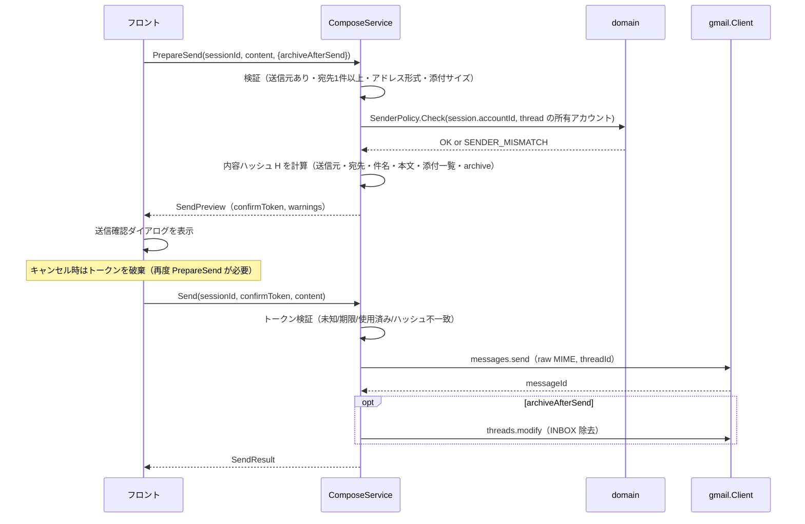

# バインディング仕様（API 仕様）

> 関連: [プロジェクト概要](../overview.md) / [機能要件](../requirements/functional.md) / [アーキテクチャ設計](../architecture/overview.md) / [ER](../architecture/er.md) / [コンポーネント設計](../components/overview.md)

Hitomado は HTTP サーバーを持たない。フロントエンド（Vue）と Go バックエンドの境界は **Wails v3 のバインディング**（Go のサービスメソッドを TypeScript から呼ぶ）であり、本書がその契約を定める。外部 API（Gmail API・OAuth・AI・GitHub）の利用方法も §10 にまとめる。

## 1. 規約

### 1.1 サービスと生成物

- 各サービスは `internal/app` の Go 構造体で、Wails の `application.NewService` に登録する。メソッドは `context.Context` を第 1 引数に取ってよい（Wails が注入する）
- TypeScript クライアントは `wails3 generate bindings` で生成し、コミットする（CI で差分なしを検査）。フロントは生成されたクライアントのみを経由して呼ぶ。`fetch`／`XMLHttpRequest` による外部通信は CSP で禁止する
- 型名は Go と TS で同名。JSON フィールドは `camelCase`。日時は **Unix ミリ秒（number）**。ID は文字列

| サービス | 責務 |
|----------|------|
| `AccountService` | OAuth クライアント・アカウントの管理、署名、通知設定 |
| `InboxService` | 統合受信箱、検索、未読件数、スレッド操作、ラベル |
| `ThreadService` | スレッド詳細、添付保存、リンクを開く |
| `ComposeService` | 作成セッション、下書き、送信前確認、送信、宛先候補 |
| `AIService` | AI 設定・同意・下書き生成 |
| `AppService` | アプリ設定（受信箱フィルタ等）、バージョン、更新確認 |

### 1.2 エラー

エラーは Go の `error` を返し、フロントでは reject される。reject 値は**次の JSON として解釈できる文字列**にする（フロントは共通ラッパー `parseBindingError` で `AppError` に変換する）。Wails v3 のエラー整形（`MarshalError` オプション等）を使うか、`error.Error()` に JSON を載せる。実装時に Wails の API を確認して選ぶ。

```ts
type AppError = {
  code: ErrorCode;        // 下表
  message: string;        // 利用者に表示してよい日本語。機密（トークン・本文）を含めない
  retryable: boolean;     // 再試行で成功し得るか
  accountId?: string;     // 特定アカウントに起因する場合
  details?: Record<string, unknown>; // コード固有の補足（例: 添付の上限バイト数）
};
```

| コード | 意味 | `retryable` | 主な発生元 |
|--------|------|-------------|------------|
| `VALIDATION` | 引数不正 | false | 全般 |
| `NOT_FOUND` | アカウント・スレッド・メッセージ・セッション等が存在しない | false | 全般 |
| `SESSION_NOT_FOUND` | 作成セッションが存在しない・破棄済み | false | ComposeService, AIService |
| `OFFLINE` | ネットワーク不通 | true | Gmail／AI／GitHub 呼び出し |
| `RATE_LIMITED` | 429（バックオフで解消せず） | true | Gmail／AI |
| `GMAIL_ERROR` | Gmail API のその他のエラー | 状況による | Gmail 呼び出し |
| `NEEDS_REAUTH` | トークン失効（`invalid_grant`）。当該アカウントを「要再接続」にする | false | Gmail 呼び出し |
| `ACCOUNT_DUPLICATE` | 同じアドレスのアカウントが登録済み | false | StartAddAccount |
| `OAUTH_CLIENT_IN_USE` | OAuth クライアントを使うアカウントが存在する | false | DeleteOAuthClient |
| `OAUTH_CANCELLED` | 利用者が認可をキャンセルした | false | StartAddAccount |
| `OAUTH_DENIED` | Google 側で拒否された（アクセス拒否・スコープ不足） | false | StartAddAccount |
| `OAUTH_TIMEOUT` | 認可が 5 分以内に完了しなかった | true | StartAddAccount |
| `SENDER_REQUIRED` | 送信元アカウントが未選択 | false | ComposeService |
| `SENDER_LOCKED` | 返信・転送で送信元を変更しようとした | false | SetComposeSender |
| `SENDER_MISMATCH` | 送信元と受信アカウントの不整合を検知（防御的検査） | false | PrepareSend, Send |
| `NO_RECIPIENTS` | 宛先（To／Cc／Bcc）が 1 件もない | false | PrepareSend |
| `INVALID_ADDRESS` | メールアドレスの形式不正（`details.emails`） | false | PrepareSend |
| `ATTACHMENT_TOO_LARGE` | 添付合計が 25MB を超える（`details.limitBytes`） | false | AddAttachments |
| `ATTACHMENT_IO` | 添付ファイルの読み込み・保存に失敗 | false | AddAttachments, SaveAttachment, Send |
| `CONFIRM_REQUIRED` | 確認トークンがない・未知 | false | Send |
| `CONFIRM_EXPIRED` | 確認トークンの期限切れ（5 分）または使用済み | false | Send |
| `CONFIRM_MISMATCH` | 確認時と送信時で送信内容が異なる | false | Send |
| `AI_NOT_CONFIGURED` | API キー・プロバイダ未設定 | false | AIService |
| `AI_CONSENT_REQUIRED` | 当該プロバイダへの送信に未同意 | false | AIService |
| `AI_FAILED` | AI プロバイダのエラー（キー不正・タイムアウト等） | 状況による | AIService |
| `CANCELLED` | 呼び出し側がキャンセルした | false | AIService |
| `INTERNAL` | 想定外の内部エラー | false | 全般 |

### 1.3 共通型

```ts
type ThreadRef = { accountId: string; threadId: string };
type MessageRef = ThreadRef & { messageId: string };
type Address = { name?: string; email: string };

type Account = {
  id: string;
  oauthClientId: string;
  email: string;            // 返信・転送の送信元（変更不可）
  displayName: string;
  color: string;            // パレットキー
  signatureHtml: string;
  notifyEnabled: boolean;
  status: 'active' | 'needs_reauth' | 'error';
  statusMessage?: string;
  sortOrder: number;
};

type OAuthClient = { id: string; name: string; clientId: string; accountCount: number; hasSecret: boolean };

type Label = { id: string; name: string; colorBg?: string; colorFg?: string };

type ThreadSummary = ThreadRef & {
  subject: string;
  snippet: string;
  lastMessageAt: number;
  lastFrom: Address;
  messageCount: number;
  isUnread: boolean;
  hasAttachment: boolean;
  inInbox: boolean;
  labels: Label[];          // ユーザー作成ラベルのみ
};

type ThreadPage = {
  items: ThreadSummary[];
  nextCursor?: string;      // 不透明文字列。undefined なら末尾
  failures: { accountId: string; error: AppError }[]; // 一部アカウントの取得失敗（他アカウントの結果は返す）
};
```

## 2. AccountService

| メソッド | 引数 | 戻り値 | 内容 |
|----------|------|--------|------|
| `ListOAuthClients()` | — | `OAuthClient[]` | 登録済みクライアント（Secret は返さない） |
| `AddOAuthClient(name, clientId, clientSecret)` | string ×3 | `OAuthClient` | 登録。Secret は資格情報ストアへ。`client_id` 重複は `VALIDATION` |
| `UpdateOAuthClient(id, name, clientId, clientSecret?)` | | `OAuthClient` | Secret は指定時のみ更新 |
| `DeleteOAuthClient(id)` | string | — | 使用中は `OAUTH_CLIENT_IN_USE`。Secret も削除 |
| `ListAccounts()` | — | `Account[]` | `sortOrder` 昇順 |
| `StartAddAccount(oauthClientId)` | string | `Account` | 認可フローを開始し、**完了またはキャンセル・タイムアウトまでブロック**する。システムブラウザを開く。完了後に初回同期を開始 |
| `CancelAddAccount()` | — | — | 進行中の認可を中断（`StartAddAccount` は `OAUTH_CANCELLED` で reject） |
| `Reconnect(accountId)` | string | `Account` | `needs_reauth` のアカウントを再認可。**認可されたアドレスが `accounts.email` と異なる場合は拒否**（`VALIDATION`） |
| `RemoveAccount(accountId)` | string | — | DB カスケード削除＋資格情報削除＋トークン revoke（失敗しても削除は成功扱い） |
| `UpdateAccount(accountId, patch)` | `{ displayName?, color?, notifyEnabled? }` | `Account` | 表示名・色・通知設定 |
| `SetSignature(accountId, signatureHtml)` | string ×2 | `Account` | 署名。許可タグ（`p, br, strong, b, em, i, u, a[href], ul, ol, li`）以外はサーバー側で除去 |
| `ReorderAccounts(accountIds)` | `string[]` | `Account[]` | 並び順を更新。全アカウント ID を過不足なく指定 |

- 色の候補（パレットキー）は定数として TS 側と Go 側で共有し、未知のキーは `VALIDATION`
- 認可フロー・保存先は [アーキテクチャ設計 §7.1](../architecture/overview.md#71-アカウント追加byo-oauth)、[ER](../architecture/er.md) を参照

## 3. InboxService

```ts
type InboxQuery = {
  accountIds: string[];     // 空配列なら「すべて」
  unreadOnly: boolean;
  limit: number;            // 1〜100、既定 50
  cursor?: string;          // 前回の nextCursor
};

type SearchQuery = {
  q: string;                // Gmail 検索クエリ（そのまま渡す）
  accountIds: string[];     // 空配列なら「すべて」
  limit: number;
  cursor?: string;
};
```

| メソッド | 引数 | 戻り値 | 内容 |
|----------|------|--------|------|
| `ListInbox(query)` | `InboxQuery` | `ThreadPage` | ローカル DB の `INBOX` スレッドを `last_message_at` 降順で返す（キーセットページング）。ローカルの行が尽き、かつ対象アカウントの `inbox_exhausted = 0` なら、`inbox_page_token` で Gmail から追加取得して保存し、続きを返す |
| `Refresh(accountIds)` | `string[]`（空＝全） | `{ results: { accountId: string; ok: boolean; error?: AppError }[] }` | 差分同期を今すぐ実行し完了を待つ（直近の手動更新から 5 秒未満の呼び出しは直近の結果を返す） |
| `GetUnreadCounts()` | — | `Record<accountId, number>` | `threads` の `in_inbox = 1 AND is_unread = 1` の件数 |
| `Search(query)` | `SearchQuery` | `ThreadPage` | 各アカウントで `threads.list(q)`＋`threads.get(metadata)` を並列実行し、`lastMessageAt` 降順に統合する。結果は DB に保存しない。カーソルはアカウントごとの `pageToken` を含む不透明文字列。クエリが空文字は `VALIDATION` |
| `MarkRead(refs, read)` | `ThreadRef[]`, boolean | `ThreadSummary[]` | `UNREAD` の付与・除去（`threads.modify`）。更新後のサマリを返す |
| `Archive(refs)` | `ThreadRef[]` | `ThreadSummary[]` | `INBOX` を除去 |
| `Trash(refs)` | `ThreadRef[]` | `ThreadSummary[]` | `threads.trash` |
| `ListLabels(accountId)` | string | `Label[]` | ユーザー作成ラベル（キャッシュ。`labels.list` で更新）【Could】 |
| `ModifyLabels(ref, addLabelIds, removeLabelIds)` | | `ThreadSummary` | ユーザー作成ラベルの付与・除去（`threads.modify`）【Could】。システムラベルの指定は `VALIDATION` |

- 複数 ref を渡す操作は、アカウントごとにまとめて実行する。**1 件でも失敗したら、失敗した ref を `details.failedRefs` に載せた `GMAIL_ERROR`（または `NEEDS_REAUTH`／`OFFLINE`）で reject する**。成功した分は Gmail・DB に反映済みなので、フロントは reject を受けたら `ListInbox` を再取得して画面を揃える
- 操作後は DB を更新し、`threads` の集計値を再計算する（[ER §5](../architecture/er.md)）

## 4. ThreadService

```ts
type Attachment = { id: string; filename: string; mimeType: string; size: number };

type ThreadMessage = {
  id: string;
  from: Address;
  to: Address[];
  cc: Address[];
  date: number;
  isUnread: boolean;
  bodyHtml?: string;        // 未サニタイズ。cid 画像は data: URL に置換済み。サニタイズ・リモート画像ブロックはフロント
  bodyText?: string;        // HTML がない場合のみ
  hasRemoteImages: boolean; // 本文にリモート画像参照がある
  attachments: Attachment[];
};

type ThreadDetail = {
  account: Account;         // 受信アカウント
  threadId: string;
  subject: string;
  messages: ThreadMessage[]; // 下書き（DRAFT ラベル）を除く。時系列昇順
  draftId?: string;         // このスレッドの Gmail 下書き（あれば）
  labels: Label[];
};
```

| メソッド | 引数 | 戻り値 | 内容 |
|----------|------|--------|------|
| `GetThread(ref)` | `ThreadRef` | `ThreadDetail` | `threads.get(format=full)`。メモリ LRU に保持。**状態は変更しない**（既読化は、スレッドを開いて表示した後にフロントが `MarkRead` を呼ぶ。F-03） |
| `SaveAttachment(ref, attachmentId, suggestedName)` | `MessageRef`, string ×2 | `{ saved: boolean; path?: string }` | ネイティブの保存ダイアログを開き、選択先に書き込む。キャンセルは `saved=false`。ファイル名は `suggestedName` を OS の禁止文字で正規化する |
| `OpenExternal(url)` | string | — | システムブラウザ／メーラーで開く。許可スキームは `http`／`https`／`mailto` のみ（それ以外は `VALIDATION`、NF-S07） |

- 本文の取得は毎回 Gmail に問い合わせ、ディスクには保存しない（NF-S08／S09）。メモリ LRU にあれば再利用し、`history` で当該スレッドが変更されたら破棄する
- `bodyHtml` のサニタイズとリモート画像ブロックは [コンポーネント設計](../components/overview.md) の `MessageBody` が担う

## 5. ComposeService

返信・転送・新規を**作成セッション**として Go 側で保持する。セッションはメモリ上のみ。送信元・スレッド・元メッセージ・添付・Gmail 下書き ID を Go が持ち、フロントは本文などの**入力内容（`ComposeContent`）を都度渡す**。

```ts
type ComposeMode = 'reply' | 'reply_all' | 'forward' | 'new';

type OpenComposeRequest = {
  mode: ComposeMode;
  ref?: ThreadRef;           // reply / reply_all / forward で必須
  sourceMessageId?: string;  // 省略時は最新メッセージ（自分の送信を除く）
  accountId?: string;        // new のみ。未指定なら送信元未選択
  draftId?: string;          // 既存の Gmail 下書きから復元する
};

type ComposeContent = {
  to: Address[];
  cc: Address[];
  bcc: Address[];
  subject: string;
  bodyHtml: string;          // 署名ブロックは <div data-hitomado-signature> で囲む
};

type ComposeSession = {
  sessionId: string;
  mode: ComposeMode;
  from?: Address;            // 送信元（未選択なら undefined）
  accountId?: string;
  senderLocked: boolean;     // reply / reply_all / forward は true
  content: ComposeContent;   // 宛先・件名・本文（署名＋引用込み）の初期値
  attachments: ComposeAttachment[]; // 転送の元添付を含む
  draftId?: string;
};

type ComposeAttachment = {
  id: string;
  filename: string;
  size: number;
  source: 'local' | 'forwarded';
};

type SendPreview = {
  confirmToken: string;      // 5 分有効・1 回限り
  expiresAt: number;
  from: Address & { accountId: string; color: string };
  to: Address[]; cc: Address[]; bcc: Address[];
  subject: string;
  attachmentCount: number;
  bodyPreview: string;       // 本文冒頭（プレーンテキスト、約 200 文字）
  warnings: SendWarning[];
};

type SendWarning =
  | { code: 'OTHER_OWN_ACCOUNT'; message: string; emails: string[] } // 宛先に他の自アカウントのアドレスがある
  | { code: 'EMPTY_SUBJECT'; message: string }
  | { code: 'EMPTY_BODY'; message: string };

type SendResult = { messageId: string; threadId: string; archived: boolean; archiveError?: AppError };
```

| メソッド | 引数 | 戻り値 | 内容 |
|----------|------|--------|------|
| `OpenCompose(req)` | `OpenComposeRequest` | `ComposeSession` | セッションを作成し、宛先・件名・本文（署名・引用込み）を計算して返す（§5.1）。`draftId` 指定時は Gmail 下書きの内容で上書き |
| `SetComposeSender(sessionId, accountId)` | string ×2 | `ComposeSession` | **`mode = new` のみ**。それ以外は `SENDER_LOCKED`。署名の差し替えはフロントが `Account.signatureHtml` で行う（F-07） |
| `AddAttachments(sessionId, paths)` | string, `string[]` | `ComposeAttachment[]` | ローカルファイルを添付に追加（Go がパスを保持。内容は送信時に読む）。合計 25MB 超は `ATTACHMENT_TOO_LARGE`（追加分は全て不採用） |
| `RemoveAttachment(sessionId, attachmentId)` | string ×2 | `ComposeAttachment[]` | 転送の元添付も削除可 |
| `SaveDraft(sessionId, content)` | string, `ComposeContent` | `{ draftId: string; savedAt: number }` | Gmail の下書きを作成・更新（`drafts.create`／`update`）。送信元未選択は `SENDER_REQUIRED`（メモリのみで保持するため呼ばない） |
| `PrepareSend(sessionId, content, options)` | string, `ComposeContent`, `{ archiveAfterSend: boolean }` | `SendPreview` | 送信前検証（§5.2）を行い、確認ダイアログ用の内容と**確認トークン**を返す |
| `Send(sessionId, confirmToken, content)` | string ×2, `ComposeContent` | `SendResult` | トークンを検証して送信する（§5.2）。成功時はセッションを閉じ、下書きを削除、連絡先候補を加算する |
| `CloseCompose(sessionId)` | string | — | セッションを破棄（下書きは残す）。未保存の変更の保存はフロントが先に `SaveDraft` する |
| `DiscardCompose(sessionId)` | string | — | セッションを破棄し、Gmail 下書きがあれば削除する |
| `SuggestContacts(accountId, prefix, limit)` | string, string, number | `Address[]` | `contacts` から前方一致（メールアドレス）で候補を返す。順位は [ER §3.8](../architecture/er.md) |

### 5.1 OpenCompose の初期値

| モード | 送信元 | 宛先 | 件名 | 本文 |
|--------|--------|------|------|------|
| `reply` | スレッドのアカウント（固定） | 元メッセージの `Reply-To`、なければ `From`。元が自分の送信なら元の `To` | `Re: ` を付与（既にあれば重複させない） | 署名＋引用 |
| `reply_all` | 同上 | 返信宛先＋元の `To`／`Cc` から**受信アカウントのアドレスを除外** | 同上 | 署名＋引用 |
| `forward` | 同上 | 空 | `Fwd: ` を付与 | 署名＋元メッセージの引用（ヘッダ付き）。元の添付を `source = 'forwarded'` として引き継ぐ |
| `new` | `accountId` 指定があればそのアカウント、なければ未選択 | 空 | 空 | 署名（送信元ありの場合） |

- `In-Reply-To`／`References`／`threadId` は Go がセッションに保持し、送信時に設定する（フロントに渡さない）
- `from` は `accounts.email` のみから決まる。`ComposeContent` に `from` フィールドは存在しない（フロントから送信元を指定する経路を作らない）
- 引用・署名の挿入規則は [機能要件 F-05／F-07](../requirements/functional.md) に従う

### 5.2 送信前確認と送信（確認トークン）



- **確認トークン**: 暗号論的乱数 128bit。セッションに紐づけてメモリのみで保持する。有効期限 5 分、1 回限り（使用で失効）。`PrepareSend` を再度呼ぶと以前のトークンは無効になる
- **内容ハッシュ**: `PrepareSend` が受け取った `ComposeContent`、送信元アカウント ID、添付（ID・サイズ）、`archiveAfterSend` を正規化して SHA-256 を取り、トークンに紐づける。`Send` は渡された `content` で同じ計算を行い、**不一致なら `CONFIRM_MISMATCH`**（確認後に宛先や本文を変えて送信することを防ぐ）
- `Send` はトークンがない・未知なら `CONFIRM_REQUIRED`、期限切れ・使用済みなら `CONFIRM_EXPIRED`
- 検証順序: 送信元（`SENDER_REQUIRED`）→ 宛先（`NO_RECIPIENTS`）→ アドレス形式（`INVALID_ADDRESS`）→ 送信元整合（`SENDER_MISMATCH`）。件名・本文が空のときは**エラーにせず警告**（`EMPTY_SUBJECT`／`EMPTY_BODY`）
- 送信元の整合（`SENDER_MISMATCH`）: セッションのアカウントと、スレッドの所有アカウント（`threads.account_id`／セッション作成時の `ThreadRef.accountId`）が一致すること。`From` ヘッダは `accounts.email` から生成し、本文・ヘッダに由来する値を使わない
- 送信は `archiveAfterSend` が真でも**送信成功後**にアーカイブする。アーカイブ失敗時は `SendResult.archived = false`、`archiveError` に理由を入れ、送信自体は成功として扱う
- MIME: `multipart/alternative`（`text/plain`＋`text/html`）。添付があれば `multipart/mixed`。ヘッダは `From`、`To`、`Cc`、`Bcc`、`Subject`（RFC 2047）、`In-Reply-To`、`References`、`Date`、`Message-ID`

## 6. AIService

```ts
type AIProvider = 'anthropic' | 'openai';   // openai は OpenAI 互換（baseUrl 指定可）

type AIConfig = {
  provider: AIProvider;
  model: string;
  baseUrl?: string;           // openai のみ。未指定は OpenAI 既定
  hasApiKey: boolean;         // キー自体は返さない
  consentedProviders: AIProvider[];
};
```

| メソッド | 引数 | 戻り値 | 内容 |
|----------|------|--------|------|
| `GetAIConfig()` | — | `AIConfig` | |
| `SetAIConfig(provider, model, baseUrl?)` | | `AIConfig` | `app_settings.ai.config` を更新 |
| `SetAIApiKey(provider, apiKey)` | string ×2 | `AIConfig` | 資格情報ストアへ保存 |
| `ClearAIApiKey(provider)` | string | `AIConfig` | キーを削除 |
| `RecordAIConsent(provider)` | string | `AIConfig` | 「スレッド内容が当該プロバイダへ送信される」ことの同意を保存（`app_settings.ai.consent`） |
| `GenerateReplyDraft(sessionId, requestId)` | string ×2 | `{ bodyHtml: string }` | 返信系セッション（`reply`／`reply_all`）のスレッドから下書きを生成する。署名・引用は含めない。`new`／`forward` は `VALIDATION` |
| `CancelGenerate(requestId)` | string | — | 生成を中止（`GenerateReplyDraft` は `CANCELLED` で reject） |

- `GenerateReplyDraft` の前提: キー設定済み（`AI_NOT_CONFIGURED`）・同意済み（`AI_CONSENT_REQUIRED`）。タイムアウトは 60 秒（`AI_FAILED`）
- 送信するコンテキスト: 直近 5 メッセージ・合計 20,000 文字以内（NF §12）。HTML はテキスト化して送る。機密のログ出力は禁止（NF-S10）
- 自動送信・自動生成は行わない。本メソッドはボタン押下からのみ呼ばれる

## 7. AppService

| メソッド | 引数 | 戻り値 | 内容 |
|----------|------|--------|------|
| `GetInboxFilter()` | — | `{ accountIds: string[]; unreadOnly: boolean }` | 保存済みフィルタ（`app_settings.inbox.filter`）。存在しないアカウント ID は除いて返す |
| `SetInboxFilter(filter)` | 同上 | — | 保存 |
| `GetAppInfo()` | — | `{ version: string; updateCheckEnabled: boolean; dataDir: string }` | |
| `SetUpdateCheckEnabled(enabled)` | boolean | — | NF-D03 |
| `CheckForUpdate()` | — | `{ available: boolean; version?: string; url?: string }` | GitHub Releases API を即時確認。無効時は `{ available: false }` |
| `AckBeforeQuit()` | — | — | `app:before-quit` を受けたフロントが、未保存の作成セッションを `SaveDraft` し終えたことを Go に伝える（§9）。Go はこれを受けるか猶予 3 秒の経過で終了処理に進む |

## 8. イベント（Go → フロント）

Wails のイベントとして発行する。ペイロードに本文・件名・宛先などの機密を載せない。フロントは受信後に該当バインディングを再呼び出しして再描画する。

| イベント名 | ペイロード | 契機 |
|-----------|------------|------|
| `sync:updated` | `{ accountId: string; changedThreadIds: string[] }` | 差分同期・リセット同期でキャッシュが更新された |
| `account:status` | `{ accountId: string; status: 'active' \| 'syncing' \| 'needs_reauth' \| 'error'; message?: string }` | アカウント状態の変化（`syncing` は一時状態で DB に保存しない） |
| `notify:open-thread` | `{ accountId: string; threadId: string }` | 通知クリック、またはトレイから開く |
| `update:available` | `{ version: string; url: string }` | 新バージョン検出 |
| `app:before-quit` | なし | トレイの「終了」。フロントは未保存の下書きを保存して `AckBeforeQuit` を呼ぶ |
| `files-dropped` | `{ files: string[] }` | ウィンドウへのファイルドロップ（`data-file-drop-target` 属性の要素上のみ）。フロントは `AddAttachments` に渡す |

## 9. セッション・状態の寿命

| 対象 | 保持 | 破棄 |
|------|------|------|
| 作成セッション | メモリのみ | `Send` 成功／`CloseCompose`／`DiscardCompose`／アプリ終了。最終操作から 24 時間で自動破棄 |
| 確認トークン | メモリのみ | 5 分で失効／使用／`PrepareSend` の再実行／セッション破棄 |
| 本文キャッシュ（LRU） | メモリのみ（直近 50 スレッド） | `history` で変更検知／アプリ終了／アカウント削除 |
| 検索カーソル | カーソル文字列に埋め込み（サーバー状態なし） | — |

- アプリ終了時は、Go が `app:before-quit` を発行し、フロントが未保存の作成セッションに `SaveDraft` を呼んでから `AckBeforeQuit` を呼ぶ（F-12。Go は猶予 3 秒で打ち切る）。トレイ格納（× ボタン）ではセッションを維持する

## 10. 外部 API の利用

| 外部 API | 用途 | 主なエンドポイント／スコープ |
|----------|------|------------------------------|
| Google OAuth 2.0 | 認可・更新・revoke | `https://accounts.google.com/o/oauth2/v2/auth`、`https://oauth2.googleapis.com/token`、`https://oauth2.googleapis.com/revoke`、`https://openidconnect.googleapis.com/v1/userinfo`。スコープ: `https://www.googleapis.com/auth/gmail.modify`、`openid`、`email`、`profile` |
| Gmail API v1 | メール取得・操作・送信 | `users.history.list`、`users.threads.list／get／modify／trash`、`users.messages.send`、`users.messages.attachments.get`、`users.drafts.create／update／delete／list`、`users.labels.list／get` |
| AI プロバイダ | 下書き生成 | Anthropic Messages API／OpenAI 互換 Chat Completions（Base URL 指定可） |
| GitHub Releases API | 更新確認 | `GET /repos/ousiassllc/hitomado/releases/latest`（未認証） |

### Gmail API の呼び出し規則

- `threads.get` は一覧同期で `format=metadata`（`metadataHeaders=From,To,Cc,Subject,Date`）、閲覧時は `format=full`
- すべての Gmail 呼び出しはアカウントごとの `rate.Limiter`（クォータユニット単位）を通す。429／5xx は指数バックオフ（初回 1 秒、上限 60 秒、ジッタ付き）
- `invalid_grant` は `NEEDS_REAUTH` に変換し、`accounts.status = 'needs_reauth'` を更新して `account:status` を発行する
- ネットワーク不通は `OFFLINE` に変換する。取得済みのキャッシュ表示は維持する

## 改訂履歴

| 版 | 日付 | 変更内容 | 変更理由 |
|----|------|---------|---------|
| 1.0 | 2026-11-02 | 新規作成 | 初版 |
| 1.1 | 2026-11-02 | `AckBeforeQuit`、イベント `app:before-quit`／`files-dropped` を追加 | トレイ終了時の下書き保存（F-12）とファイルドロップのパス取得（Wails はパスを Go 側でのみ受け取る）のため |
