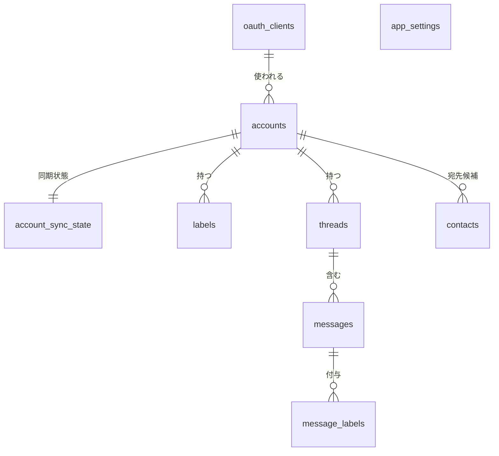
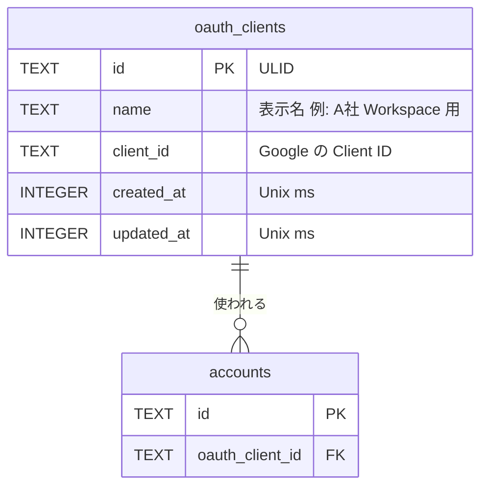
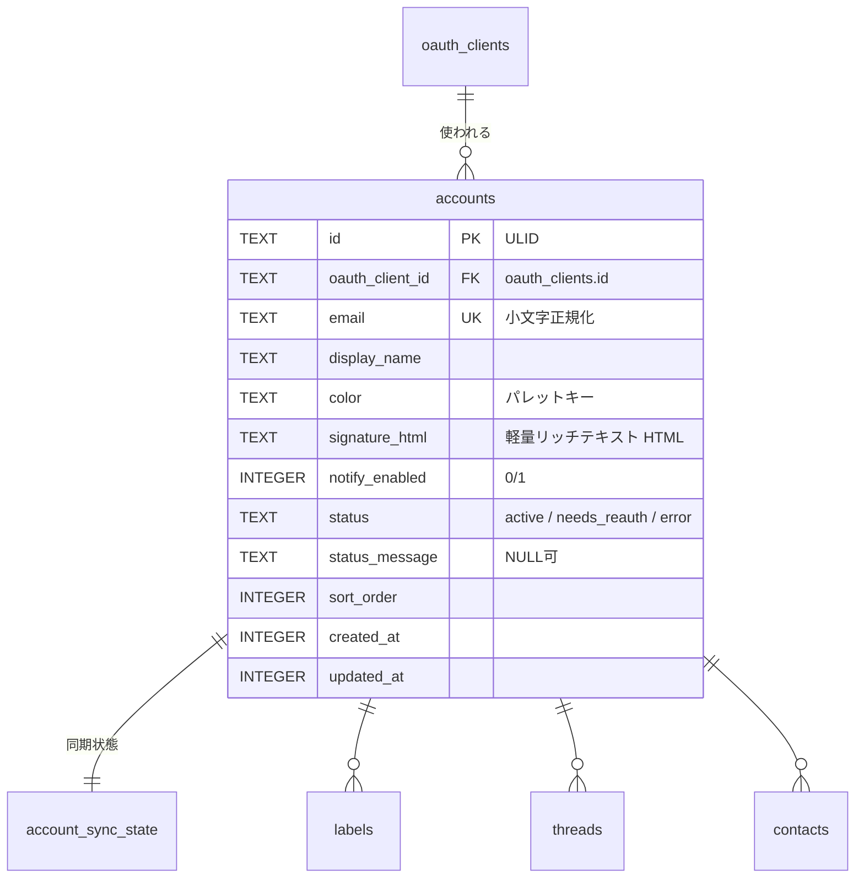
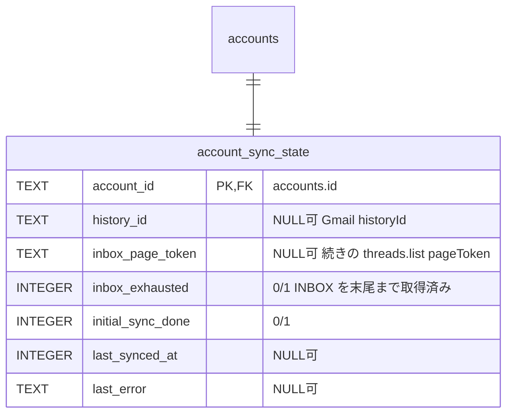
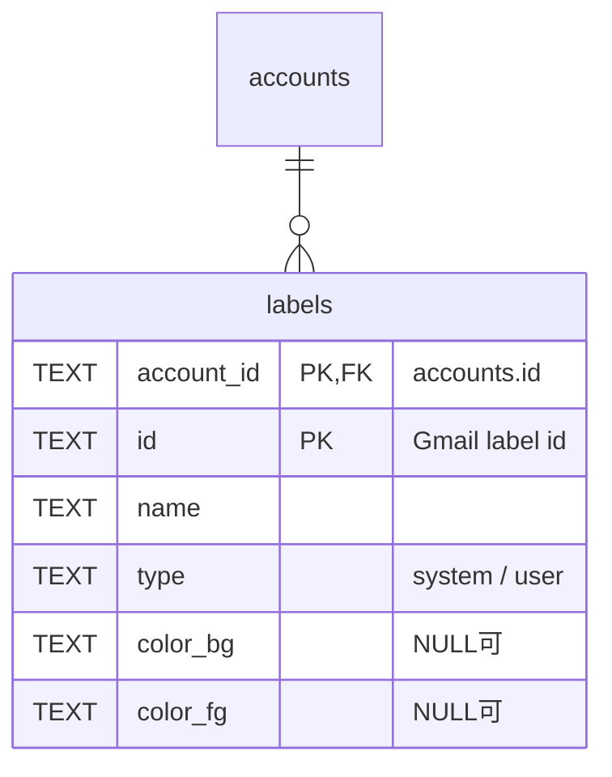
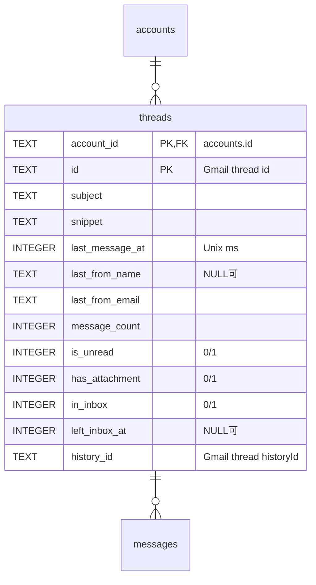
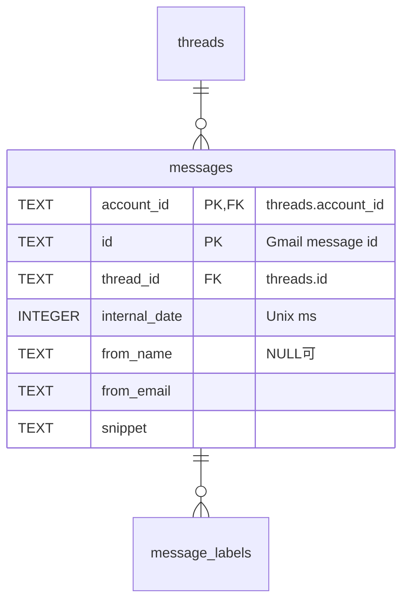
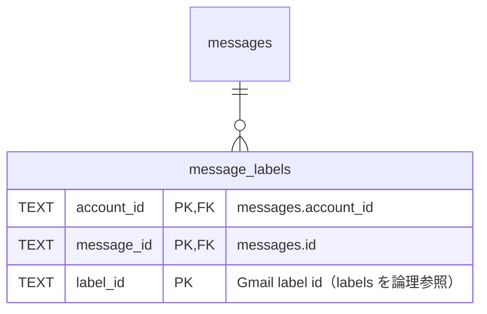
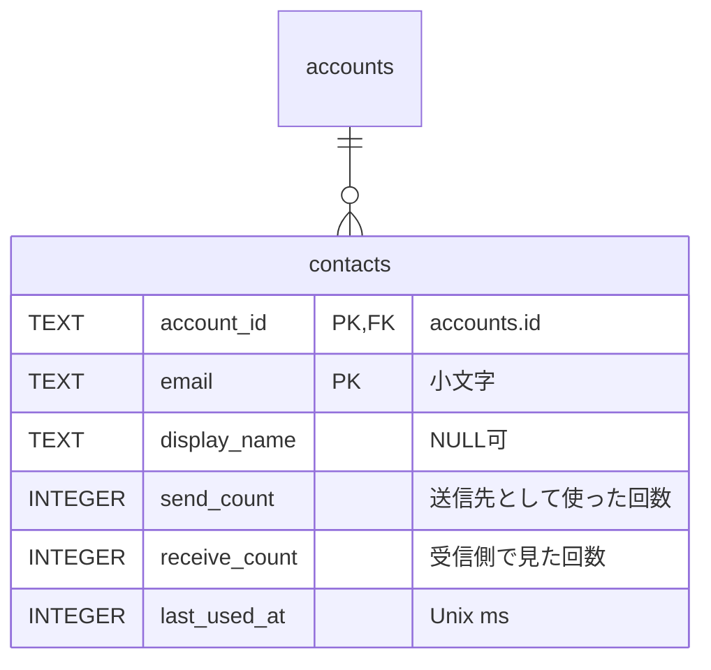
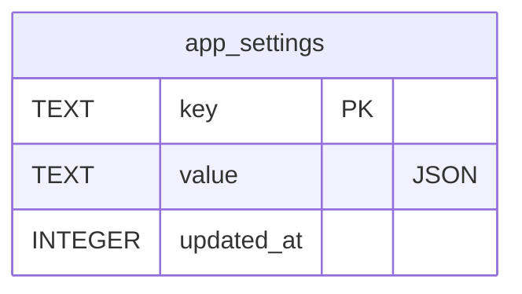

# ER / データモデル

> 関連: [プロジェクト概要](../overview.md) / [アーキテクチャ設計](overview.md) / [機能要件](../requirements/functional.md) / [非機能要件](../requirements/non-functional.md) / [バインディング仕様](../api/endpoints.md)

## 1. 方針

- ローカル DB は **SQLite**（`modernc.org/sqlite`、WAL）。スキーマは goose のマイグレーション（`internal/store/migrations/*.sql`）で管理し、クエリは sqlc で生成する
- **保存するのはヘッダ由来のメタデータとスニペットのみ**。メッセージ本文・添付データ・下書きは保存しない（[NF-S08](../requirements/non-functional.md#1-セキュリティ)。下書きは Gmail 側）
- **秘密情報は DB に保存しない**。OAuth のリフレッシュトークン、OAuth クライアントの Client Secret、AI の API キーは Windows 資格情報マネージャーに保存する

| 資格情報キー | 内容 |
|--------------|------|
| `hitomado/refresh_token/<account_id>` | アカウントのリフレッシュトークン |
| `hitomado/oauth_client_secret/<oauth_client_id>` | OAuth クライアントの Client Secret |
| `hitomado/ai_api_key/<provider>` | AI プロバイダの API キー（`anthropic`／`openai`） |

- **ID**: ローカルで採番するテーブルの主キーは **ULID（TEXT）**。Gmail 由来の ID（スレッド・メッセージ・ラベル）は Gmail の文字列 ID を使い、アカウントをまたいで一意でないため **`account_id` との複合主キー**にする
- **日時**: UTC の Unix ミリ秒（`INTEGER`）。**真偽値**: `INTEGER`（0／1、`CHECK (x IN (0,1))`）
- **接続時 PRAGMA**: `foreign_keys = ON`、`journal_mode = WAL`、`busy_timeout = 5000`、`secure_delete = ON`（アカウント削除で消した件名・スニペットが空きページに残らないようにする）
- **削除**: アカウント削除は子テーブルへ `ON DELETE CASCADE`（トークンは資格情報ストア側を別途削除）

## 2. 全体 ER 図

> `app_settings` は他テーブルと関係を持たない（キー・値）。`message_labels.label_id` は `labels` を論理参照するが、ラベル一覧の取得順に依存しないよう外部キー制約は張らない。

## 3. テーブル定義

### 3.1 oauth_clients

利用者が登録した OAuth クライアント（Client Secret は資格情報ストア）。

| カラム | 型 | NULL | 説明 |
|--------|----|------|------|
| `id` | TEXT | NO | PK。ULID |
| `name` | TEXT | NO | 表示名。空文字不可 |
| `client_id` | TEXT | NO | Google の Client ID |
| `created_at` | INTEGER | NO | 作成日時 |
| `updated_at` | INTEGER | NO | 更新日時 |

- 制約: `UNIQUE(client_id)`、`CHECK (length(name) > 0)`
- 削除: 参照するアカウントが 0 件のときのみ（`accounts.oauth_client_id` は `ON DELETE RESTRICT`）

### 3.2 accounts

接続済みの Gmail／Workspace アカウント。

| カラム | 型 | NULL | 説明 |
|--------|----|------|------|
| `id` | TEXT | NO | PK。ULID |
| `oauth_client_id` | TEXT | NO | FK → `oauth_clients.id`（`ON DELETE RESTRICT`） |
| `email` | TEXT | NO | プライマリアドレス（小文字）。**返信・転送の送信元はこの値**（[F-05](../requirements/functional.md#f-05-返信全員に返信転送送信してアーカイブ)） |
| `display_name` | TEXT | NO | 表示名。既定は Google プロフィール名 |
| `color` | TEXT | NO | アカウント色のパレットキー（プリセットのみ。NF §11 のコントラスト基準を満たす） |
| `signature_html` | TEXT | NO | 署名（既定は空文字）。サニタイズ済みの許可タグのみ |
| `notify_enabled` | INTEGER | NO | 新着通知。既定 1 |
| `status` | TEXT | NO | `active`／`needs_reauth`／`error` |
| `status_message` | TEXT | YES | エラー内容（機密を含めない） |
| `sort_order` | INTEGER | NO | サイドバーの並び順 |
| `created_at` | INTEGER | NO | |
| `updated_at` | INTEGER | NO | |

- 制約: `UNIQUE(email)`、`CHECK (status IN ('active','needs_reauth','error'))`、`CHECK (notify_enabled IN (0,1))`
- 同期中（`syncing`）はメモリ上の一時状態であり DB に保存しない（`account:status` イベントのみ）

### 3.3 account_sync_state

アカウントごとの同期状態（更新が頻繁なため `accounts` と分離）。

| カラム | 型 | NULL | 説明 |
|--------|----|------|------|
| `account_id` | TEXT | NO | PK／FK → `accounts.id`（`ON DELETE CASCADE`） |
| `history_id` | TEXT | YES | 直近に反映した `historyId`。NULL は未同期。失効（404）時は NULL に戻してリセット同期 |
| `inbox_page_token` | TEXT | YES | 受信箱の「続きを読む」用 `pageToken` |
| `inbox_exhausted` | INTEGER | NO | 既定 0。1 のとき続きの取得を行わない |
| `initial_sync_done` | INTEGER | NO | 既定 0。0 の間は新着通知を出さない |
| `last_synced_at` | INTEGER | YES | 最終成功時刻 |
| `last_error` | TEXT | YES | 直近のエラー（機密を含めない） |

### 3.4 labels

アカウントごとの Gmail ラベル（チップ表示・F-04b 用）。

| カラム | 型 | NULL | 説明 |
|--------|----|------|------|
| `account_id` | TEXT | NO | PK(1)／FK → `accounts.id`（`ON DELETE CASCADE`） |
| `id` | TEXT | NO | PK(2)。Gmail のラベル ID（`INBOX`、`UNREAD`、`Label_123` 等） |
| `name` | TEXT | NO | 表示名 |
| `type` | TEXT | NO | `system`／`user` |
| `color_bg` | TEXT | YES | Gmail のラベル背景色 |
| `color_fg` | TEXT | YES | Gmail のラベル文字色 |

- 制約: `CHECK (type IN ('system','user'))`
- チップ表示の対象は `type = 'user'` のみ

### 3.5 threads

スレッド（アカウントごと）。リスト表示に必要な非正規化フィールドを持つ。

| カラム | 型 | NULL | 説明 |
|--------|----|------|------|
| `account_id` | TEXT | NO | PK(1)／FK → `accounts.id`（`ON DELETE CASCADE`） |
| `id` | TEXT | NO | PK(2)。Gmail のスレッド ID |
| `subject` | TEXT | NO | 最初のメッセージの件名（なければ空文字） |
| `snippet` | TEXT | NO | 最新メッセージのスニペット |
| `last_message_at` | INTEGER | NO | 最新メッセージの `internalDate`。統合受信箱の並び順の基準 |
| `last_from_name` | TEXT | YES | 最新メッセージの差出人名 |
| `last_from_email` | TEXT | NO | 最新メッセージの差出人アドレス |
| `message_count` | INTEGER | NO | スレッド内メッセージ数 |
| `is_unread` | INTEGER | NO | いずれかのメッセージが `UNREAD`。`messages`／`message_labels` から導出して更新する |
| `has_attachment` | INTEGER | NO | 添付あり（メタデータ取得時の `multipart/mixed` 等から判定する近似値。スレッドを開いたとき確定する） |
| `in_inbox` | INTEGER | NO | いずれかのメッセージが `INBOX` |
| `left_inbox_at` | INTEGER | YES | `in_inbox` が 1→0 になった時刻。1 に戻ったら NULL |
| `history_id` | TEXT | NO | Gmail の `thread.historyId`。変更検出に使う |

- 制約: `CHECK (is_unread IN (0,1))`、`CHECK (has_attachment IN (0,1))`、`CHECK (in_inbox IN (0,1))`
- 保持期間: `in_inbox = 0 AND left_inbox_at < now - 90日` のスレッドを日次で削除する（`messages`／`message_labels` はカスケード）。`contacts` は削除しない
- 統合受信箱のキーセットページング: `(last_message_at DESC, account_id, id)` をカーソルとする

### 3.6 messages

メッセージ（ヘッダ由来のみ。本文は保存しない）。

| カラム | 型 | NULL | 説明 |
|--------|----|------|------|
| `account_id` | TEXT | NO | PK(1)／FK |
| `id` | TEXT | NO | PK(2)。Gmail のメッセージ ID |
| `thread_id` | TEXT | NO | FK `(account_id, thread_id)` → `threads(account_id, id)`（`ON DELETE CASCADE`） |
| `internal_date` | INTEGER | NO | 受信日時 |
| `from_name` | TEXT | YES | 差出人名 |
| `from_email` | TEXT | NO | 差出人アドレス（小文字） |
| `snippet` | TEXT | NO | スニペット |

- `To`／`Cc`／`Reply-To`／`Message-ID`／`References` は保存しない。返信時にスレッドを開いて取得したデータ（メモリ）から決定する
- 同期ごとに `messages` から `threads` の集計値（最新メッセージ・件数・未読・受信箱）を再計算する

### 3.7 message_labels

メッセージとラベルの関連（Gmail のラベルはメッセージ単位）。

| カラム | 型 | NULL | 説明 |
|--------|----|------|------|
| `account_id` | TEXT | NO | PK(1)／FK |
| `message_id` | TEXT | NO | PK(2)／FK `(account_id, message_id)` → `messages(account_id, id)`（`ON DELETE CASCADE`） |
| `label_id` | TEXT | NO | PK(3)。`labels.id` を論理参照（FK なし） |

- 保存対象のラベル: `INBOX`、`UNREAD`、`TRASH`、`CATEGORY_*`、およびユーザー作成ラベル。その他のシステムラベル（`SENT`、`DRAFT` 等）も取得できたものはそのまま保存してよい

### 3.8 contacts

宛先オートコンプリート用の連絡先候補（**アカウントごと**に集計。[F-13](../requirements/functional.md#f-13-宛先オートコンプリート)）。

| カラム | 型 | NULL | 説明 |
|--------|----|------|------|
| `account_id` | TEXT | NO | PK(1)／FK → `accounts.id`（`ON DELETE CASCADE`） |
| `email` | TEXT | NO | PK(2)。小文字正規化 |
| `display_name` | TEXT | YES | 直近に観測した表示名 |
| `send_count` | INTEGER | NO | 既定 0。送信完了時に宛先へ加算 |
| `receive_count` | INTEGER | NO | 既定 0。同期時に、取得したメッセージの差出人・宛先・Cc を加算（閲覧時は加算しない） |
| `last_used_at` | INTEGER | NO | 最終観測時刻 |

- 候補の順位: `send_count * 3 + receive_count` の降順、同点は `last_used_at` の降順（`SuggestContacts` の SQL が唯一の実装）
- 自アカウントのアドレス（`accounts.email`）は候補から除外する
- スレッドの保持期間削除の影響を受けない。アカウント削除時にカスケード削除する

### 3.9 app_settings

アプリ設定（キー・値）。値は JSON 文字列。

| カラム | 型 | NULL | 説明 |
|--------|----|------|------|
| `key` | TEXT | NO | PK |
| `value` | TEXT | NO | JSON（`json_valid(value)` を `CHECK`） |
| `updated_at` | INTEGER | NO | |

| キー | 値の例 | 用途 |
|------|--------|------|
| `inbox.filter` | `{"accountIds":["01H..."],"unreadOnly":false}` | 受信箱フィルタの保持（F-02） |
| `ai.config` | `{"provider":"openai","model":"...","baseUrl":"https://example.com/v1"}` | AI 設定（API キーは資格情報ストア）。`baseUrl` は省略可（Base URL 無しのときはキー自体を保存しない。`null` は保存しない。例: `{"provider":"anthropic","model":"..."}`） |
| `ai.consent` | `{"providers":[{"provider":"openai","baseUrl":"https://api.openai.com","agreedAt":1730000000000}]}` | AI 送信の同意（F-08）。「プロバイダ＋送信先（Base URL の scheme とホスト。パスは含めない）」単位の配列で、プロバイダごとに 1 件。`baseUrl` は省略可（省略は既定の送信先）。送信先が変わった同意は無効になり、保存からも外す。旧形式 `{"provider":"anthropic","agreedAt":...}`（単一オブジェクト）は読み取り専用の互換入力で、保存は常に `providers` 形式（`RecordAIConsent` が書き込む。[API §6](../api/endpoints.md)） |
| `update.check_enabled` | `true` | 新バージョン確認の有効／無効（NF-D03） |
| `update.last_checked_at` | `1730000000000` | 最終確認日時 |
| `window.state` | `{"x":100,"y":60,"width":1280,"height":800,"maximized":false}` | ウィンドウ状態。位置・サイズは最大化していないときの DIP 値（`x`／`y` は省略可。省略時は位置を OS に任せる）。画面外の位置は起動時に捨てる（[F-10](../requirements/functional.md)） |

## 4. インデックス

| テーブル | インデックス | 用途 |
|----------|--------------|------|
| `accounts` | `UNIQUE(email)` | 二重登録拒否（F-01） |
| `oauth_clients` | `UNIQUE(client_id)` | 重複登録防止 |
| `threads` | `idx_threads_inbox` ON `(last_message_at DESC, account_id, id) WHERE in_inbox = 1` | 統合受信箱の取得・キーセットページング（F-02） |
| `threads` | `idx_threads_unread` ON `(account_id) WHERE in_inbox = 1 AND is_unread = 1` | アカウント別の未読件数 |
| `threads` | `idx_threads_retention` ON `(left_inbox_at) WHERE in_inbox = 0` | 保持期間削除（日次） |
| `messages` | `idx_messages_thread` ON `(account_id, thread_id, internal_date)` | スレッド内の集計・並び |
| `message_labels` | `idx_message_labels_label` ON `(account_id, label_id, message_id)` | ラベルからの逆引き、`history` 反映 |
| `contacts` | `idx_contacts_rank` ON `(account_id, last_used_at DESC)` | 候補の取得 |
| `contacts` | 主キー `(account_id, email)` | メールアドレスの前方一致。`email` は小文字正規化済みなので、`LIKE` ではなく範囲検索 `email >= :q AND email < :q_next`（`:q_next` は `:q` の最終文字を 1 つ進めた文字列）で PK インデックスを使う。SQLite の `LIKE` は既定で大文字小文字を区別しないため BINARY 照合の PK では使われない。表示名の前方一致は件数が小さいため全走査で許容する |

## 5. 整合性・運用ルール

- `threads` の `is_unread`／`in_inbox`／`last_*`／`message_count`／`has_attachment` は、同一トランザクション内で `messages`／`message_labels` の変更後に再計算する
- 同期の反映は 1 スレッド（または 1 アカウント分の 1 周期）を 1 トランザクションで行い、途中失敗時は `history_id` を進めない
- リセット同期（`history` 失効）は当該アカウントの `INBOX` 内スレッドのみ入れ替える。`contacts`・`labels` は保持する
- アカウント削除: DB は `DELETE FROM accounts WHERE id = ?` のカスケード、続いて資格情報ストアの `refresh_token/<account_id>` を削除する。OAuth クライアントはユーザー操作で別途削除する
- 本文・添付・下書きに相当するカラム・テーブルは作らない

## 改訂履歴

| 版 | 日付 | 変更内容 | 変更理由 |
|----|------|---------|---------|
| 1.0 | 2026-11-02 | 新規作成 | 初版 |
| 1.1 | 2026-11-02 | `contacts` の前方一致を範囲検索に変更 | `LIKE` が PK インデックスを使わないため |
| 1.2 | 2026-11-03 | §3.9 の `ai.config`／`ai.consent` の値を実装の保存形式に合わせ、旧形式の扱いを追記 | 同意が送信先単位の配列になり、`baseUrl` は省略可のため（#29） |
| 1.3 | 2026-11-03 | §3.8 の候補の順位規則の実装が `SuggestContacts` の SQL のみであることを明記 | `domain/contacts` の未使用の順位付けを削除したため（#47） |
| 1.4 | 2026-11-03 | §3.8 の `receive_count` を、同期時に加算し閲覧時は加算しない旨に修正（履歴に未記録だった分） | 実装との整合（#32。記録漏れの補正 #53） |
