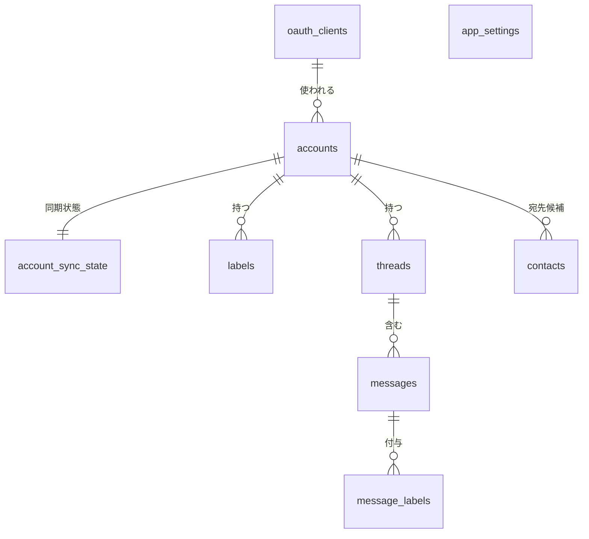
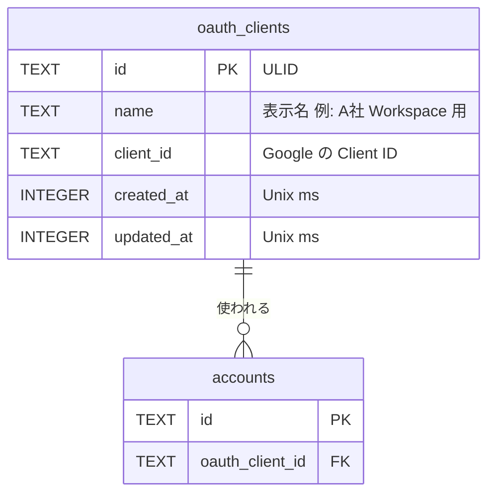
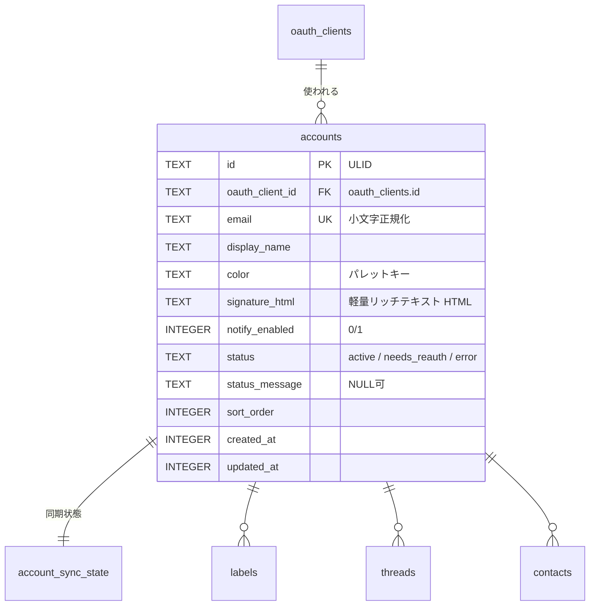
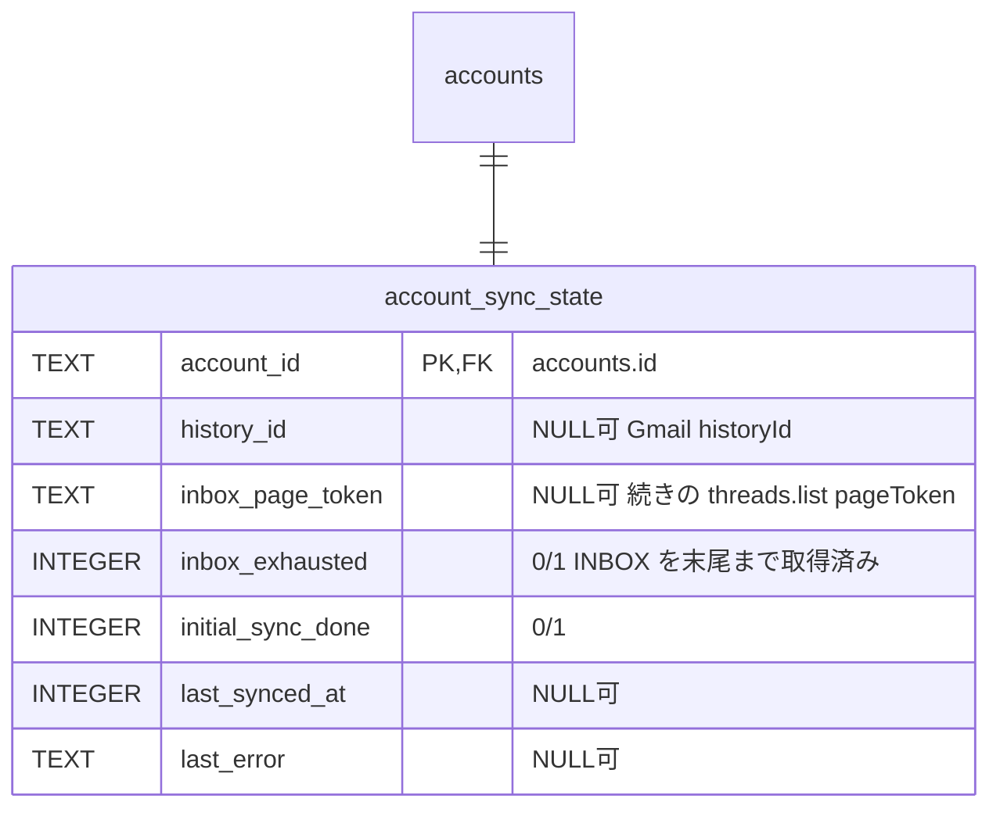
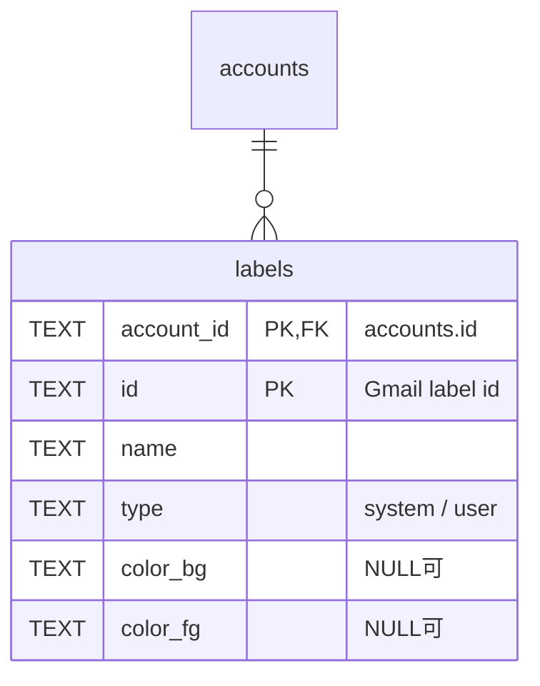
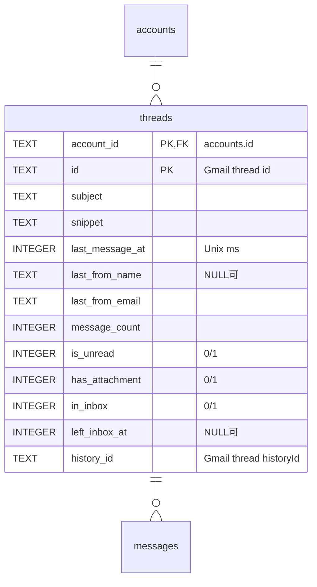
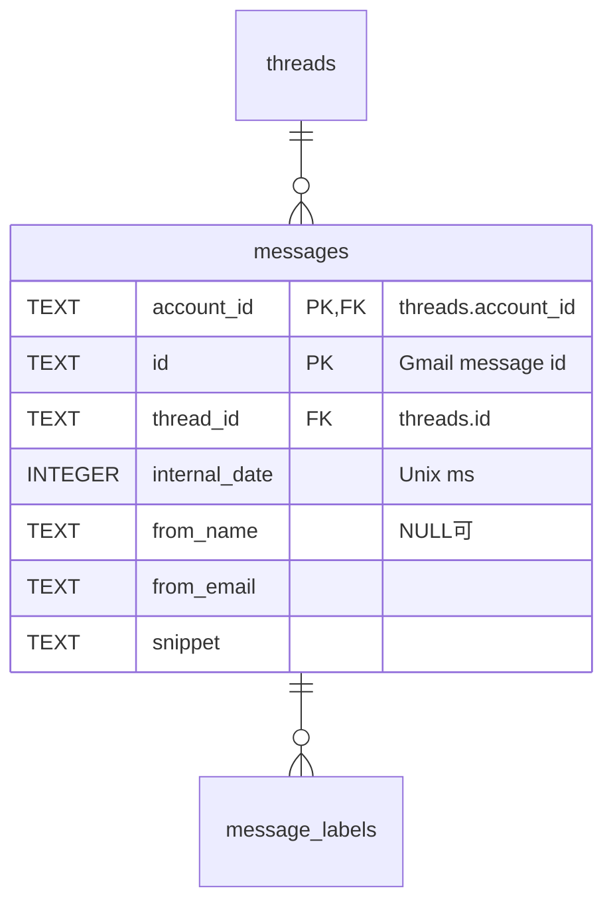
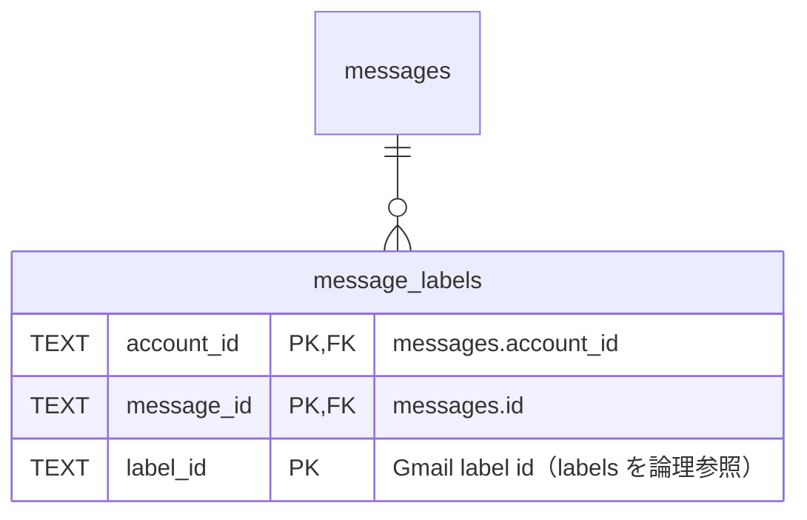
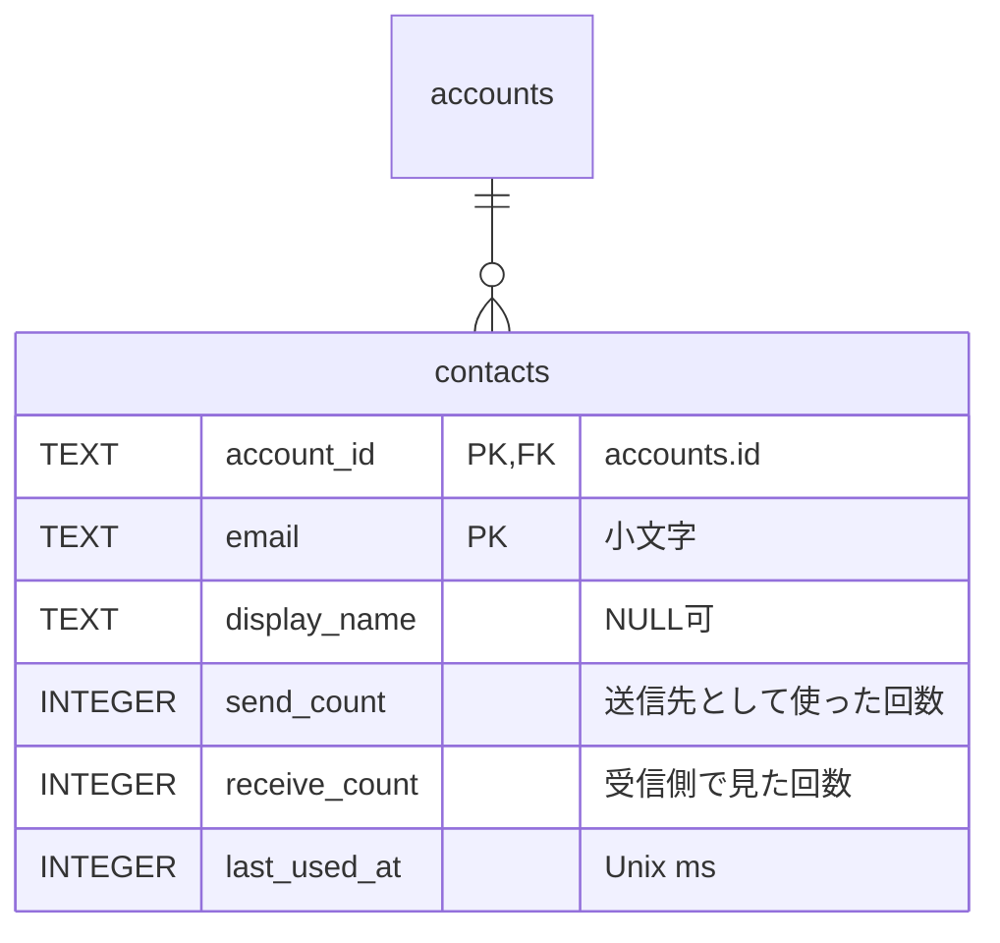
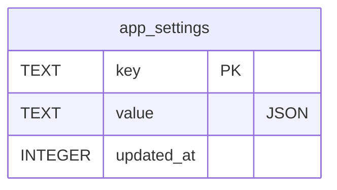

# ER / データモデル

> 関連: [プロジェクト概要](../overview.md) / [アーキテクチャ設計](overview.md) / [機能要件](../requirements/functional.md) / [非機能要件](../requirements/non-functional.md) / [バインディング仕様](../api/endpoints.md)

## 1. 方針

- ローカル DB は **SQLite**（`modernc.org/sqlite`、WAL）。スキーマは goose のマイグレーション（`internal/store/migrations/*.sql`）で管理し、クエリは sqlc で生成する
- **保存するのはヘッダ由来のメタデータとスニペットのみ**。メッセージ本文・添付データ・下書きは保存しない（[NF-S08](../requirements/non-functional.md#1-セキュリティ)。下書きは Gmail 側）
- **秘密情報は DB に保存しない**。OAuth のリフレッシュトークン、OAuth クライアントの Client Secret、AI の API キー、ChatGPT ログインのトークンは OS の資格情報ストア（Windows は資格情報マネージャー、Android は Android Keystore の鍵で暗号化した EncryptedSharedPreferences）に保存する

| 資格情報キー | 内容 |
|--------------|------|
| `hitomado/refresh_token/<account_id>` | アカウントのリフレッシュトークン |
| `hitomado/oauth_client_secret/<oauth_client_id>` | OAuth クライアントの Client Secret |
| `hitomado/ai_api_key/<provider>` | AI プロバイダの API キー（`anthropic`／`openai`） |
| `hitomado/chatgpt_token/<client_id>/<kind>` | ChatGPT ログイン（Sign in with ChatGPT）のトークン。ChatGPT アカウント（クライアント登録）ごとに `<client_id>`（発行されたクライアント ID）で別のキーにし、ほかのアカウントのトークンと混ぜない。Windows 資格情報マネージャーはキーの大文字小文字を区別しないので、`<client_id>` は大文字小文字を無視して一意として扱う（大文字小文字だけが違う登録は拒否。§3.9）。`kind` は `access`（アクセストークン）／`refresh`（リフレッシュトークン）／`id`（ID トークン。任意）。1 件の上限（Windows は約 2.5KB）を超える値は `<キー>#0`、`#1`… に分割し、先頭のキーに `chunks:<個数>` を置く。v0.1.7 までの `hitomado/chatgpt_token/<kind>`（アカウント 1 件）は、最初の読み取りで新しいキーへ移して消す（消すのに失敗しても、残っている間は後の読み取りで消し直す） |

- **ID**: ローカルで採番するテーブルの主キーは **ULID（TEXT）**。Gmail 由来の ID（スレッド・メッセージ・ラベル）は Gmail の文字列 ID を使い、アカウントをまたいで一意でないため **`account_id` との複合主キー**にする
- **日時**: UTC の Unix ミリ秒（`INTEGER`）。**真偽値**: `INTEGER`（0／1、`CHECK (x IN (0,1))`）
- **接続時 PRAGMA**: `foreign_keys = ON`、`journal_mode = WAL`、`busy_timeout = 5000`、`secure_delete = ON`（アカウント削除で消した件名・スニペットが空きページに残らないようにする）
- **削除**: アカウント削除は子テーブルへ `ON DELETE CASCADE`（トークンは資格情報ストア側を別途削除）

## 2. 全体 ER 図

> `app_settings` は他テーブルと関係を持たない（キー・値）。`message_labels.label_id` は `labels` を論理参照するが、ラベル一覧の取得順に依存しないよう外部キー制約は張らない。

## 3. テーブル定義

### 3.1 oauth_clients

利用者が登録した OAuth クライアント（Client Secret は資格情報ストア）。

| カラム | 型 | NULL | 説明 |
|--------|----|------|------|
| `id` | TEXT | NO | PK。ULID |
| `name` | TEXT | NO | 表示名。空文字不可 |
| `client_id` | TEXT | NO | Google の Client ID |
| `created_at` | INTEGER | NO | 作成日時 |
| `updated_at` | INTEGER | NO | 更新日時 |

- 制約: `UNIQUE(client_id)`、`CHECK (length(name) > 0)`
- 削除: 参照するアカウントが 0 件のときのみ（`accounts.oauth_client_id` は `ON DELETE RESTRICT`）

### 3.2 accounts

接続済みの Gmail／Workspace アカウント。

| カラム | 型 | NULL | 説明 |
|--------|----|------|------|
| `id` | TEXT | NO | PK。ULID |
| `oauth_client_id` | TEXT | NO | FK → `oauth_clients.id`（`ON DELETE RESTRICT`） |
| `email` | TEXT | NO | プライマリアドレス（小文字）。**返信・転送の送信元はこの値**（[F-05](../requirements/functional.md#f-05-返信全員に返信転送送信してアーカイブ)） |
| `display_name` | TEXT | NO | 表示名。既定は Google プロフィール名 |
| `color` | TEXT | NO | アカウント色のパレットキー（プリセットのみ。NF §11 のコントラスト基準を満たす） |
| `signature_html` | TEXT | NO | 署名（既定は空文字）。サニタイズ済みの許可タグのみ。手入力、または Gmail から取り込んだもの（#110。取得元は保存せず、列・マイグレーションの追加はない） |
| `notify_enabled` | INTEGER | NO | 新着通知。既定 1 |
| `status` | TEXT | NO | `active`／`needs_reauth`／`error` |
| `status_message` | TEXT | YES | エラー内容（機密を含めない） |
| `sort_order` | INTEGER | NO | サイドバーの並び順 |
| `created_at` | INTEGER | NO | |
| `updated_at` | INTEGER | NO | |

- 制約: `UNIQUE(email)`、`CHECK (status IN ('active','needs_reauth','error'))`、`CHECK (notify_enabled IN (0,1))`
- 同期中（`syncing`）はメモリ上の一時状態であり DB に保存しない（`account:status` イベントのみ）

### 3.3 account_sync_state

アカウントごとの同期状態（更新が頻繁なため `accounts` と分離）。

| カラム | 型 | NULL | 説明 |
|--------|----|------|------|
| `account_id` | TEXT | NO | PK／FK → `accounts.id`（`ON DELETE CASCADE`） |
| `history_id` | TEXT | YES | 直近に反映した `historyId`。NULL は未同期。失効（404）時は NULL に戻してリセット同期 |
| `inbox_page_token` | TEXT | YES | 受信箱の「続きを読む」用 `pageToken` |
| `inbox_exhausted` | INTEGER | NO | 既定 0。1 のとき続きの取得を行わない |
| `initial_sync_done` | INTEGER | NO | 既定 0。0 の間は新着通知を出さない |
| `last_synced_at` | INTEGER | YES | 最終成功時刻 |
| `last_error` | TEXT | YES | 直近のエラー（機密を含めない） |

### 3.4 labels

アカウントごとの Gmail ラベル（チップ表示・F-04b 用）。

| カラム | 型 | NULL | 説明 |
|--------|----|------|------|
| `account_id` | TEXT | NO | PK(1)／FK → `accounts.id`（`ON DELETE CASCADE`） |
| `id` | TEXT | NO | PK(2)。Gmail のラベル ID（`INBOX`、`UNREAD`、`Label_123` 等） |
| `name` | TEXT | NO | 表示名 |
| `type` | TEXT | NO | `system`／`user` |
| `color_bg` | TEXT | YES | Gmail のラベル背景色 |
| `color_fg` | TEXT | YES | Gmail のラベル文字色 |

- 制約: `CHECK (type IN ('system','user'))`
- チップ表示の対象は `type = 'user'` のみ

### 3.5 threads

スレッド（アカウントごと）。リスト表示に必要な非正規化フィールドを持つ。

| カラム | 型 | NULL | 説明 |
|--------|----|------|------|
| `account_id` | TEXT | NO | PK(1)／FK → `accounts.id`（`ON DELETE CASCADE`） |
| `id` | TEXT | NO | PK(2)。Gmail のスレッド ID |
| `subject` | TEXT | NO | 最初のメッセージの件名（なければ空文字） |
| `snippet` | TEXT | NO | 最新メッセージのスニペット |
| `last_message_at` | INTEGER | NO | 最新メッセージの `internalDate`。統合受信箱の並び順の基準 |
| `last_from_name` | TEXT | YES | 最新メッセージの差出人名 |
| `last_from_email` | TEXT | NO | 最新メッセージの差出人アドレス |
| `message_count` | INTEGER | NO | スレッド内メッセージ数 |
| `is_unread` | INTEGER | NO | いずれかのメッセージが `UNREAD`。`messages`／`message_labels` から導出して更新する |
| `has_attachment` | INTEGER | NO | 添付あり（メタデータ取得時の `multipart/mixed` 等から判定する近似値。スレッドを開いたとき確定する） |
| `in_inbox` | INTEGER | NO | いずれかのメッセージが `INBOX` |
| `left_inbox_at` | INTEGER | YES | `in_inbox` が 1→0 になった時刻。1 に戻ったら NULL |
| `history_id` | TEXT | NO | Gmail の `thread.historyId`。変更検出に使う |

- 制約: `CHECK (is_unread IN (0,1))`、`CHECK (has_attachment IN (0,1))`、`CHECK (in_inbox IN (0,1))`
- 保持期間: `in_inbox = 0 AND left_inbox_at < now - 90日` のスレッドを日次で削除する（`messages`／`message_labels` はカスケード）。`contacts` は削除しない
- 統合受信箱のキーセットページング: `(last_message_at DESC, account_id, id)` をカーソルとする

### 3.6 messages

メッセージ（ヘッダ由来のみ。本文は保存しない）。

| カラム | 型 | NULL | 説明 |
|--------|----|------|------|
| `account_id` | TEXT | NO | PK(1)／FK |
| `id` | TEXT | NO | PK(2)。Gmail のメッセージ ID |
| `thread_id` | TEXT | NO | FK `(account_id, thread_id)` → `threads(account_id, id)`（`ON DELETE CASCADE`） |
| `internal_date` | INTEGER | NO | 受信日時 |
| `from_name` | TEXT | YES | 差出人名 |
| `from_email` | TEXT | NO | 差出人アドレス（小文字） |
| `snippet` | TEXT | NO | スニペット |

- `To`／`Cc`／`Reply-To`／`Message-ID`／`References` は保存しない。返信時にスレッドを開いて取得したデータ（メモリ）から決定する
- 同期ごとに `messages` から `threads` の集計値（最新メッセージ・件数・未読・受信箱）を再計算する

### 3.7 message_labels

メッセージとラベルの関連（Gmail のラベルはメッセージ単位）。

| カラム | 型 | NULL | 説明 |
|--------|----|------|------|
| `account_id` | TEXT | NO | PK(1)／FK |
| `message_id` | TEXT | NO | PK(2)／FK `(account_id, message_id)` → `messages(account_id, id)`（`ON DELETE CASCADE`） |
| `label_id` | TEXT | NO | PK(3)。`labels.id` を論理参照（FK なし） |

- 保存対象のラベル: `INBOX`、`UNREAD`、`TRASH`、`CATEGORY_*`、およびユーザー作成ラベル。その他のシステムラベル（`SENT`、`DRAFT` 等）も取得できたものはそのまま保存してよい
- 受信箱のタブ（[バインディング仕様 §3 `ListInbox`](../api/endpoints.md#3-inboxservice)）は、スレッド内のいずれかのメッセージの `message_labels` に `CATEGORY_PERSONAL`／`CATEGORY_SOCIAL`／`CATEGORY_PROMOTIONS` があるかで絞り込む（`threads` に非正規化した列は持たない。`messages` の `(account_id, thread_id)` と `message_labels` の主キーで引く）。メインは `CATEGORY_PERSONAL` を持つ、またはどの `CATEGORY_*` も持たないスレッド。新着は `threads.is_unread`

### 3.8 contacts

宛先オートコンプリート用の連絡先候補（**アカウントごと**に集計。[F-13](../requirements/functional.md#f-13-宛先オートコンプリート)）。

| カラム | 型 | NULL | 説明 |
|--------|----|------|------|
| `account_id` | TEXT | NO | PK(1)／FK → `accounts.id`（`ON DELETE CASCADE`） |
| `email` | TEXT | NO | PK(2)。小文字正規化 |
| `display_name` | TEXT | YES | 直近に観測した表示名 |
| `send_count` | INTEGER | NO | 既定 0。送信完了時に宛先へ加算 |
| `receive_count` | INTEGER | NO | 既定 0。同期時に、取得したメッセージの差出人・宛先・Cc を加算（閲覧時は加算しない） |
| `last_used_at` | INTEGER | NO | 最終観測時刻 |

- 候補の順位: `send_count * 3 + receive_count` の降順、同点は `last_used_at` の降順（`SuggestContacts` の SQL が唯一の実装）
- 自アカウントのアドレス（`accounts.email`）は候補から除外する
- スレッドの保持期間削除の影響を受けない。アカウント削除時にカスケード削除する

### 3.9 app_settings

アプリ設定（キー・値）。値は JSON 文字列。

| カラム | 型 | NULL | 説明 |
|--------|----|------|------|
| `key` | TEXT | NO | PK |
| `value` | TEXT | NO | JSON（`json_valid(value)` を `CHECK`） |
| `updated_at` | INTEGER | NO | |

| キー | 値の例 | 用途 |
|------|--------|------|
| `inbox.filter` | `{"accountIds":["01H..."],"unreadOnly":false}` | 受信箱フィルタの保持（F-02） |
| `ai.config` | `{"provider":"openai","model":"...","baseUrl":"https://example.com/v1"}` | AI 設定（API キー・トークンは資格情報ストア。`provider` は `anthropic`／`openai`／`chatgpt`）。この行が無い（未保存）ときの `provider` は `chatgpt`（#104。`GetAIConfig` が `configured = false` で返す。保存済みの値は変えない）。`baseUrl` は省略可（Base URL 無しのときはキー自体を保存しない。`null` は保存しない。例: `{"provider":"anthropic","model":"..."}`） |
| `ai.config`（`effort`） | `{"provider":"anthropic","model":"...","effort":"high"}` | `ai.config` の任意キー `effort`（#111）。「モデルの既定」のときはキー自体を書かない（`null`・空文字は保存しない）。値は `anthropic` が `low`／`medium`／`high`／`xhigh`／`max`、`openai`／`chatgpt` が `low`／`medium`／`high`。範囲外の保存値（手で書き換えられた値）は読むときに無視して「既定」として扱い、プロバイダへは送らない |
| `ai.chatgpt` | `{"hostId":"urn:uuid:...","active":"oaiapp_AAAA","accounts":[{"clientId":"oaiapp_AAAA","subject":"...","email":"me@example.com","expiresAt":1730000000000,"planNotice":"done"},{"clientId":"oaiapp_BBBB","subject":"...","email":"me@example.com","consentNeeded":true}]}` | ChatGPT ログインの登録情報（**秘密ではない**。トークンは資格情報ストア）。`hostId` はこの PC のホスト ID（`urn:uuid:` ＋ UUIDv4。初回ログインの前に作り、以後変えない。全アカウントで共通）、`active` は下書きの生成に使うアカウントの `clientId`（無ければ省略）。`accounts` は ChatGPT アカウント（クライアント登録）の配列で、登録順。1 件ごとに、`clientId` は動的登録で発行されたクライアント ID（アカウントの識別子。同じメールアドレスでも別の登録は別の `clientId` で別の要素。資格情報ストアのキーに使うので、形式は定めず（公式ドキュメントに規定がない）、キーの区切りと衝突する値だけを拒否する: 空・128 文字超、`/`・`#`・`\`、空白・制御文字、ASCII 以外を含む値が返ったログインは、コードを交換する前に失敗させる。Windows 資格情報マネージャーはキーの大文字小文字を区別しない（`Abc` と `abc` は同じキー）ので、`clientId` は大文字小文字を無視して一意な値として扱う（資格情報キーの形式は変えない。変えると、リリース済みのキーの移行が要るため。OpenAI が発行する値は一意で、大文字小文字だけが違う発行は現実には起きないので、重なりを拒否するだけにする）。新しい登録が既存の `clientId` と大文字小文字だけが違う値で返ってきたときは、`subject` に関わらず、既存の要素・トークンに触れずに拒否し、得たトークンは失効させる。選んだ登録への再ログインで、返った `clientId` が選んだ値と大文字小文字だけ違うときも、コードを交換する前に拒否する。新しい登録が既存の `clientId` と同じ値で返ってきたときは、`subject` が同じ場合だけ同じ要素を更新し、違うとき、または既存の要素に `subject` が未記録（旧形式から移行した直後など）で同じアカウントか照合できないときは、既存の要素・トークンに触れずに拒否し、得たトークンは失効させる。選んだ登録への再ログインは拒否せず、成功すると `subject` が記録される）、`subject`／`email` は検証済み ID トークンの本人情報（表示・同一アカウントの確認用）、`consentNeeded` は前回 ChatGPT プランの利用が許可されなかったこと（その登録での次のログインで同意画面を求め直す）、`expiresAt` はアクセストークンの期限、`planNotice` は「You're using your ChatGPT plan」の確認の状態（省略＝ChatGPT プランの利用がまだ有効になっていない／`pending`＝初めて有効になり確認はまだ／`done`＝確認済み。初めてのログインで `pending` にし、「Got it」で `done` にする。再ログイン・ログアウト・更新では変えない。要素ごとなので、別のアカウントを初めて追加したときだけ 1 度出る。要素は `clientId` 単位なので、`RemoveChatGPTAccount` で消してから同じアカウントを追加し直したとき、および同じアカウントを 2 回追加したときは、新しい `clientId` の要素になり、その要素でもう一度 `pending` になる）。`consentNeeded`（`false`）・`expiresAt`（`0`）・`planNotice`（空）・`active`（空）は、値が無いときは保存しない（省略する。上の例のとおり、実装は `"consentNeeded":false` を出力しない）。ログアウトしても `accounts` の要素（`clientId`／`subject`／`email`）と `hostId` は残す（`RemoveChatGPTAccount` で要素を消す）。v0.1.7 までの形式（`clientId`／`subject`／`email`… を最上位に持つ 1 アカウント分）は、最初の読み取りで `accounts` の 1 要素へ移す（`subject` があり `consentNeeded` でなければ、ログアウト済みでも `planNotice` を `done` にして、確認を出さない）。移行では、新しい `accounts` を保存してから旧キーを消す。旧キーの削除に失敗しても移行したアカウントは失わず、旧キーが残っている間は、プロセスの最初の呼び出し（削除に失敗し続けている間は呼び出しごと）に削除をやり直す |
| `ai.consent` | `{"providers":[{"provider":"openai","baseUrl":"https://api.openai.com","agreedAt":1730000000000}]}` | AI 送信の同意（F-08）。「プロバイダ＋送信先（Base URL の scheme とホスト。パスは含めない）」単位の配列で、プロバイダ＋送信先ごとに 1 件（保存前に選んだ送信先の同意も、`RecordAIConsent` の引数の送信先として保存する。#105）。`baseUrl` は省略可（省略は既定の送信先）。送信先が変わった同意は無効になり、保存からも外す。旧形式 `{"provider":"anthropic","agreedAt":...}`（単一オブジェクト）は読み取り専用の互換入力で、保存は常に `providers` 形式（`RecordAIConsent` が書き込む。[API §6](../api/endpoints.md)）。`typesafe`（TypeSafe AI。Inbox Zero の判定。#314）の同意は `{"provider":"typesafe","agreedAt":...}`（送信先は固定の api.typesafe.ai で `baseUrl` は持たない。選択中のプロバイダの変更では無効にならない） |
| `inbox_zero.reasons` | `{"ad":true,"notification":true,"newsletter":true,"replied":true}` | Inbox Zero で「不要なメール」とみなす理由ごとのオン・オフ（#314）。未設定・壊れた値は 4 つとも `true`。保存値に無いキーは `true` として読む |
| `update.check_enabled` | `true` | 新バージョン確認の有効／無効（NF-D03） |
| `update.auto_enabled` | `true` | 自動アップデート（Windows 版。新しい版の自動ダウンロードと入れ替え）の有効／無効（NF-D03）。未設定・壊れた値は有効。入れ替えを行わないビルド（Android・dev ビルド）では保存値にかかわらず無効 |
| `compose.send_confirm` | `true` | 送信前に確認画面を出すか（真偽。#313）。未設定・壊れた値は `true`（出す）。値は JSON として妥当な `true`／`false` |
| `update.last_checked_at` | `1730000000000` | 最終確認日時 |
| `window.state` | `{"x":100,"y":60,"width":1280,"height":800,"maximized":false}` | ウィンドウ状態。位置・サイズは最大化していないときの DIP 値（`x`／`y` は省略可。省略時は位置を OS に任せる）。画面外の位置は起動時に捨てる（[F-10](../requirements/functional.md)） |

## 4. インデックス

| テーブル | インデックス | 用途 |
|----------|--------------|------|
| `accounts` | `UNIQUE(email)` | 二重登録拒否（F-01） |
| `oauth_clients` | `UNIQUE(client_id)` | 重複登録防止 |
| `threads` | `idx_threads_inbox` ON `(last_message_at DESC, account_id, id) WHERE in_inbox = 1` | 統合受信箱の取得・キーセットページング（F-02） |
| `threads` | `idx_threads_unread` ON `(account_id) WHERE in_inbox = 1 AND is_unread = 1` | アカウント別の未読件数 |
| `threads` | `idx_threads_retention` ON `(left_inbox_at) WHERE in_inbox = 0` | 保持期間削除（日次） |
| `messages` | `idx_messages_thread` ON `(account_id, thread_id, internal_date)` | スレッド内の集計・並び |
| `message_labels` | `idx_message_labels_label` ON `(account_id, label_id, message_id)` | ラベルからの逆引き、`history` 反映 |
| `contacts` | `idx_contacts_rank` ON `(account_id, last_used_at DESC)` | 候補の取得 |
| `contacts` | 主キー `(account_id, email)` | メールアドレスの前方一致。`email` は小文字正規化済みなので、`LIKE` ではなく範囲検索 `email >= :q AND email < :q_next`（`:q_next` は `:q` の最終文字を 1 つ進めた文字列）で PK インデックスを使う。SQLite の `LIKE` は既定で大文字小文字を区別しないため BINARY 照合の PK では使われない。表示名の前方一致は件数が小さいため全走査で許容する |

## 5. 整合性・運用ルール

- `threads` の `is_unread`／`in_inbox`／`last_*`／`message_count`／`has_attachment` は、同一トランザクション内で `messages`／`message_labels` の変更後に再計算する
- 同期の反映は 1 スレッド（または 1 アカウント分の 1 周期）を 1 トランザクションで行い、途中失敗時は `history_id` を進めない
- リセット同期（`history` 失効）は当該アカウントの `INBOX` 内スレッドのみ入れ替える。`contacts`・`labels` は保持する
- アカウント削除: 先に同期ワーカーを止めて実行中の周期の終了を待ち（DB 削除に失敗したら再開する）、DB は `DELETE FROM accounts WHERE id = ?` のカスケード、続いて資格情報ストアの `refresh_token/<account_id>` を削除する。OAuth クライアントはユーザー操作で別途削除する
- 本文・添付・下書きに相当するカラム・テーブルは作らない

## 改訂履歴

| 版 | 日付 | 変更内容 | 変更理由 |
|----|------|---------|---------|
| 1.0 | 2026-11-02 | 新規作成 | 初版 |
| 1.1 | 2026-11-02 | `contacts` の前方一致を範囲検索に変更 | `LIKE` が PK インデックスを使わないため |
| 1.2 | 2026-11-03 | §3.9 の `ai.config`／`ai.consent` の値を実装の保存形式に合わせ、旧形式の扱いを追記 | 同意が送信先単位の配列になり、`baseUrl` は省略可のため（#29） |
| 1.3 | 2026-11-03 | §3.8 の候補の順位規則の実装が `SuggestContacts` の SQL のみであることを明記 | `domain/contacts` の未使用の順位付けを削除したため（#47） |
| 1.4 | 2026-11-03 | §3.8 の `receive_count` を、同期時に加算し閲覧時は加算しない旨に修正（履歴に未記録だった分） | 実装との整合（#32。記録漏れの補正 #53） |
| 1.5 | 2026-11-03 | §5 のアカウント削除に、先に同期ワーカーを止めて実行中の周期の終了を待ち、DB 削除に失敗したら再開する旨を追記 | 実装（`internal/app/account.go`）との整合（#4） |
| 1.6 | 2026-11-03 | §1 の資格情報キーに `hitomado/chatgpt_token/<kind>` を、§3.9 に `ai.chatgpt` を追加し、`ai.config` の `provider` に `chatgpt` を追記 | Sign in with ChatGPT（#75） |
| 1.7 | 2026-11-03 | §1 の秘密情報の保存先に Android の EncryptedSharedPreferences（Android Keystore の鍵）を追記 | #84 |
| 1.8 | 2026-11-04 | §1 の資格情報キーを `hitomado/chatgpt_token/<client_id>/<kind>`（アカウントごと）に、§3.9 の `ai.chatgpt` を `hostId`・`active`・`accounts[]` の形に変え、v0.1.7 までの 1 アカウントの形式からの移行を追記 | 複数の ChatGPT アカウント（#79） |
| 1.9 | 2026-11-04 | §3.9 の `ai.chatgpt` の `accounts[]` に `planNotice` を追加 | 初めてのログインの確認をアカウントごとに 1 度だけ出す（#80） |
| 1.10 | 2026-11-04 | §3.9 の `ai.chatgpt` の値の例を実装の出力（`planNotice` あり・`consentNeeded` は `true` のときだけ）に合わせ、`clientId` の文字種と、新しい登録が既存の `clientId` と衝突したときの扱いを追記 | PR #95 の minor 指摘（#79・#80） |
| 1.11 | 2026-11-04 | §3.9 の `ai.chatgpt` の `clientId` が衝突したときの扱いに、既存の要素に `subject` が未記録で照合できない場合も拒否する（得たトークンは失効）旨を追記 | sub を照合できない登録を別アカウントの新規ログインで上書きしないため（#100） |
| 1.12 | 2026-11-04 | §3.7 に、受信箱のタブがスレッドのカテゴリのラベルを `message_labels` から引いて絞り込む旨を追記（スキーマの変更なし） | 受信トレイのカテゴリのタブと新着タブ（#97） |
| 1.13 | 2026-11-04 | §1 の資格情報キーと §3.9 の `clientId` に、大文字小文字を無視して一意として扱い、大文字小文字だけが違う登録は拒否する旨を追記（キーの形式は変えない） | Windows 資格情報マネージャーがキーの大文字小文字を区別せず、別アカウントの資格情報がぶつかるため（#101） |
| 1.14 | 2026-11-04 | §3.9 に `update.auto_enabled`（自動アップデートの有効／無効）を追加 | #103 |
| 1.15 | 2026-11-04 | §3.9 の `ai.config` に、未保存のときの既定のプロバイダ（`chatgpt`）を、`ai.consent` に、同意が「プロバイダ＋送信先」ごとであり保存前に選んだ送信先の同意も保存する旨を追記 | #104・#105 |
| 1.16 | 2026-11-05 | §2 の `accounts.signature_html` に、Gmail から取り込める旨（取得元は持たず、列の追加はない）を追記 | #110 |
| 1.17 | 2026-11-05 | §3.9 の `ai.config` に任意キー `effort`（モデルのエフォート）を追加 | #111 |
| 1.18 | 2026-11-10 | §3.9 に `compose.send_confirm`（送信前の確認画面のオン・オフ）を追加 | #313 |
| 1.19 | 2026-11-11 | §3.9 に `inbox_zero.reasons`（Inbox Zero の理由ごとのオン・オフ）を追加し、`ai.consent` に `typesafe`（TypeSafe AI。送信先は固定で `baseUrl` なし）の同意が入り得る旨を追記 | #314 |
