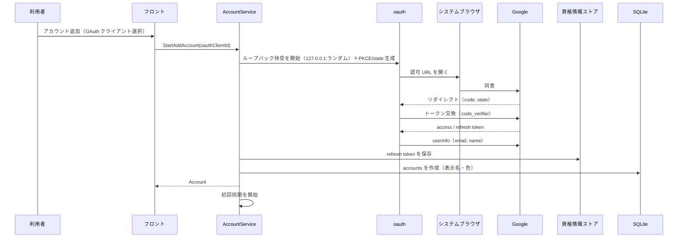
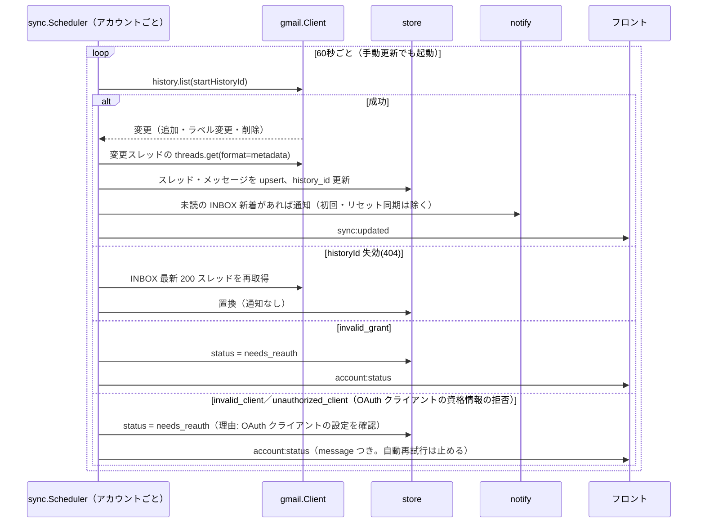
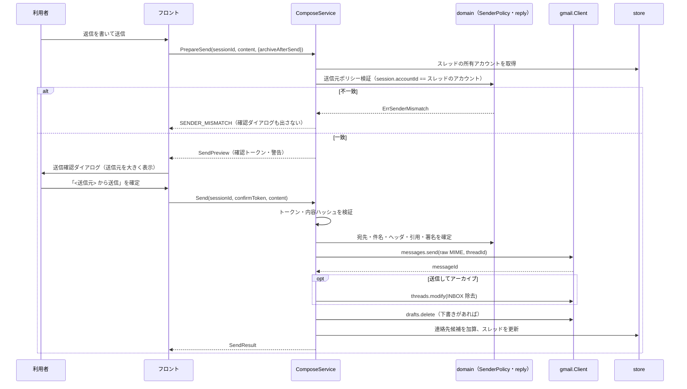
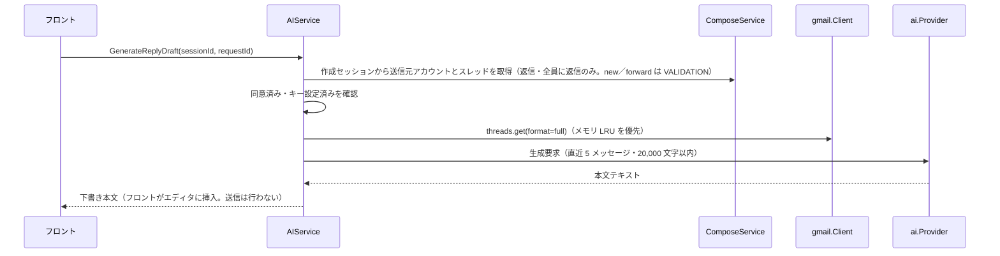

# アーキテクチャ設計

> 関連: [プロジェクト概要](../overview.md) / [機能要件](../requirements/functional.md) / [非機能要件](../requirements/non-functional.md) / [ER](er.md) / [バインディング仕様](../api/endpoints.md) / [コンポーネント設計](../components/overview.md)

## 1. 設計方針

- **サーバーレス**: 公開者のサーバーを持たない。すべての通信は利用者の PC から Google／AI プロバイダ／GitHub API へ直接行う
- **薄いフロント・厚い Go**: 認証・同期・MIME 生成・送信元の強制など、安全性に関わる処理はすべて Go 側に置く。フロントエンドは表示と入力に専念し、外部へ直接通信しない（CSP で禁止）
- **送信元の強制は Go 側が最終防衛線**: UI の制御を迂回しても、返信・転送の送信元は受信アカウント以外にならない
- **アカウント単位の隔離**: 同期・レート制限・エラー状態はアカウントごとに独立させる
- **機密はローカルに平文で残さない**: 秘密情報は OS 資格情報ストア、メール本文・添付はディスクに保存しない

## 2. 技術選定

| 領域 | 採用 | 理由 |
|------|------|------|
| デスクトップ基盤 | **Wails v3**（v3.1.0。版は `go.mod` で固定） | システムトレイ・ネイティブ通知（クリック応答つき）・単一インスタンス制御を標準 API で扱える（F-10）。Go バインディングの TypeScript 自動生成（`wails3 generate bindings`） |
| バックエンド言語 | Go | Gmail API 公式クライアント・単一バイナリ配布 |
| メール API | Gmail API（`google.golang.org/api/gmail/v1`） | `history` による差分同期、`threads`／`drafts`／`messages.send` を使う。IMAP は採用しない（OAuth スコープが粗く、スレッド・ラベル・下書きの対応が弱い） |
| OAuth | `golang.org/x/oauth2`＋Google エンドポイント（PKCE・ループバック） | NF-S03 |
| 資格情報ストア | `github.com/zalando/go-keyring`（Windows 資格情報マネージャー） | NF-S01 |
| ローカル DB | SQLite（`modernc.org/sqlite`、純 Go・CGO なし） | Windows でのビルドが容易（C コンパイラ不要） |
| クエリ生成・マイグレーション | **sqlc**（型安全なクエリ生成）＋ **goose**（SQL マイグレーションを `embed`） | |
| MIME 構築 | `github.com/jhillyerd/enmime`（Builder） | `multipart/alternative`・添付・`In-Reply-To`／`References` |
| レート制限 | `golang.org/x/time/rate` | アカウントごとのクォータ制御（NF 同期） |
| ログ | 標準 `log/slog`（JSON Lines）＋ `lumberjack` によるローテーション。書き込み前に秘密・メール内容を伏せる Handler を通す | NF-S10 |
| MCP | 公式 Go SDK `github.com/modelcontextprotocol/go-sdk`（Streamable HTTP）。既定オフ・Bearer トークン必須・送信ツールなし | NF-S13〜NF-S15、[docs/mcp.md](../mcp.md) |
| AI | 自前の薄い `Provider` インターフェース。Anthropic と OpenAI 互換の 2 実装 | NF §12 |
| フロントエンド | **Vue 3＋TypeScript**（Composition API／`<script setup>`）、Vite、Pinia | |
| リッチテキスト | Tiptap（ProseMirror）。太字・リンク・箇条書き | F-11 |
| 仮想スクロール | `@tanstack/vue-virtual` | NF-P04 |
| サニタイズ | DOMPurify＋`sandbox` iframe（`srcdoc`、`allow-same-origin` のみ・スクリプト不可） | NF-S04 |
| テスト | Go: 標準 `testing`／`testify`。フロント: **`bun test`**（DOM は happy-dom、コンポーネントは Vue Test Utils。`.vue` の読み込みは `frontend/bunfig.toml` の preload で行い、`bun test` で SFC を import できる。検証結果は [環境構築 §5.3](../environment/setup.md)） | NF §10 |
| CI／配布 | GitHub Actions（Windows ランナーでビルド）、GitHub Releases | NF-D01〜D04 |

> 補足: Wails v3 の API は公式ドキュメント（v3.wails.io）を一次情報とし、バージョンは `go.mod` で固定している。

## 3. システム構成

```mermaid
graph TD
  subgraph PC[利用者の Windows PC]
    subgraph FE[WebView2 内のフロントエンド Vue]
      V[画面・ストア Pinia]
    end
    subgraph BE[Go バックエンド（単一プロセス）]
      SV[サービス層<br/>Wails バインディング]
      DM[ドメイン層<br/>返信規則・MIME・送信元ポリシー]
      SY[同期スケジューラ]
      INF[インフラ層<br/>Gmail / OAuth / Store / Secrets / AI / Notify / Update]
    end
    DB[(SQLite<br/>メタデータ・スニペット)]
    KS[(Windows 資格情報<br/>マネージャー)]
    TR[システムトレイ・トースト通知]
  end
  V <-->|バインディング呼出し・イベント| SV
  SV --> DM
  SV --> INF
  SY --> INF
  SY --> DM
  INF --> DB
  INF --> KS
  INF --> TR
  INF <-->|HTTPS| GG[Google OAuth / Gmail API]
  INF <-->|HTTPS| AI[AI プロバイダ 利用者のキー]
  INF <-->|HTTPS| GH[GitHub Releases API]
```



## 4. レイヤー構造

| レイヤー | 責務 | 依存してよい先 |
|----------|------|----------------|
| **UI**（`frontend/`） | 表示・入力・フォーカス・ショートカット。ビジネス判断をしない | バインディング（生成された TS クライアント）のみ |
| **サービス層**（`internal/app`） | Wails に公開するバインディング。入力検証・DTO 変換・ドメインとインフラの調停 | ドメイン層、インフラ層（インターフェース越し） |
| **ドメイン層**（`internal/domain`） | 返信宛先の決定、送信元ポリシー、署名挿入、引用生成、MIME 組立の入力モデル。**I/O を持たない純粋なロジック** | なし（標準ライブラリのみ） |
| **同期層**（`internal/sync`） | アカウント別スケジューラ、`history` 差分の適用、リセット同期、新着検出 | ドメイン層、インフラ層 |
| **インフラ層**（`internal/gmail`／`oauth`／`store`／`secrets`／`ai`／`notify`／`update`／`platform`） | 外部との I/O。すべてインターフェースで抽象化し、テストではフェイクを注入する。`platform` は Wails の機能（ウィンドウ・トレイ・通知・ダイアログ・イベント発行）への接続層で、`notify` などのインターフェースの Wails 実装を持つ | 標準ライブラリ、外部ライブラリ |

横断のパッケージ: `internal/events`（Go からフロントへ発行するイベントの名前とペイロード）、`internal/clock`（時刻の注入）、`internal/logging`（ログ出力の組み立て。機密を出さない）。いずれもレイヤーには属さず、各層から使う。

### ディレクトリ構成（目安）

```
hitomado/
├─ main.go                 # エントリポイント（run() を呼び、失敗時は致命的エラーを表示して終了）
├─ run.go                  # composition root（Wails アプリ作成・単一インスタンス・依存の組み立て・サービス登録・トレイ生成）
├─ internal/
│  ├─ app/                 # バインディング（サービス層）
│  ├─ domain/              # 純粋ロジック（reply, quote, signature, senderpolicy, confirm, contacts, palette, textconv, model）
│  ├─ sync/                # 同期スケジューラ
│  ├─ gmail/               # Gmail クライアント（interface＋実装）
│  ├─ oauth/               # ループバック＋PKCE フロー
│  ├─ store/               # sqlc 生成コード・クエリ・goose マイグレーション
│  ├─ secrets/             # 資格情報ストア（interface＋keyring 実装）
│  ├─ ai/                  # Provider interface、anthropic、openai-compat
│  ├─ notify/              # 新着通知・トレイバッジの Notifier インターフェース（Wails 実装は platform）
│  ├─ platform/            # Wails 接続層（メインウィンドウ・トレイ・トースト通知・ファイル／ブラウザのダイアログ・イベント発行・終了処理）
│  ├─ events/              # フロントへ発行するイベントの名前とペイロード
│  ├─ clock/               # 時刻の注入（System／Fake）
│  ├─ logging/             # ログ出力（slog＋ローテーション。機密を出さない）
│  └─ update/              # GitHub Releases 確認
├─ frontend/               # Vue 3 + TS（src/components, src/stores, src/lib）
└─ docs/
```

## 5. 実行モデル

- **プロセス**: 単一プロセス。多重起動は Wails v3 の単一インスタンス機能で禁止し、2 つ目の起動は既存ウィンドウを前面に出す
- **ウィンドウ**: メインウィンドウ 1 つ。エディタはメインウィンドウ内のペイン（返信・転送はスレッド下部、新規作成は右ペイン全面）として表示する。独立ウィンドウは v0 では設けない
- **トレイ**: ウィンドウの × は非表示化（トレイへ格納）。トレイメニュー「開く」「終了」。「終了」でのみ同期スケジューラを停止してプロセスを終了する
- **同期**: アカウントごとに 1 ゴルーチン。`time.Ticker`（60 秒）＋手動更新シグナル。`context` でキャンセル可能。アカウント追加・削除に応じて起動・停止する
- **レート制限**: アカウントごとの `rate.Limiter`（クォータユニット単位）。429／5xx は指数バックオフ。ただし `messages.send`／`drafts.create` は二重実行を避けるため 5xx を再試行しない（429 は再試行する）
- **フロントへの通知**: Go から Wails のイベントを発行し、フロントはイベント受信時にバインディングを再呼び出しして再描画する（イベントに本文等の機密は載せない）

### 発行イベント

| イベント名 | ペイロード | 契機 |
|-----------|------------|------|
| `sync:updated` | `{ accountId, changedThreadIds[] }` | 差分同期でキャッシュが更新された |
| `account:status` | `{ accountId, status, message? }` | `active`／`syncing`／`needs_reauth`／`error` が変化した |
| `notify:open-thread` | `{ accountId, threadId }` | 通知クリック |
| `update:available` | `{ version, url }` | 新バージョン検出 |
| `app:before-quit` | なし | トレイの「終了」（フロントが下書きを保存して `AckBeforeQuit`） |
| `files-dropped` | `{ files }` | ファイルドロップ（添付） |

## 6. データの置き場所

| データ | 保存先 | 備考 |
|--------|--------|------|
| リフレッシュトークン・Client Secret・AI API キー | Windows 資格情報マネージャー | `hitomado/<種別>/<ID>` 形式のキー名 |
| アカウント・OAuth クライアント（Secret を除く）・署名・設定・同期状態・スレッド／メッセージのメタデータ・スニペット・連絡先候補 | SQLite（`%APPDATA%\Hitomado\hitomado.db`、WAL） | 本文・添付は保存しない（NF-S08） |
| メッセージ本文・添付データ | Go プロセスのメモリ（LRU・直近 50 スレッド） | NF-S09 |
| 下書き | **Gmail の下書き**（`users.drafts`） | ローカルに保存しない。例外: 送信元未選択の新規作成はメモリのみ |
| ログ | `%APPDATA%\Hitomado\logs\`（JSON Lines。5 MB×5 世代・30 日） | NF-S10 |
| MCP トークン | Windows 資格情報マネージャー（`hitomado/mcp_token`） | NF-S13 |

## 7. 通信フロー

### 7.1 アカウント追加（BYO OAuth）



### 7.2 差分同期と新着通知



### 7.3 返信送信（送信元強制・確認トークン）



契約の詳細（トークン仕様・エラーコード）は [バインディング仕様 §5.2](../api/endpoints.md#52-送信前確認と送信確認トークン) を参照。

`messages.send` がリクエストを送った後に応答を受け取れず失敗した場合は、`gmail.Client` が Gmail の送信済みを確認し（独自ヘッダ `X-Hitomado-Send-Id` と `in:sent` 検索）、見つかれば成功として扱う。見つからない・確認できないときは `SEND_UNCERTAIN` を返し、再送を促さずアーカイブ・下書き削除もしない（二重送信を避けるため）。接続前の失敗と送信前の期限切れは `OFFLINE`（再送可）、送信前のキャンセルは `CANCELLED`。詳細は同 §5.2 を参照。

### 7.4 AI 下書き



生成中の中止はフロントが `CancelGenerate(requestId)` を呼び、`GenerateReplyDraft` は `CANCELLED` で reject される。契約は [バインディング仕様 §6](../api/endpoints.md#6-aiservice)。

## 8. 主要な設計判断

| 判断 | 採用 | 理由・トレードオフ |
|------|------|--------------------|
| 本文キャッシュ | しない（メモリ LRU のみ） | ディスクに本文を残さずプライバシーを優先。開くたびに通信し、オフラインでは本文を読めない |
| 受信箱の「続きを読む」 | アカウントごとに `threads.list` の `pageToken` を保持して追加取得 | ローカルキャッシュ外の古いスレッドも辿れる。`nextPageToken` の永続化が必要（ER 参照） |
| 検索 | 結果を DB に保存せず DTO のみで返す（カーソルはアカウントごとの `pageToken` を埋め込んだ不透明文字列で、サーバー側に状態を持たない） | ローカル全文検索を持たない方針（F-09）。結果への操作は Gmail に反映し、ローカルに行があれば更新する |
| 下書き | Gmail 下書きのみ（ローカル保存なし） | 二重管理を避ける。編集中の異常終了は直近の自動保存分までとなる |
| 送信前確認 | `PrepareSend` が確認トークンを発行し、`Send` がトークンと内容ハッシュを検証する（Go 側でも強制） | 確認ダイアログを経ない送信、確認後に宛先・本文を変えた送信をバックエンドで拒否できる。API は 2 段階になる。**送信元の整合性（`SENDER_MISMATCH`）も同時に検証**し、`From` は `accounts.email` のみから生成する |
| 添付の受け渡し | ファイルパスをバインディングで渡し、Go が読む | 大きなデータをブリッジで往復しない。ドラッグ＆ドロップは Wails のファイルドロップイベントからパスを得る |
| インライン画像（`cid:`） | Go が取得して `data:` URL に埋め込んで表示用 HTML を返す。画像 1 枚 5 MiB 超は取得せず、1 メッセージの `data:` URL 合計 10 MiB（`appcore.MaxInlineDataBytes`）を超える参照は `cid:` のまま残し、表示されない（通知なし。[F-03](../requirements/functional.md)） | 既定の表示は `img-src data:` のみで足りる。リモート画像は既定でブロックし、「画像を表示」を押したメッセージだけ WebView が HTTPS で直接取得する（**外部通信の例外**。`srcdoc` の iframe は親の CSP を継承するため、ホストの CSP に `img-src https:` が必要。取得先はメール本文が指定したホストで、本アプリ側のサーバーへの通信ではない） |
| OAuth クライアント | 複数登録・アカウントごとに選択 | Workspace の「内部」アプリは他社アカウントで使えないため（F-01） |
| 作成セッション | `ComposeService` が返信・転送・新規のセッション（送信元・スレッド・元メッセージ・添付・下書き ID）をメモリに保持する。フロントは本文などの入力内容のみ都度渡す | 送信元の整合・転送の元添付引き継ぎ・`In-Reply-To`／`References` を Go 側で完結できる。セッションの管理と破棄（最終操作から 24 時間）が必要。契約は [バインディング仕様 §5・§9](../api/endpoints.md#5-composeservice) |

## 9. ビルド・CI

- ローカル: `wails3 dev`（開発）、`wails3 package VERSION=X.Y.Z`（NSIS インストーラー `bin/hitomado-vX.Y.Z-windows-amd64-setup.exe` を作る。`task package` も同じ）。`sqlc generate` と `wails3 generate bindings` の生成物はコミットする（差分が出ていないことを CI で検査する）
- GitHub Actions: lint（ubuntu）、test（ubuntu／windows のマトリクス。Go のテスト・vet、フロントは `bun test`）、build（`windows-latest` で `wails3 package` によりインストーラーを作り、インストール・上書き・アンインストールを検証する）。`main` への push（PR のマージ）ごとに CI を通したうえで patch を 1 つ上げたタグを自動で作り、インストーラーを Releases に添付する。詳細は [環境構築 §4](../environment/setup.md)
- マイグレーションは `internal/store/migrations/*.sql`（goose）を `embed` し、起動時に適用する。失敗時は起動中止（NF 可用性）

## 改訂履歴

| 版 | 日付 | 変更内容 | 変更理由 |
|----|------|---------|---------|
| 1.0 | 2026-11-02 | 新規作成 | 初版 |
| 1.1 | 2026-11-02 | §2 サニタイズ欄を NF-S04 の最終形に合わせた。§7.3 を `PrepareSend`→確認トークン→`Send` に書き換え。§8 の送信前確認を Go 側強制に変更、検索カーソルの記述を修正、作成セッションを追記 | バインディング仕様の確認トークン方式・作成セッション方式との整合 |
| 1.2 | 2026-11-02 | §2 のフロントのテストを Vitest から `bun test` に変更。§9 の CI 記述を ubuntu／windows 構成に更新 | 環境構築（bun 統一・CI マトリクス）との整合 |
| 1.3 | 2026-11-02 | 発行イベントに `app:before-quit`／`files-dropped` を追加 | バインディング仕様 1.1 との整合 |
| 1.4 | 2026-11-03 | §2 の Wails を v3.1.0 に、§9 のビルド・CI を `wails3 package`（インストーラー）に更新。§4 のレイヤー表・ディレクトリ構成に `run.go`（composition root）、`internal/platform`、`events`／`clock`／`logging` を追加し、`notify` の説明を実装に合わせた | #34、#35 |
| 1.5 | 2026-11-03 | §5 のレート制限に `messages.send`／`drafts.create` が 5xx を再試行しない例外を追記（履歴に未記録だった分） | 二重送信・重複作成を避ける実装との整合（#46。記録漏れの補正 #53） |
| 1.6 | 2026-11-03 | §2 のテスト行を `frontend/bunfig.toml` の preload による検証済みの記述に、補足を「バージョンは `go.mod` で固定している」に改めた | 環境構築 §5.3 の検証結果・`go.mod`（v3.1.0）との整合（#56） |
| 1.7 | 2026-11-03 | §4 のディレクトリ構成の `domain/` の説明を実際のパッケージ名に直した（`replyto` → `reply`、`confirm`・`contacts`・`palette`・`textconv`・`model` を追加） | 実装（`internal/domain/*`）との整合（#59） |
| 1.8 | 2026-11-03 | §7.3 に、応答を受け取れなかった送信の扱い（送信済みの確認→成功扱い／`SEND_UNCERTAIN`）への参照を追記 | バインディング仕様 §5.2 との整合（#55） |
| 1.9 | 2026-11-03 | §7.3 の `SEND_UNCERTAIN` の要約に、送信前の期限切れは `OFFLINE`・送信前のキャンセルは `CANCELLED` を追記 | バインディング仕様 §5.2 の振り分けとの整合（#66） |
| 1.10 | 2026-11-03 | §7.4 の AI 下書きのシーケンスを `GenerateReplyDraft(sessionId, requestId)` に直し、作成セッションから送信元とスレッドを引くこと・`CancelGenerate(requestId)` での中止を追記 | バインディング仕様 §6・実装（`internal/app/aicore`）との整合（#67） |
| 1.11 | 2026-11-03 | §7.2 の同期シーケンスに、`invalid_client`／`unauthorized_client` による `needs_reauth`（理由つき・自動再試行を止める）を追記 | 実装（`internal/sync/cycle.go`）・バインディング仕様 §10 との整合（#43、#69） |
| 1.12 | 2026-11-03 | 技術選定とデータ保存先に MCP・ログの形式・MCP トークンを追加 | #14 |
| 1.13 | 2026-11-03 | §8 のインライン画像に、1 枚 5 MiB・1 メッセージ合計 10 MiB の上限と超過時の動作を追記 | 実装（`internal/gmail/message.go`、`internal/app/appcore/html.go`）との整合（#6） |
