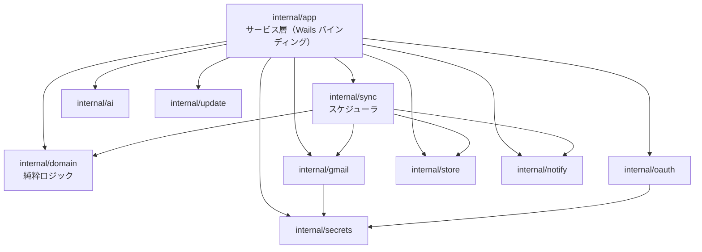
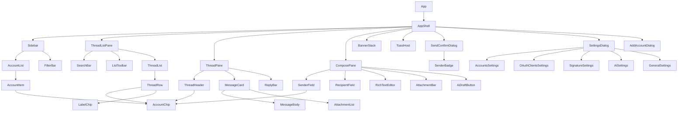

# コンポーネント設計

> 関連: [プロジェクト概要](../overview.md) / [機能要件](../requirements/functional.md) / [非機能要件](../requirements/non-functional.md) / [アーキテクチャ設計](../architecture/overview.md) / [バインディング仕様](../api/endpoints.md)

Go バックエンドとフロントエンド（Vue）それぞれのコンポーネント分割、責務、依存関係、インターフェースを定める。

## 1. 設計原則

- 依存方向は **UI → バインディング → サービス層 → ドメイン／インフラ** の一方向。ドメイン層は I/O を持たない
- 外部との I/O（Gmail・資格情報・DB・AI・通知・GitHub・時刻）は**インターフェース越し**に注入し、テストではフェイクに差し替える（NF §10）
- フロントエンドは**判断をしない**。送信元の決定・返信宛先の計算・MIME 生成・送信可否の検証は Go 側（[バインディング仕様 §5](../api/endpoints.md#5-composeservice)）
- UI の見た目は自前の Vue SFC と CSS 変数で構成する。**ダイアログ・メニュー等のフォーカス管理が必要な部品のみ、ヘッドレス UI（Reka UI）を使う**

## 2. バックエンド（Go）

### 2.1 依存関係



- `domain` は他の内部パッケージに依存しない。`app`／`sync` が `gmail`／`store` 等を**インターフェースとして**受け取る（具象は `main.go` で組み立てる）
- `gmail` はアカウントごとの `TokenSource`（`secrets` のリフレッシュトークンから生成）と `rate.Limiter` を持つ

### 2.2 domain（純粋ロジック）

| 部品 | 責務 | 主なシグネチャ（目安） |
|------|------|------------------------|
| `reply` | 返信宛先の決定（返信・全員に返信・転送）、件名の `Re:`／`Fwd:` 付与、自アドレス除外 | `Resolve(mode, source SourceMessage, self string) Recipients` |
| `quote` | 返信・転送の引用本文（HTML／テキスト）生成 | `Build(mode, source SourceMessage) (html, text string)` |
| `signature` | 署名ブロック（`<div data-hitomado-signature>`）の挿入、許可タグでのサニタイズ | `Insert(bodyHTML, sigHTML string) string`、`Sanitize(html string) string` |
| `senderpolicy` | 送信元の整合検証。`From` を `accounts.email` のみから決める | `Check(sessionAccountID, threadAccountID string) error` → `ErrSenderMismatch` |
| `confirm` | 確認トークン発行・検証（内容ハッシュ・TTL 5 分・1 回限り）。時計は注入 | `Issue(sessionID string, h Hash) Token`、`Verify(sessionID string, t Token, h Hash) error` |
| `contacts` | 候補の順位付け（`send_count*3 + receive_count`）、アドレス正規化・形式検証 | `Rank(...)`、`Normalize(email string) string` |
| `model` | `Address`、`SourceMessage`、`Recipients`、`OutgoingMessage` 等の型 | — |

### 2.3 インフラ層インターフェース

```go
// internal/gmail
type Client interface {
    ListHistory(ctx context.Context, accountID, startHistoryID string) (HistoryPage, error)
    ListThreads(ctx context.Context, accountID string, q ListQuery) (ThreadList, error)       // INBOX 追加取得・検索
    GetThreadMetadata(ctx context.Context, accountID, threadID string) (ThreadMeta, error)
    GetThreadFull(ctx context.Context, accountID, threadID string) (ThreadFull, error)
    ModifyThread(ctx context.Context, accountID, threadID string, add, remove []string) error
    TrashThread(ctx context.Context, accountID, threadID string) error
    GetAttachment(ctx context.Context, accountID, messageID, attachmentID string) ([]byte, error)
    Send(ctx context.Context, accountID string, raw []byte, threadID string) (SentMessage, error)
    CreateDraft(ctx context.Context, accountID string, raw []byte, threadID string) (draftID string, err error)
    UpdateDraft(ctx context.Context, accountID, draftID string, raw []byte) error
    GetDraft(ctx context.Context, accountID, draftID string) (DraftFull, error)
    DeleteDraft(ctx context.Context, accountID, draftID string) error
    FindDraftForThread(ctx context.Context, accountID, threadID string) (draftID string, ok bool, err error)
    ListLabels(ctx context.Context, accountID string) ([]Label, error)
    Profile(ctx context.Context, accountID string) (Profile, error) // Profile{Email, HistoryID}
}

// internal/oauth
type Flow interface {
    Authorize(ctx context.Context, client ClientConfig) (Result, error) // ブラウザ起動・ループバック待受・PKCE・userinfo
}

// internal/secrets
type Store interface {
    Get(key string) (string, error)
    Set(key, value string) error
    Delete(key string) error
}

// internal/ai
type Provider interface {
    GenerateReply(ctx context.Context, in ReplyInput) (text string, err error)
}

// internal/notify
type Notifier interface {
    NewMail(ctx context.Context, n NewMailNotice) error  // トースト（クリックで notify:open-thread）
    SetUnread(hasUnread bool)                            // トレイアイコンのバッジ
}

// internal/update
type Checker interface {
    Latest(ctx context.Context) (Release, error)
}
```

- **MIME 構築**は `internal/gmail/mime.go`（`enmime` Builder）。入力は `domain/model.OutgoingMessage`（`From` は `accounts.email` から生成済み）
- **`store`** は sqlc 生成の `Queries` を包む `Store` インターフェース。トランザクション境界（1 スレッド反映＝1 トランザクション）を提供する
- 時刻は `Clock` インターフェース（`Now() time.Time`）で注入し、トークン期限・保持期間・バックオフをテスト可能にする

### 2.4 サービス層（`internal/app`）と主な協調

| サービス | 主な依存 | 協調の要点 |
|----------|----------|------------|
| `AccountService` | `oauth.Flow`、`secrets.Store`、`store`、`sync.Scheduler` | 追加成功で `Scheduler.Start(accountID)`、削除で `Stop`＋DB カスケード＋資格情報削除 |
| `InboxService` | `store`、`gmail.Client`、`sync.Scheduler` | ローカル優先で返し、末尾で `inbox_page_token` による追加取得。操作後に `threads` を再計算 |
| `ThreadService` | `gmail.Client`、メモリ LRU | 本文は保存せず LRU のみ。`cid` 画像を `data:` に変換 |
| `ComposeService` | `domain`（reply／quote／signature／senderpolicy／confirm）、`gmail.Client`、`store` | 作成セッションのマップ（排他制御つき）。`PrepareSend`→`Send` の確認トークン検証 |
| `AIService` | `ai.Provider`、`secrets.Store`、`gmail.Client`、`ComposeService`（セッション参照） | 同意・キー確認後、直近 5 メッセージ・20,000 文字以内で生成 |
| `AppService` | `store`、`update.Checker` | 設定の読み書き、更新確認 |

### 2.5 同期スケジューラ（`internal/sync`）

| 部品 | 責務 |
|------|------|
| `Scheduler` | アカウントごとの `worker` を起動・停止。`Start(accountID)`／`Stop(accountID)`／`Trigger(accountIDs)`（手動更新）／`Shutdown()` |
| `worker` | 60 秒 `Ticker`＋`Trigger` で `syncOnce`。1 周期の状態遷移: `idle → syncing → idle`／`needs_reauth`／`error` |
| `applier` | `history` の変更を `messages`／`message_labels`／`threads` に反映し、`threads` の集計値を再計算。1 スレッド 1 トランザクション |
| `detector` | 新着検出（`messagesAdded` かつ `INBOX`＋`UNREAD`）。`initial_sync_done = 0` とリセット同期では通知しない |
| `retention` | 日次で `in_inbox = 0 AND left_inbox_at < now - 90 日` のスレッドを削除 |

### 2.6 エラー変換

`internal/app` に `apperr` を置き、インフラのエラーを [バインディング仕様 §1.2](../api/endpoints.md#12-エラー) の `AppError` に写像する。`invalid_grant`→`NEEDS_REAUTH`（アカウント状態の更新を伴う）、`net.Error`→`OFFLINE`、HTTP 429→`RATE_LIMITED`、その他の Gmail エラー→`GMAIL_ERROR`。機密（トークン・本文）はメッセージに含めない。

## 3. フロントエンド（Vue 3＋TypeScript）

### 3.1 ディレクトリ構成（目安）

```
frontend/src/
├─ components/
│  ├─ ui/            # 基本部品（Base*）
│  ├─ account/       # アカウント関連
│  ├─ inbox/         # 受信箱リスト
│  ├─ thread/        # スレッド表示
│  ├─ compose/       # エディタ・送信確認
│  ├─ settings/      # 設定
│  └─ shell/         # AppShell・バナー・トースト
├─ stores/           # Pinia
├─ lib/              # bindings ラッパー・sanitize・signature・shortcuts・format
├─ composables/      # useShortcuts・useAutosave・useWailsEvents など
├─ styles/           # トークン（CSS 変数）・リセット
└─ App.vue
```

### 3.2 コンポーネントツリー



### 3.3 基本部品（`components/ui`）

| コンポーネント | 責務 | 備考 |
|----------------|------|------|
| `BaseButton`／`BaseIconButton` | ボタン。`variant`: primary／secondary／danger／ghost。`loading` 状態 | アイコンのみは `aria-label` 必須 |
| `BaseDialog` | モーダル。フォーカストラップ・Esc・スクロールロック | Reka UI `Dialog` |
| `BaseMenu` | ドロップダウンメニュー（返信メニュー・ラベル付け替え等） | Reka UI `DropdownMenu` |
| `BaseSelect` | 選択（AI プロバイダ等） | Reka UI `Select` |
| `BaseSwitch` | オン／オフ（通知・更新確認） | Reka UI `Switch` |
| `BaseTooltip` | ツールチップ（ショートカット表示） | Reka UI `Tooltip` |
| `BaseChip` | 小さなラベル | 色トークンを受け取る |
| `Spinner` | 読み込み表示 | `prefers-reduced-motion` 対応 |

### 3.4 アカウント・共通（`components/account`、`components/shell`）

| コンポーネント | 責務 | Props／Emits | バインディング／ストア |
|----------------|------|--------------|------------------------|
| `AccountChip` | アカウントの色の帯＋名前（＋アドレス）。**色だけに依存せず名前を併記**（NF §11） | props: `account`, `showEmail?`, `size` | — |
| `SenderBadge` | 送信元の大表示（アカウント色の帯・名前・アドレス）。確認ダイアログとエディタで共用 | props: `from`, `color` | — |
| `AccountList`／`AccountItem` | アカウント一覧、選択（単一／複数／すべて）、未読件数、`needs_reauth` の警告アイコン | emits: `select(ids)`、`reconnect(id)` | `accountsStore`、`inboxStore.unreadCounts` |
| `FilterBar` | 未読のみ切替、フィルタのクリア | emits: `change` | `inboxStore.filter`（`AppService.SetInboxFilter`） |
| `AppShell` | 3 ペインのレイアウト。最小幅 960px。ペイン幅のリサイズ | — | `uiStore` |
| `BannerStack` | オフライン、要再接続、更新あり、同期エラーのバナー（優先度順に最大 2 件） | — | `uiStore`、`accountsStore` |
| `ToastHost` | 通知トースト（`uiStore.toasts`。成功・エラー・情報。エラーは `retry` 指定時に再試行ボタンを出し、自動では消えない） | — | `uiStore.pushToast`／`dismissToast` |
| `AddAccountDialog` | OAuth クライアント選択（未登録なら登録へ誘導）→ ブラウザ認可待ち表示（キャンセル可）→ 表示名・色設定 | emits: `done(account)` | `AccountService.StartAddAccount／CancelAddAccount` |

### 3.5 受信箱（`components/inbox`）

| コンポーネント | 責務 | Props／Emits | バインディング／ストア |
|----------------|------|--------------|------------------------|
| `SearchBar` | 検索入力（Gmail クエリ）。Enter で実行、Esc でクリア。検索中はモード表示 | emits: `search(q)`、`clear` | `inboxStore.runSearch` |
| `ListToolbar` | 更新ボタン（手動更新）、選択中スレッドへの操作（既読／未読・アーカイブ・ゴミ箱・ラベル）、検索モード表示 | emits: `refresh`、`archive`、`trash`、`toggleRead`、`label` | `inboxStore` |
| `ThreadList` | 仮想スクロール（`@tanstack/vue-virtual`）。末尾到達で `loadMore`。行選択・キーボード移動 | props: `items`, `selectedKey`, `loading`, `hasMore` | `inboxStore` |
| `ThreadRow` | 1 行表示（色の帯、アカウントチップ、差出人、件名、スニペット、日時、未読、添付アイコン、ユーザーラベル）。`needs_reauth` アカウントの行は淡色 | props: `thread`, `selected`, `account` | — |
| `LabelChip` | ユーザー作成ラベルのチップ（Gmail の色） | props: `label` | — |

### 3.6 スレッド表示（`components/thread`）

| コンポーネント | 責務 | Props／Emits | バインディング／ストア |
|----------------|------|--------------|------------------------|
| `ThreadPane` | 選択スレッドの詳細表示。表示後に未読なら `MarkRead`。未選択時は空状態 | — | `threadStore`（`ThreadService.GetThread`、`InboxService.MarkRead`） |
| `ThreadHeader` | 件名、**受信アカウント（色・名前・アドレス）を常時表示**、操作ボタン（アーカイブ・ゴミ箱・ラベル・未読にする） | | `threadStore`、`inboxStore` |
| `MessageCard` | 1 メッセージ。最新と未読は展開、他は折りたたみ。ヘッダ（差出人・宛先・Cc・日時） | props: `message`, `expanded` | — |
| `MessageBody` | 本文表示。§3.8 の方針でサニタイズ・iframe 表示・リモート画像ブロック・リンク捕捉 | props: `html?`, `text?`, `hasRemoteImages` | `lib/sanitize` |
| `AttachmentList` | 添付の名前・サイズ・保存ボタン | emits: `save(attachment)` | `ThreadService.SaveAttachment` |
| `ReplyBar` | 既定「全員に返信」の分割ボタン（メニュー: 返信／転送）。「AI で下書き」は返信エディタ内（`ComposePane`）。下書きがあれば「下書きを開く」 | emits: `open(mode)` | `composeStore.open` |

### 3.7 エディタ・送信確認（`components/compose`）

| コンポーネント | 責務 | Props／Emits | バインディング／ストア |
|----------------|------|--------------|------------------------|
| `ComposePane` | 返信・転送・新規のエディタ全体。メインウィンドウ内のペイン。破棄・閉じる（閉じる時は自動保存してから閉じる）、「送信」「送信してアーカイブ」（返信・転送のみ） | | `composeStore` |
| `SenderField` | 送信元表示。`senderLocked` なら**表示のみ**（変更 UI なし）。`new` は選択式（未選択状態あり）。未選択時は送信ボタンを無効化 | props: `from`, `locked`, `accounts` | `ComposeService.SetComposeSender` |
| `RecipientField` | To／Cc／Bcc の入力（Cc／Bcc は開閉式）。チップ化、貼り付けの複数アドレス分割、オートコンプリート | props: `modelValue`, `accountId` | `ComposeService.SuggestContacts`（デバウンス 150ms） |
| `RichTextEditor` | Tiptap。太字・リンク・箇条書き。署名ブロックを `data-hitomado-signature` として保持。貼り付けは書式をクリーニング | props/emits: `v-model:html` | — |
| `AttachmentBar` | 添付の一覧・削除・追加ボタン・ドラッグ＆ドロップ。合計サイズ表示と上限エラー | | `ComposeService.AddAttachments／RemoveAttachment` |
| `AiDraftButton` | 「AI で下書き」。キー未設定→設定へ誘導、未同意→同意ダイアログ、生成中→キャンセル可、本文入力済み→置換確認 | emits: `generated(bodyHtml)` | `AIService.GenerateReplyDraft／CancelGenerate／RecordAIConsent` |
| `SendConfirmDialog` | `PrepareSend` の結果を表示。**送信元を最大文字で表示（`SenderBadge`）**、宛先・件名・添付数・本文冒頭、`warnings`（他の自アカウント宛・件名なし・本文なし）。確定ボタン「<アドレス> から送信」。ダイアログ表示中はエディタ操作不可 | props: `preview`, `busy` | `composeStore.confirmSend`（`ComposeService.Send`） |

#### 署名の挿入・差し替え（`lib/signature`）

- `OpenCompose` が返す初期 `bodyHtml` には署名ブロック `<div data-hitomado-signature data-account-id="…">` が含まれる
- 新規作成で送信元を切り替えたとき: ブロックの内容が**直前に挿入した署名と一致**していれば切替先の署名に差し替え、**編集済みなら差し替え前に確認する**（F-07）
- 署名の正規化比較は DOMPurify 後の HTML 文字列で行う

#### 自動保存（`composables/useAutosave`）

- 編集停止後 3 秒でデバウンスして `SaveDraft`（添付の追加・削除も編集として扱い、下書きには添付も保存される。内容・添付が変わっていなければ保存しない）。送信元未選択・保存中は呼ばない。連続編集中に完了した古い保存結果で新しい内容を上書きしない（世代番号で最新のみ採用）
- 閉じる／アプリ終了時は未保存があれば直ちにフラッシュして完了を待つ

### 3.8 本文の表示方針（`MessageBody`・`lib/sanitize`）

1. Go から受け取った `bodyHtml` を **DOMPurify** でサニタイズする（スクリプト・フォーム・`iframe`・`object`・`embed`・外部 CSS・`<base>`・`on*` 属性を除去。インラインスタイルは許可するが `url()` を含む宣言は除去する）
2. **リモート画像をブロック**: 既定で `img[src]`（`data:` 以外）、`srcset`、`background` 属性、CSS の `url()` を取り除き、`hasRemoteImages` が真のときだけ「画像を表示」ボタンを出す。押すとそのメッセージのみ画像参照を復元して再描画する
3. サニタイズ済み HTML を **`sandbox` 付き iframe の `srcdoc`** で表示する。`srcdoc` 先頭に `<meta http-equiv="Content-Security-Policy" content="default-src 'none'; img-src data: …; style-src 'unsafe-inline'">` を入れる（画像表示を許可した場合のみ `img-src` に `https:` を追加）
4. iframe の `sandbox` は **`allow-same-origin` のみ**（`allow-scripts`・`allow-forms`・`allow-popups` なし）とする。スクリプトは実行されないため、ホスト側（親ウィンドウ）が iframe の `contentDocument` に対して (a) 内容の高さを計測して自動でリサイズし、(b) リンクのクリックを捕捉して `ThreadService.OpenExternal` に渡す。リンクは `http`／`https`／`mailto` のみ有効
5. HTML がなければ `bodyText` を `<pre>` 相当で表示（URL は自動リンク化しない）

> **実装時に最初に検証する項目**: `allow-same-origin` を付けた iframe でホストが DOM に触れる設計は、`allow-scripts` が無い限り安全であることを前提にしている。Wails v3／WebView2 の実機で、(a) 高さ計測とリンククリックの捕捉が動くこと、(b) サニタイズ漏れがあってもスクリプト実行を `sandbox` と CSP で止められることを、本文表示の実装に着手する前に確認する（NF-S04 と整合）。
>
> **代替案**（(a) が動かない場合）: ① iframe を固定高にして内部スクロールにする（高さ計測を不要にする）。② リンク捕捉は、新規ウィンドウ要求・ナビゲーションの開始フックで `http`／`https`／`mailto` 以外を拒否し、許可スキームのみ `OpenExternal` へ渡す。

### 3.9 設定（`components/settings`）

| コンポーネント | 責務 | バインディング |
|----------------|------|----------------|
| `SettingsDialog` | タブ（アカウント／OAuth クライアント／署名／AI／一般） | — |
| `AccountsSettings` | アカウント一覧、表示名・色・通知オン／オフ、並べ替え、再接続、削除（確認つき） | `AccountService.UpdateAccount／ReorderAccounts／Reconnect／RemoveAccount` |
| `OAuthClientsSettings` | クライアントの追加・編集・削除（使用中は削除不可を表示）、README（OAuth クライアント作成手順）へのリンク | `AccountService.*OAuthClient` |
| `SignatureSettings` | アカウント選択＋リッチテキスト署名編集（`RichTextEditor` 共用） | `AccountService.SetSignature` |
| `AISettings` | プロバイダ・モデル・Base URL（`https://`、または `localhost`／`127.0.0.1`／`::1` の `http://` のみ。それ以外は `VALIDATION` を表示）・API キー（入力後は伏字、削除可）、同意状況（送信先が変わると再同意）、送信先の表示 | `AIService.*` |
| `GeneralSettings` | 更新確認オン／オフ、バージョン表示、データ保存先の表示 | `AppService.*` |

### 3.10 ストア（Pinia）

| ストア | 状態 | 主なアクション | イベント購読 |
|--------|------|----------------|--------------|
| `accountsStore` | `accounts`、`oauthClients`、`statuses`（一時状態を含む） | `load`、`add`、`remove`、`update`、`setSignature`、`reorder` | `account:status` |
| `inboxStore` | `filter`、`mode`（`inbox`／`search`）、`items`、`nextCursor`、`unreadCounts`、`selection`、`loading`、`failures` | `load`、`loadMore`、`refresh`、`runSearch`、`clearSearch`、`archive`／`trash`／`markRead`（**楽観的更新、失敗時は元に戻してエラートースト**）、`setFilter` | `sync:updated`（先頭ページと未読件数を再取得し、スクロール位置・選択を維持） |
| `threadStore` | `current`（`ThreadDetail`）、`loading`、`error` | `open(ref)`、`close`、`reload` | `sync:updated`（開いているスレッドが `changedThreadIds` に含まれたら `reload`） |
| `composeStore` | `session`、`content`、`attachments`、`preview`、`dirty`、`saving`、`sending` | `open`、`setSender`、`save`、`prepareSend`、`confirmSend`、`close`、`discard` | — |
| `settingsStore` | `aiConfig`、`appInfo`、`update` | `load`、`setAIConfig`、`checkUpdate` | `update:available` |
| `uiStore` | `theme`、`banners`、`toasts`、`dialogs`、`online` | `pushToast`、`openSettings` 等 | `notify:open-thread`（スレッドを開いてウィンドウを前面へ） |

- ストアは**生成されたバインディングを `lib/api` のラッパー経由**で呼び、`AppError`（`parseBindingError`）に統一して扱う
- `NEEDS_REAUTH` を受け取ったら `accountsStore.statuses` を更新し、`BannerStack` に「要再接続」を出す（他アカウントは通常動作）
- `OFFLINE` を受け取ったら `uiStore.online = false`。次の成功呼び出し、または `sync:updated` で復帰する

### 3.11 lib・composables

| 部品 | 責務 |
|------|------|
| `lib/api` | 生成バインディングのラッパー。`parseBindingError`、リトライ可否（`retryable`）の判定 |
| `lib/sanitize` | §3.8 のサニタイズ設定・リモート画像ブロック・リンク捕捉用のユーティリティ |
| `lib/signature` | 署名ブロックの挿入・検出・差し替え |
| `lib/format` | 日時（今日は時刻、今年は月日、それ以外は年月日）・サイズの整形（日本語） |
| `lib/palette` | アカウント色パレット（キー→ライト／ダークの色値）。Go 側と共有する定数 |
| `lib/errorEffects` | API エラーが共通状態に及ぼす影響（オフライン表示・要再接続）の判定。ストア間の循環参照を避けるため純関数 |
| `lib/banners` | バナーの選択（優先度順に最大 2 件。§3.4 `BannerStack`） |
| `lib/composeModel` | `composeStore` が使う型と、バインディング値の正規化（`null` → 空配列） |
| `lib/dropFiles` | Wails のファイルドロップ。Go 側が発行する `files-dropped` のペイロードからパス一覧を取り出す。`AttachmentBar` が受けて `ComposeService.AddAttachments` を呼ぶ（F-14） |
| `lib/messages/` | UI 文言の集約（領域ごとに `common`／`compose`／`settings`／`thread`。`index.ts` が再エクスポート） |
| `composables/useShortcuts` | §4 のキーボードショートカット登録・コンテキスト判定 |
| `composables/useWailsEvents` | `sync:updated` などのイベント購読と解除 |
| `composables/useAutosave` | §3.7 の自動保存 |
| `composables/useQuitFlush` | `app:before-quit`（トレイの「終了」）で未保存の下書きを保存（`SaveDraft`）してから `AppService.AckBeforeQuit` を呼ぶ。保存に失敗しても必ず Ack する（F-12） |
| `composables/useAiDraft` | 「AI で下書き」の状態遷移（未設定→設定へ誘導、未同意→同意、本文入力済み→置換確認、生成中→キャンセル可。F-08） |
| `composables/useContactSuggest` | 宛先オートコンプリート。入力が止まって 150ms で `SuggestContacts` を呼ぶ（F-13） |
| `composables/useComposeLifecycle` | 作成セッションの保存・終了（`composeStore` の一部） |

## 4. キーボードショートカット

Gmail 互換の単独キー。**入力要素（`input`／`textarea`／`contenteditable`／エディタ）にフォーカスがある間、およびダイアログ表示中は無効**にする。

| キー | 動作 | 対象 |
|------|------|------|
| `j`／`k` | 次／前のスレッドへ移動 | スレッドリスト |
| `Enter`／`o` | 選択スレッドを開く | スレッドリスト |
| `Esc` | スレッドを閉じる／検索をクリア／エディタ以外のポップアップを閉じる | 全体 |
| `e` | アーカイブ | リスト／スレッド |
| `#` | ゴミ箱へ移動 | リスト／スレッド |
| `Shift+i`／`Shift+u` | 既読／未読にする | リスト／スレッド |
| `r` | 返信 | スレッド |
| `a` | 全員に返信 | スレッド |
| `f` | 転送 | スレッド |
| `c` | 新規作成 | 全体 |
| `/` | 検索窓にフォーカス | 全体 |
| `g` → `i` | 受信箱（検索解除）へ | 全体 |
| `Ctrl+Enter` | エディタ内で送信（確認ダイアログを開く。確認なしの送信はできない） | エディタ |

- 操作系キー（`e`、`#`）を押したとき、対象が複数選択なら選択全体に作用する
- 破壊的操作は `#`（ゴミ箱）のみ。完全削除はない。ゴミ箱は Gmail 側で 30 日復元できる

## 5. テーマ・アクセシビリティ

- **テーマ**: ライトとダーク。`prefers-color-scheme` に追従する。配色は `styles/tokens.css` の CSS 変数（`--color-bg`、`--color-text`、`--color-border`、`--color-accent`、`--account-<key>` 等）で定義し、コンポーネントに色値を直書きしない
- **アカウント色パレット**: 10 色を用意し、ライト／ダークの各背景に対して文字・帯のコントラスト比 4.5:1 を満たす値のみ採用する（NF §11）。**色だけで識別させない**（名前チップを常に併記）
- **フォーカス**: すべての操作要素で可視フォーカスを表示する。ダイアログはフォーカストラップ（Reka UI）。スレッドリストは矢印キーでも移動できる（`role="listbox"`、`aria-activedescendant`）
- **動き**: `prefers-reduced-motion` ではアニメーションを無効にする
- **文字**: UI は日本語。文言は `lib/messages/` に集約する（将来の多言語化を妨げない。NF §7）
- **ダイアログの代替文**: アイコンのみのボタンには `aria-label` を付ける

## 6. 要件との対応

| 要件 | フロントのコンポーネント | バックエンドのコンポーネント |
|------|--------------------------|------------------------------|
| F-01 アカウント接続 | `AddAccountDialog`、`AccountsSettings`、`OAuthClientsSettings`、`BannerStack` | `AccountService`、`oauth.Flow`、`secrets.Store` |
| F-02 統合受信箱 | `Sidebar`、`FilterBar`、`ThreadList`、`ThreadRow`、`inboxStore` | `InboxService`、`sync.*`、`store` |
| F-03 スレッド閲覧 | `ThreadPane`、`MessageCard`、`MessageBody`、`AttachmentList` | `ThreadService`、`gmail.Client` |
| F-04／F-04b 基本操作・ラベル | `ListToolbar`、`ThreadHeader`、`inboxStore` | `InboxService`、`gmail.Client` |
| F-05 返信・転送 | `ReplyBar`、`ComposePane`、`SenderField` | `ComposeService`、`domain/reply`、`domain/quote`、`domain/senderpolicy` |
| F-06 送信前確認 | `SendConfirmDialog`、`SenderBadge` | `ComposeService`（`PrepareSend`／`Send`）、`domain/confirm` |
| F-07 署名 | `SignatureSettings`、`lib/signature` | `AccountService.SetSignature`、`domain/signature` |
| F-08 AI 下書き | `AiDraftButton`、`AISettings` | `AIService`、`ai.Provider` |
| F-09 検索 | `SearchBar`、`inboxStore.runSearch` | `InboxService.Search` |
| F-10 通知・トレイ | `uiStore`（`notify:open-thread`）、`AccountsSettings`（通知切替） | `sync.detector`、`notify.Notifier`、`main.go`（トレイ・単一インスタンス） |
| F-11 新規作成 | `ComposePane`、`SenderField`、`RecipientField`、`RichTextEditor` | `ComposeService` |
| F-12 下書き保存 | `useAutosave`、`composeStore` | `ComposeService.SaveDraft`、`gmail.Client`（drafts） |
| F-13 オートコンプリート | `RecipientField` | `ComposeService.SuggestContacts`、`domain/contacts`、`store` |
| F-14 添付送信 | `AttachmentBar` | `ComposeService.AddAttachments`、`gmail/mime.go` |

## 改訂履歴

| 版 | 日付 | 変更内容 | 変更理由 |
|----|------|---------|---------|
| 1.0 | 2026-11-02 | 新規作成 | 初版 |
| 1.1 | 2026-11-02 | §3.8 の「実装時の確認事項」を「最初に検証する項目」に改め、代替案（固定高＋内部スクロール、ナビゲーションフック）を追記 | WebView2 上での動作が未検証のため |
| 1.2 | 2026-11-03 | §3.3 から `BaseToast` を外して `ToastHost` を §3.4 に追加し、文言の集約先を `lib/messages/` に修正、§3.11 に `useQuitFlush`・`dropFiles` ほかを追記 | 実装のファイル構成・責務との乖離（#36） |
