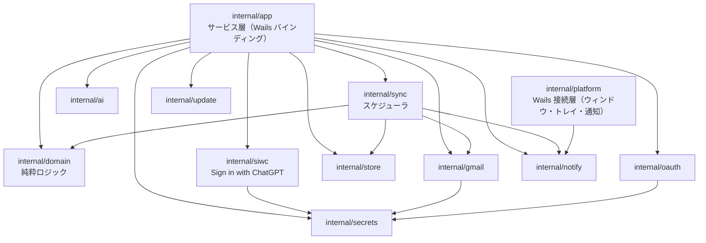
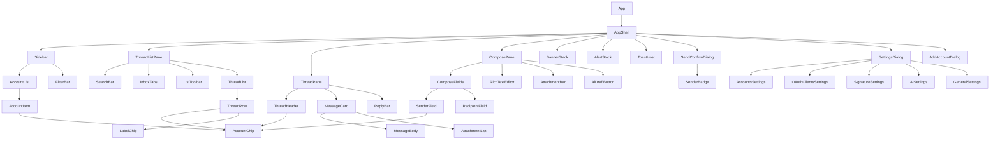

# コンポーネント設計

> 関連: [プロジェクト概要](../overview.md) / [機能要件](../requirements/functional.md) / [非機能要件](../requirements/non-functional.md) / [アーキテクチャ設計](../architecture/overview.md) / [バインディング仕様](../api/endpoints.md)

Go バックエンドとフロントエンド（Vue）それぞれのコンポーネント分割、責務、依存関係、インターフェースを定める。

## 1. 設計原則

- 依存方向は **UI → バインディング → サービス層 → ドメイン／インフラ** の一方向。ドメイン層は I/O を持たない
- 外部との I/O（Gmail・資格情報・DB・AI・通知・GitHub・時刻）は**インターフェース越し**に注入し、テストではフェイクに差し替える（NF §10）
- フロントエンドは**判断をしない**。送信元の決定・返信宛先の計算・MIME 生成・送信可否の検証は Go 側（[バインディング仕様 §5](../api/endpoints.md#5-composeservice)）。例外は、新規作成の送信元の**初期値の選択**のみ（受信箱のアカウントフィルタが単一選択ならそのアカウントを `OpenComposeRequest.accountId` に入れる。F-11）で、指定された `accountId` の検証は Go 側が行う
- UI の見た目は自前の Vue SFC と CSS 変数で構成する。**ダイアログ・メニュー等のフォーカス管理が必要な部品のみ、ヘッドレス UI（Reka UI）を使う**

## 2. バックエンド（Go）

### 2.1 依存関係



- `domain` は他の内部パッケージに依存しない。`app`／`sync` が `gmail`／`store` 等を**インターフェースとして**受け取る（具象は `run.go`（composition root）で組み立てる）
- `platform` は Wails のウィンドウ・トレイ・トースト通知・ダイアログ・イベント発行を包み、`notify.Notifier` などの Wails 実装を持つ。`run.go` だけが生成し、`app`／`sync` にはインターフェース越しに渡す（`app`／`sync` は `platform` に依存しない）
- `gmail` はアカウントごとの `TokenSource`（`secrets` のリフレッシュトークンから生成）と `rate.Limiter` を持つ

### 2.2 domain（純粋ロジック）

| 部品 | 責務 | 主なシグネチャ（目安） |
|------|------|------------------------|
| `reply` | 返信宛先の決定（返信・全員に返信・転送）、件名の `Re:`／`Fwd:` 付与、自アドレス除外 | `Resolve(mode, source SourceMessage, self string) Recipients` |
| `quote` | 返信・転送の引用本文（HTML／テキスト）生成 | `Build(mode, source SourceMessage) (html, text string)` |
| `signature` | 署名ブロック（`<div data-hitomado-signature data-account-id>`）の生成・挿入（`data-account-id` に署名の持ち主のアカウント ID を持たせ、同じアカウントの署名が既にあれば挿入しない）、許可タグでのサニタイズ | `Block(accountID, sigHTML string) string`、`Insert(bodyHTML, accountID, sigHTML string) string`、`Sanitize(html string) string` |
| `senderpolicy` | 送信元の整合検証。`From` を `accounts.email` のみから決める | `Check(sessionAccountID, threadAccountID string) error` → `ErrSenderMismatch` |
| `confirm` | 確認トークン発行・検証（内容ハッシュ・TTL 5 分・1 回限り）。時計は注入 | `NewManager(c Clock, ttl time.Duration) *Manager`、`HashContent(in ContentInput) Hash`、`(*Manager).Issue(sessionID string, h Hash) (Token, time.Time)`（失効時刻は `SendPreview.expiresAt` 用）、`Verify(sessionID string, t Token, h Hash) error`、`Invalidate(sessionID string)` |
| `contacts` | アドレス正規化・形式検証（候補の順位付けは `store` の SQL） | `Normalize(email string) string`、`IsValid(email string) bool` |
| `palette` | アカウント色のパレットキー（フロントの `lib/palette` と同じキー・順序を保つ）。色の検証と未使用色の割り当て | `Keys() []string`、`IsValid(key string) bool`、`NextUnused(used []string) string` |
| `textconv` | HTML のプレーンテキスト化と先頭の切り詰め（MIME の text 部・送信確認の本文プレビュー・AI へ渡すテキスト・空本文の判定） | `HTMLToText(src string) string`、`Preview(src string, maxRunes int) string` |
| `model` | `Address`、`SourceMessage`、`Recipients`、`OutgoingMessage` 等の型 | — |

### 2.3 インフラ層インターフェース

```go
// internal/gmail
type Client interface {
    ListHistory(ctx context.Context, accountID, startHistoryID string) (HistoryPage, error)
    ListThreads(ctx context.Context, accountID string, q ListQuery) (ThreadList, error)       // INBOX 追加取得・検索
    GetThreadMetadata(ctx context.Context, accountID, threadID string) (ThreadMeta, error)
    GetThreadFull(ctx context.Context, accountID, threadID string) (ThreadFull, error)
    ModifyThread(ctx context.Context, accountID, threadID string, add, remove []string) error
    TrashThread(ctx context.Context, accountID, threadID string) error
    GetAttachment(ctx context.Context, accountID, messageID, attachmentID string) ([]byte, error)
    Send(ctx context.Context, accountID string, raw []byte, threadID string) (SentMessage, error)
    CreateDraft(ctx context.Context, accountID string, raw []byte, threadID string) (draftID string, err error)
    UpdateDraft(ctx context.Context, accountID, draftID string, raw []byte) error
    GetDraft(ctx context.Context, accountID, draftID string) (DraftFull, error)
    DeleteDraft(ctx context.Context, accountID, draftID string) error
    FindDraftForThread(ctx context.Context, accountID, threadID string) (draftID string, ok bool, err error)
    ListLabels(ctx context.Context, accountID string) ([]Label, error)
    Profile(ctx context.Context, accountID string) (Profile, error) // Profile{Email, HistoryID}
}

// internal/oauth
type Flow interface {
    Authorize(ctx context.Context, client ClientConfig) (Result, error) // ブラウザ起動・ループバック待受・PKCE・userinfo
}

// internal/secrets
type Store interface {
    Get(key string) (string, error)
    Set(key, value string) error
    Delete(key string) error
}

// internal/ai
type Provider interface {
    GenerateReply(ctx context.Context, in ReplyInput) (text string, err error)
}
// 実装は anthropic／openai（Chat Completions）／chatgpt（Responses API）。モデル一覧は
// ListModels(ctx, provider, baseURL, credential, hc) ([]ModelInfo, error)（Models API が無いときは ErrModelsUnsupported）

// internal/siwc（Sign in with ChatGPT。トークンは secrets.Store、登録情報は app_settings）
type Auth interface {
    SignIn(ctx context.Context, opts SignInOptions) (Status, error)  // opts.AccountID 空 = 別アカウントの追加、指定 = その登録で再ログイン。検証・保存を終えるまで使用中とトークンは変えない
    CancelSignIn()
    Status(ctx context.Context) (Status, error)        // 通信しない。Status.Accounts に保存済みのアカウント（登録順）
    SelectAccount(ctx context.Context, accountID string) error  // 使用中の切り替え。ログイン中のアカウントだけ（ErrUnknownAccount／ErrNotSignedIn）
    AccessToken(ctx context.Context) (string, error)   // 使用中のアカウントのもの。期限が近ければ更新（直列化）。ErrNotSignedIn／ErrReauthRequired
    ForceRefresh(ctx context.Context) (string, error)  // 401 を受けたときに 1 度だけ
    SignOut(ctx context.Context, accountID string) (revoked bool, err error)  // 指定したアカウントのトークンだけ消す。登録と使用中の選択は変えない
    AckPlanNotice(ctx context.Context, accountID string) error  // 初めてのログインの確認を済みにする（冪等。ErrUnknownAccount）
    RemoveAccount(ctx context.Context, accountID string) error  // ログアウト済みの登録を忘れる（ログイン中は ErrAccountInUse）
}

// internal/notify
type Notifier interface {
    NewMail(ctx context.Context, n NewMailNotice) error  // トースト（クリックで notify:open-thread）
    SetUnread(hasUnread bool)                            // トレイアイコンのバッジ
}

// internal/update
type Checker interface {
    Latest(ctx context.Context) (Release, error)        // Release は Version・URL・Assets（添付ファイルの名前・URL・サイズ）
}
// Windows 版の自動アップデート（NF-D03）。Manager が Stager（ダウンロード・SHA-256 照合）と Launcher（インストーラーの分離起動）を束ねる
type Fetcher interface {
    Stage(ctx context.Context, rel Release) (Staged, error)
}
type Launcher func(installer string, opts LaunchOptions) error // 起動だけして完了は待たない。fake に差し替えてテストする
```

- **MIME 構築**は `internal/gmail/mime.go`（`enmime` Builder）。入力は `domain/model.OutgoingMessage`（`From` は `accounts.email` から生成済み）
- **`store`** は sqlc 生成の `Queries` を包む `Store` インターフェース。トランザクション境界（1 スレッド反映＝1 トランザクション）を提供する
- 時刻は `Clock` インターフェース（`Now() time.Time`）で注入し、トークン期限・保持期間・バックオフをテスト可能にする

### 2.4 サービス層（`internal/app`）と主な協調

| サービス | 主な依存 | 協調の要点 |
|----------|----------|------------|
| `AccountService` | `oauth.Flow`、`secrets.Store`、`store`、`sync.Scheduler` | 追加成功で `Scheduler.Start(accountID)`、削除で `Stop`＋DB カスケード＋資格情報削除 |
| `InboxService` | `store`、`gmail.Client`、`sync.Scheduler` | ローカル優先で返し、末尾で `inbox_page_token` による追加取得。操作後に `threads` を再計算 |
| `ThreadService` | `gmail.Client`、メモリ LRU | 本文は保存せず LRU のみ。`cid` 画像を `data:` に変換 |
| `ComposeService` | `domain`（reply／quote／signature／senderpolicy／confirm）、`gmail.Client`、`store` | 作成セッションのマップ（排他制御つき）。`PrepareSend`→`Send` の確認トークン検証 |
| `AIService` | `ai.Provider`、`ai.ListModels`、`siwc.Auth`、`secrets.Store`、`gmail.Client`、`ComposeService`（セッション参照） | 同意・キー（ChatGPT はログイン）確認後、直近 5 メッセージ・20,000 文字以内で生成。ChatGPT で 401 のときは 1 度だけトークンを更新してやり直す。モデル一覧は保存済みの設定の送信先から、同意後だけ取得し、取れなければ手入力へ |
| `AppService` | `store`、`update.Checker`、`update.Manager`、`capability.Capabilities` | 設定の読み書き、更新確認（更新確認を持たない OS では常に無効）、自動アップデート（Windows 版のリリース版だけ。`GetUpdateStatus`／`RestartToUpdate`／`SetAutoUpdateEnabled`）。実装は `internal/app/updatecore`（`Service`＝設定・確認・状態・「再起動して更新」、`Loop`＝起動時と 24 時間ごとの確認、`ApplyOnExit`＝終了処理からの入れ替え。送信・下書きの保存の進行中は `deps.Busy` で見る） |
| `PlatformService`（`internal/capability`） | `capability.Capabilities` | 実行中の OS で提供する機能（MCP・トレイ・自動更新・ウィンドウ状態・多重起動の防止）をフロントへ返す。全 OS で同じシグネチャ・値だけが変わる |
| `LogService` | `logging`、`FileDialog`（返す `exportfile.Target` に書いて `Commit`）、`PathOpener` | フロントのエラーを伏せてログへ記録（流量制限つき）、ログフォルダを開く、ログを zip で書き出す |
| `MCPService` | `mcpserver`、`secrets.Store`、`store` | 設定（既定オフ）の保存と待ち受けの起動・停止、トークンの発行・無効化。MCP のバックエンド（`mcpbackend.go`）は読み取りと `composecore` の `OpenCompose`→`SaveDraft`→`CloseCompose` だけを使い、送信は呼ばない |

### 2.5 同期スケジューラ（`internal/sync`）

以下は概念上の部品で、実装の関数名とは一致しない。実装は `internal/sync`（`Scheduler.runWorker`／`ingest`／`collectNotice`／`runRetention`・`purge` など）を参照する。

| 部品 | 責務 |
|------|------|
| `Scheduler` | アカウントごとの `worker` を起動・停止。`Start(accountID)`／`Stop(accountID)`／`Trigger(accountIDs)`（手動更新）／`Shutdown()` |
| `worker` | 60 秒 `Ticker`＋`Trigger` で `syncOnce`。1 周期の状態遷移: `idle → syncing → idle`／`needs_reauth`／`error` |
| `applier` | `history` の変更を `messages`／`message_labels`／`threads` に反映し、`threads` の集計値を再計算。1 スレッド 1 トランザクション |
| `detector` | 新着検出（`messagesAdded` かつ `INBOX`＋`UNREAD`）。`initial_sync_done = 0` とリセット同期では通知しない |
| `retention` | 日次で `in_inbox = 0 AND left_inbox_at < now - 90 日` のスレッドを削除 |

アプリ終了処理全体（更新確認ループの停止待ち・MCP サーバーの停止・`Scheduler.Shutdown()`）の待ちには上限 5 秒（`platform.ShutdownGrace`）を付ける。`wapp.Run` がトレイ終了を経由せず戻った場合（SIGINT・セッション終了）に、flush 中のトレイアイコン更新（UI スレッドへの同期呼び出し）などで戻らなくなっても、終了処理は警告をログに出して先へ進む。打ち切られた呼び出しは別 goroutine で後から終わる。

### 2.6 エラー変換

`internal/app` に `apperr` を置き、インフラのエラーを [バインディング仕様 §1.2](../api/endpoints.md#12-エラー) の `AppError` に写像する。`invalid_grant`→`NEEDS_REAUTH`（アカウント状態の更新を伴う）、`invalid_client`／`unauthorized_client`→`OAUTH_CLIENT_REJECTED`、`net.Error`→`OFFLINE`、HTTP 429→`RATE_LIMITED`、その他の Gmail エラー→`GMAIL_ERROR`。機密（トークン・本文）はメッセージに含めない。

## 3. フロントエンド（Vue 3＋TypeScript）

### 3.1 ディレクトリ構成（目安）

```
frontend/src/
├─ components/
│  ├─ ui/            # 基本部品（Base*）
│  ├─ account/       # アカウント関連
│  ├─ inbox/         # 受信箱リスト
│  ├─ thread/        # スレッド表示
│  ├─ compose/       # エディタ・送信確認
│  ├─ settings/      # 設定
│  └─ shell/         # AppShell・バナー・アラート・トースト
├─ stores/           # Pinia
├─ lib/              # bindings ラッパー・sanitize・signature・shortcuts・format
├─ composables/      # useShortcuts・useAutosave・useWailsEvents など
├─ styles/           # トークン（CSS 変数）・リセット
└─ App.vue
```

### 3.2 コンポーネントツリー



### 3.3 基本部品（`components/ui`）

| コンポーネント | 責務 | 備考 |
|----------------|------|------|
| `BaseButton`／`BaseIconButton` | ボタン。`variant`: primary／secondary／danger／ghost。`size`: `md`（高さ 40・16px。既定）／`sm`（高さ 32・14px。ツールバー・行の中）。`loading` 状態。SemiBold・`--r-md`・無効は opacity .4。押下で小さなリップル（`v-ripple`＝`lib/ripple`。280ms。reduced-motion では出さない） | アイコンのみは `aria-label` 必須。`BaseIconButton` は任意の `shortcut` を受け取り、指定時は `BaseTooltip` で「ラベル (キー)」を表示する（`title` は出さない） |
| `BaseDialog` | モーダル（中央・`--r-xl`・`--shadow-modal`。幅は `min(サイズ, 100vw - 32px)` で、1 画面ずつのレイアウトでも全画面にしない）。フォーカストラップ・Esc・スクロールロック。**外側（スクラム）クリック・Esc・×は `update:open(false)`（キャンセル）**。確認を迫るダイアログは呼び出し側がこれを「キャンセル」と同じ処理につなぐ。送信中・保存中のように中断できない間は `busy` で、「キャンセル」の無い確認（ChatGPT プランの確認）は `closable=false` で、閉じる操作（外側クリック・Esc・×）を無効にする。出現はフェードイン 320ms・退出はフェードアウト 240ms（スクラムも一緒）。開いている間は最前面の印を `uiStore.overlays` に登録し、失敗のアラート（`AlertStack`）をダイアログの中に出す | Reka UI `Dialog` |
| `ConfirmDialog` | 破壊的操作の確認（O2: トーストで確認しない）。タイトル・補足（`detail`）・「キャンセル」と赤の確認ボタン。実行中（`busy`）は閉じない。OAuth クライアント・ChatGPT アカウント登録の削除、MCP トークンの無効化が使う（アカウントの削除は同じ作りの `BaseDialog`） | `BaseDialog` |
| `BaseMenu` | ドロップダウンメニュー（返信メニュー・ラベル付け替え等）。項目に任意の `shortcut` を併記できる。`checked` を指定した項目はチェック項目（`menuitemcheckbox`）で、選択中は Iconoir の Check を出す（ラベルの付け替え） | Reka UI `DropdownMenu` |
| `BaseSelect` | 選択（AI プロバイダ等） | Reka UI `Select` |
| `BaseSwitch` | オン／オフ（通知・更新確認）。ガイドのトグル: トラック 36×20・OFF の地 `--accent-soft`＋`1px --border`、つまみ 14×14（OFF は `--surface`＋`0 0 0 1px --border`、ON は `--bone`）、ON のトラックは `--accent`。タッチ UI の当たり判定は `styles/touch.css` の `.sw::after`（上下 12px 拡張で 44px） | Reka UI `Switch` |
| `BaseTooltip` | ツールチップ（ショートカット表示）。ボタンを包んでホバー／フォーカスで表示。キー表記は `lib/shortcuts` の `SHORTCUT_KEYS`、併記文言は `common.shortcutHint` | Reka UI `Tooltip` |
| `BaseDisclosure` | 折りたたみ（ネイティブの `<details>`）。初回だけ必要な補足を既定で閉じて置く（MCP の「接続方法」）。枠つきカード（`1px --border`・`--r-lg`・`--surface`）、summary は padding 12/16・SemiBold・`--ink`・右端に 8px のシェブロン（`--mute` の辺。開閉で回転・`--motion-base`。ネイティブのマーカーは非表示）、body は padding `0 16 12`・Regular・`--mute`（ガイドの P1 部品） | `summary` を props で受け取る |
| `BaseChip` | 小さなチップ。`bg`／`fg`（CSS の色）を任意で受け取り、指定が無ければ `--bone` 地・`--ink` 字。`1px --border`・`--r-sm`・`--font-size-xs`・行の高さ 18px・1 行（はみ出しは省略記号）・padding は左右 `--s-2`。色を渡す呼び出し元は `AccountChip`（アカウント色のトークン `--account-<key>`）と `LabelChip`（Gmail のラベルの色値。[§5.3 案件固有部品](#ガイド未収載の部品案件固有部品)） | `bg`／`fg` を props で受け取る |
| `Spinner` | 読み込み表示。`size`: `sm`／`md`（既定）／`lg`＝`--icon-sm/md/lg`（16／20／24px）。2px・track `--accent-soft`・先端 `--accent`。**処理中の表示なので `prefers-reduced-motion` でも回し続ける**（M3） | — |
| `EmptyState` | 空状態（ガイド S4）。`1px dashed --border`・`--r-lg`・padding 48/24（`compact` は `--pad-card-sm`。サイドバー用）、アイコン（`icon` スロット。24px）＋文言（既定スロット。`--mute`）＋次の操作（`action` スロット。任意）。設定の「アカウント」「OAuth クライアント」は、すぐ上に主ボタン（追加）があるため `action` は使わない | スロットで受け取る |

> **ポップアップ本体のスタイル（`BaseMenu`／`BaseSelect`／`BaseTooltip`）**: Reka UI の Popper は、親の scoped 属性（`data-v-*`）を外側のラッパーに付け、`class` を付けた本体には付けない。本体（`.menu-pop`／`.sel-pop`／`.tip-pop`）の CSS は `:global(...)` で書く。scoped のままだと `z-index`・背景・枠が効かず、`BaseDialog`（`--z-modal`）の中で一覧が背面に隠れる（#98。ダイアログの中から開くポップアップは `--z-popup`＝`--z-modal` + 1 で前に出す）。回帰テストは `frontend/test/popperStyles.test.ts`。

### 3.4 アカウント・共通（`components/account`、`components/shell`）

| コンポーネント | 責務 | Props／Emits | バインディング／ストア |
|----------------|------|--------------|------------------------|
| `AccountChip` | アカウントの色の帯＋名前（＋アドレス）。**色だけに依存せず名前を併記**（NF §11） | props: `account`, `showEmail?`, `size` | — |
| `SenderBadge` | 送信元の表示（左にアカウント色の帯・名前・アドレス。背景と文字はテーマの色）。確認ダイアログで使う | props: `from`, `color` | — |
| `AccountList`／`AccountItem` | アカウント一覧、選択（単一／複数／すべて）、未読件数、`needs_reauth` の警告アイコン | emits: `select(ids)`、`reconnect(id)` | `accountsStore`、`inboxStore.unreadCounts` |
| `FilterBar` | 未読のみ切替、フィルタのクリア | emits: `change` | `inboxStore.filter`（`AppService.SetInboxFilter`） |
| `AppShell` | レイアウト（§5.1）。サイドバーのドロワーとスクラムはフェード＋小さな移動で出入りし、`--z-drawer`。Windows は常に 3 ペイン（最小幅 960px）。Android は幅で 3 ペイン／2 ペイン／1 画面ずつ（サイドバーはドロワー）。ペイン幅のリサイズ（3 ペイン）。Android の戻るボタンの受け口（`window.hitomadoHandleBack`）を登録 | — | `layoutStore`、`uiStore`、`platformStore` |
| `BackToListButton` | 1 画面ずつのとき、`ThreadHeader` の件名の左に出す「←」（スレッドを閉じて一覧へ） | — | `layoutStore`、`inboxStore` |
| `BannerStack` | オフライン、要再接続、更新あり、同期エラーのバナー（優先度順に最大 2 件）。OAuth クライアントの拒否（`needs_reauth` で `statusMessage` が Go の案内文「OAuth クライアントの設定（Client ID／Secret）…」）のアカウントは、再接続ではなく、その `statusMessage` と「OAuth クライアントを確認」ボタン（設定ダイアログの OAuth クライアントタブを開く）を出す | — | `uiStore`、`accountsStore`（`statuses`・`statusMessages`） |
| `ToastHost` | 通知トースト（O3）。画面下中央（端から 24）・高さ 40・ピル・`--ink` 地に `--bone` 字・アイコン＋1 行の短文。**同時に 1 つ**（新しいものが前を置き換える）・**3 秒**で消える。成功・お知らせの短い結果だけで、エラーの詳細・再試行・確認には使わない | — | `uiStore.toast`／`pushToast`／`dismissToast` |
| `AlertStack` | インラインアラート（アイコン＋見出し＋本文。エラー・お知らせ・成功）。失敗の理由（`pushAlert`。再試行できる失敗は「再試行」つき）や、1 行に収まらない補足（`pushNotice`）を、閉じるまで出す。ダイアログが開いている間は最前面のダイアログの中（`BaseDialog`）、なければ `AppShell` の上部。出現はフェードイン 320ms・消去はフェードアウト 240ms | — | `uiStore.alerts`／`pushAlert`／`pushNotice`／`dismissAlert` |
| `AddAccountDialog` | OAuth クライアント選択（未登録なら登録へ誘導）→ ブラウザ認可待ち表示（キャンセル可）→ 表示名・色設定 | emits: `done(account)` | `AccountService.StartAddAccount／CancelAddAccount` |

### 3.5 受信箱（`components/inbox`）

| コンポーネント | 責務 | Props／Emits | バインディング／ストア |
|----------------|------|--------------|------------------------|
| `SearchBar` | 検索入力（Gmail クエリ）。Enter で実行、Esc でクリア。検索中はモード表示 | emits: `search(q)`、`clear` | `inboxStore.runSearch` |
| `InboxTabs` | 受信箱のタブ（すべて／メイン／ソーシャル／プロモーション／新着）。`reka-ui` の `TabsRoot`／`TabsList`／`TabsTrigger`（`tablist`／`tab`／`aria-selected`・矢印キー）。狭い画面では横スクロール。検索中は出さない | v-model: `InboxTab`（`all`／`primary`／`social`／`promotions`／`new`） | `inboxStore` |
| `ListToolbar` | 更新ボタン（手動更新）、複数選択（2 件以上）のときだけの一括操作（既読／未読・アーカイブ・ゴミ箱・ラベル。1 件はスレッドのヘッダーの操作で足りるので出さない。1 画面ずつのレイアウトでは出さない）、「受信箱に戻る」（検索結果モード中のみ） | emits: `refresh`、`archive`、`trash`、`toggleRead`、`label` | `inboxStore` |
| `ThreadList` | 仮想スクロール（`@tanstack/vue-virtual`）。続きがある間（`hasMore`）は末尾に「さらに読み込む」ボタン（`secondary`・`sm`）を出し、押すと `loadMore` を通知する（無限スクロールにしない。ガイド O7）。一覧が 0 件（未読のみで該当なし等）でも利用者が続きを読める。行選択・キーボード移動 | props: `items`, `selectedKey`, `loading`, `loadingMore`, `hasMore` | `inboxStore` |
| `ThreadRow` | 1 行表示（色の帯、アカウントチップ、差出人、件名、スニペット、日時、未読、添付アイコン、ユーザーラベル）。`needs_reauth` アカウントの行は、警告アイコン＋「再接続が必要なアカウントです」を件名の前に出し（`aria-label` にも含める）、文字を `--mute` にする（薄くはしない） | props: `thread`, `selected`, `account` | — |
| `LabelChip` | ユーザー作成ラベルのチップ。Gmail で利用者が設定した背景色・文字色（`Label.colorBg`／`colorFg`。Gmail から取得してそのまま保存）を `BaseChip` の `bg`／`fg` に渡す。色の指定が無いラベルは `BaseChip` の既定（`--bone`／`--ink`）。ラベル名は常に文字で出し（`title` にも同じ名前）、色だけに頼らない | props: `label` | — |

### 3.6 スレッド表示（`components/thread`）

| コンポーネント | 責務 | Props／Emits | バインディング／ストア |
|----------------|------|--------------|------------------------|
| `ThreadPane` | 選択スレッドの詳細表示。表示後に未読なら `MarkRead`。未選択時は空状態。返信・転送の `ComposePane` を下部に埋め込み、占める高さは右ペインの 60% までだが本文エディタの最低高さ（240px）を優先する。「広げる」中（`expanded`。コンポーネント内のメモリだけ）は作成画面が右ペイン全体を使い、スレッド本文は隠す。スレッドの切り替え・作成画面を閉じる／送信／破棄で元に戻す（#112） | — | `threadStore`（`ThreadService.GetThread`、`InboxService.MarkRead`） |
| `ThreadHeader` | 件名、**受信アカウント（色・名前・アドレス）を常時表示**、操作ボタン（アーカイブ・ゴミ箱・ラベル・未読にする） | | `threadStore`、`inboxStore` |
| `MessageCard` | 1 メッセージ。最新と未読は展開、他は折りたたみ。ヘッダ（差出人・宛先・Cc・日時） | props: `message`, `expanded` | — |
| `MessageBody` | 本文表示。§3.8 の方針でサニタイズ・iframe 表示・リモート画像ブロック・リンク捕捉 | props: `html?`, `text?`, `hasRemoteImages` | `lib/sanitize` |
| `AttachmentList` | 添付の名前・サイズ・保存ボタン | emits: `save(attachment)` | `ThreadService.SaveAttachment` |
| `ReplyBar` | 既定「全員に返信」の分割ボタン（メニュー: 返信／転送）。「AI で下書き」は返信エディタ内（`ComposePane`）。下書きがあれば「下書きを開く」 | emits: `open(mode)` | `composeStore.open` |

### 3.7 エディタ・送信確認（`components/compose`）

| コンポーネント | 責務 | Props／Emits | バインディング／ストア |
|----------------|------|--------------|------------------------|
| `ComposePane` | 返信・転送・新規のエディタ全体。メインウィンドウ内のペイン。破棄・閉じる（閉じる時は自動保存してから閉じる）、「送信」「送信してアーカイブ」（返信・転送のみ）。**本文エディタ（`RichTextEditor`）の高さは 240px 以上を保証する**（#112）: 全体は縦スクロール可能にし、ヘッダ・宛先・AI・添付が増えてもエディタを縮めない。返信・転送（`ThreadPane` の中に埋め込むとき）は「広げる／元に戻す」ボタンを出す | props: `embedded`（スレッド内に埋め込むか）, `expanded`。emits: `toggle-expand` | `composeStore` |
| `SenderField` | 送信元表示。`senderLocked` なら**表示のみ**（変更 UI なし）。`new` は選択式（未選択状態あり）。未選択時は送信ボタンを無効化 | props: `from`, `locked`, `accounts` | `ComposeService.SetComposeSender` |
| `ComposeFields` | `ComposePane` の宛先・件名の入力部（送信元・To・Cc・Bcc・件名。`SenderField`／`RecipientField` を持つ）。入力途中の宛先の確定（`commitPending`）を `ComposePane` へ公開する | props: `frozen` | `composeStore` |
| `RecipientField` | To／Cc／Bcc の入力（Cc／Bcc は開閉式）。チップ化、貼り付けの複数アドレス分割、オートコンプリート。形式が正しくないアドレスのチップは警告アイコンを付け、理由を入力欄の下に文言で出す | props: `modelValue`, `accountId` | `ComposeService.SuggestContacts`（デバウンス 150ms） |
| `RichTextEditor` | Tiptap。太字・リンク・箇条書き（ツールバーは Iconoir の `Bold`・`Link`・`List`。文字のアイコンは使わない）。署名ブロックを `data-hitomado-signature` として保持。貼り付けは書式をクリーニング | props/emits: `v-model:html` | — |
| `AttachmentBar` | 添付の一覧・削除・追加ボタン・ドラッグ＆ドロップ。合計サイズ表示と上限エラー | | `ComposeService.AddAttachments／RemoveAttachment` |
| `AiDraftButton` | 「AI で下書き」。AI の設定が未保存（`aiConfig.configured` が偽）→初回の案内（ChatGPT でログインする「Continue with ChatGPT」・「別のプロバイダを選ぶ」・「あとで」。[§3.9.1](#391-ai-設定と初回の案内プロバイダ選択同意モデル一覧の流れ104105)）。保存済みでキー未設定（ChatGPT プランは未ログイン）→設定へ誘導。利用枠の超過（`AI_FAILED` の `details.reason`）は「Manage usage」を主なアクションにしたコンパクトな案内 `UsageLimitNotice`（ChatGPT の見出しを残す。失敗メッセージだけにしない）、未同意→同意ダイアログ（`AIConsentDialog`。設定画面と共通）、生成中→キャンセル可、本文入力済み→置換確認 | emits: `generated(bodyHtml)` | `AIService.GenerateReplyDraft／CancelGenerate／RecordAIConsent`（`settingsStore` 経由） |
| `AiDraftInstruction` | 「AI への指示」（F-08。#109）。`AiDraftButton` の下に常に開いている複数行の入力欄（開閉はしない。2,000 文字の残り表示。空・空白だけなら指示なしの従来の下書き）。値は `composeStore` の作成セッションにだけ持つ（`localStorage` などには保存しない）。入力欄は内容に応じて 2〜6 行まで伸びる（超えたら内部スクロール） | props/emits: `v-model` | `composeStore.aiInstruction`（`AIService.GenerateReplyDraft` の `instruction`） |
| `SendConfirmDialog` | `PrepareSend` の結果を表示。送信元（`SenderBadge`）、宛先・件名・添付数・本文（改行を保ち署名・引用を除いたプレビュー）、`warnings`（他の自アカウント宛・件名なし・本文なし。他の自アカウント宛は送信元より目立たせる）。確定ボタン「<アドレス> から送信」。ダイアログ表示中はエディタ操作不可 | props: `preview`, `busy` | `composeStore.confirmSend`（`ComposeService.Send`） |
| `SignatureConflictDialog` | 新規作成で送信元を切り替えたとき、署名部分が編集済みなら差し替える前に確認する（F-07）。「編集した署名を残す」「差し替える」。`ComposePane` が配置する | — | `composeStore.signatureConflict`／`resolveSignatureConflict` |

#### 署名の挿入・差し替え（`lib/signature`）

- `OpenCompose` が返す初期 `bodyHtml` には署名ブロック `<div data-hitomado-signature data-account-id="…">` が含まれる
- 新規作成で送信元を切り替えたとき: ブロックの内容が**直前に挿入した署名と一致**していれば切替先の署名に差し替え、**編集済みなら差し替え前に確認する**（F-07）
- 署名の正規化比較は DOMPurify 後の HTML 文字列で行う

#### 自動保存（`composables/useAutosave`）

- 編集停止後 3 秒でデバウンスして `SaveDraft`（添付の追加・削除も編集として扱い、下書きには添付も保存される。内容・添付が変わっていなければ保存しない）。送信元未選択・保存中は呼ばない。連続編集中に完了した古い保存結果で新しい内容を上書きしない（世代番号で最新のみ採用）
- 閉じる／アプリ終了時は未保存があれば直ちにフラッシュして完了を待つ

### 3.8 本文の表示方針（`MessageBody`・`lib/sanitize`）

1. Go から受け取った `bodyHtml` を **DOMPurify** でサニタイズする（スクリプト・フォーム・`iframe`・`object`・`embed`・外部 CSS・`<base>`・`on*` 属性を除去。インラインスタイルは許可するが `url()` を含む宣言は除去する）
2. **リモート画像をブロック**: 既定で `img[src]`（`data:` 以外）、`srcset`、`background` 属性、CSS の `url()` を取り除き、`hasRemoteImages` が真のときだけ「画像を表示」ボタンを出す。押すとそのメッセージのみ画像参照を復元して再描画する
3. サニタイズ済み HTML を **`sandbox` 付き iframe の `srcdoc`** で表示する。`srcdoc` 先頭に `<meta http-equiv="Content-Security-Policy" content="default-src 'none'; img-src data: …; style-src 'unsafe-inline'">` を入れる（画像表示を許可した場合のみ `img-src` に `https:` を追加）
4. iframe の `sandbox` は **`allow-same-origin` のみ**（`allow-scripts`・`allow-forms`・`allow-popups` なし）とする。スクリプトは実行されないため、ホスト側（親ウィンドウ）が iframe の `contentDocument` に対して (a) 内容の高さを計測して自動でリサイズし、(b) リンクのクリックを捕捉して `ThreadService.OpenExternal` に渡す。リンクは `http`／`https`／`mailto` のみ有効
5. HTML がなければ `bodyText` を `<pre>` 相当で表示（URL は自動リンク化しない）

> **実装時に最初に検証する項目**: `allow-same-origin` を付けた iframe でホストが DOM に触れる設計は、`allow-scripts` が無い限り安全であることを前提にしている。Wails v3／WebView2 の実機で、(a) 高さ計測とリンククリックの捕捉が動くこと、(b) サニタイズ漏れがあってもスクリプト実行を `sandbox` と CSP で止められることを、本文表示の実装に着手する前に確認する（NF-S04 と整合）。
>
> **代替案**（(a) が動かない場合）: ① iframe を固定高にして内部スクロールにする（高さ計測を不要にする）。② リンク捕捉は、新規ウィンドウ要求・ナビゲーションの開始フックで `http`／`https`／`mailto` 以外を拒否し、許可スキームのみ `OpenExternal` へ渡す。

### 3.9 設定（`components/settings`）

| コンポーネント | 責務 | バインディング |
|----------------|------|----------------|
| `SettingsDialog` | タブ（アカウント／OAuth クライアント／署名／AI／MCP／ログ／一般）。`platformStore.supportsMcp` が偽（Android）のときは MCP のタブを出さない。開くタブは `uiStore.settingsTab`（`openSettings(tab?)` で指定）に従う | `uiStore` |
| `AccountsSettings` | アカウント一覧、表示名・色・通知オン／オフ、並べ替え、再接続、削除（確認つき）。OAuth クライアントの拒否で要再接続のアカウントの行には、`statusMessage` と「OAuth クライアントを確認」ボタン（OAuth クライアントタブへ切り替える）を再接続ボタンと並べて出す | `AccountService.UpdateAccount／ReorderAccounts／Reconnect／RemoveAccount` |
| `OAuthClientsSettings` | クライアントの追加・編集・削除（使用中は削除不可を表示。削除は確認モーダル `ConfirmDialog` を経由）、README（OAuth クライアント作成手順）へのリンク | `AccountService.*OAuthClient` |
| `SignatureSettings` | アカウント選択＋リッチテキスト署名編集（`RichTextEditor` 共用）。**「Gmail から取得」ボタン**（#110）: `FetchGmailSignature` を呼び、結果を署名エディタに入れる（保存はしない。エディタに入力済みなら置換前に確認。`found` が偽なら「Gmail に署名が設定されていません」を出してエディタを変えない。`sanitized` が真なら「画像・装飾など、取り込めない部分は除きました」を出す。取得中はボタンを無効にし、失敗は理由を表示する） | `AccountService.SetSignature`／`FetchGmailSignature` |
| `AISettings` | プロバイダ（Anthropic／OpenAI 互換／ChatGPT プラン。**未保存のときの既定は ChatGPT プラン**。選ぶと、保存前でも同意の確認→モデル一覧の取得へ進む。[§3.9.1](#391-ai-設定と初回の案内プロバイダ選択同意モデル一覧の流れ104105)）・モデル（取得した一覧から選択。取得できない・まだのときは手入力。「一覧を更新」ボタンと取得できない理由の表示。保存済みのモデルが一覧に無くても選択肢に残す。子コンポーネント `AIModelField`）・Base URL（`https://`、または `localhost`／`127.0.0.1`／`::1` の `http://` のみ。それ以外は `VALIDATION` を表示）・API キー（入力後は伏字、削除可。子コンポーネント `AIApiKey`）・ChatGPT プランでは API キー・Base URL の代わりに `AIChatGPTLogin`（「Continue with ChatGPT」・ログイン中の中止・保存済みの ChatGPT アカウントの一覧（使用中の表示・選んで切り替え・アカウントごとのログアウト・ログアウト済みの登録の再ログインと削除。同じメールアドレスの登録は ID の末尾で見分ける。画面が古くログアウト済みのアカウントを選んでしまったときは、エラー欄に「このアカウントはログアウト済みです。「再ログイン」からもう一度ログインしてください。」を出し、一覧を読み込み直す）・「アカウントを追加」・初めてログインして ChatGPT プランの利用が有効になったときだけ出す確認モーダル `ChatGPTPlanNotice`（「You're using your ChatGPT plan」・説明・「Got it」で確認済みにする。ロゴは使わない））・設定画面からの送信への同意（同意すると一覧を取得）、同意状況（送信先が変わると再同意）、送信先の表示 | `AIService.*` |
| `AIEffortField` | 「エフォート」の選択（F-08。#111。`AISettings` の子）。先頭は常に「モデルの既定」。`anthropic` は選んだモデルの `AIModel.efforts` の段階だけを出し、`efforts` が省略のモデル・一覧が取れず手入力のモデルでは、エフォートの選択自体を出さない。`openai`／`chatgpt` は共通の `low`／`medium`／`high` を出す。モデル・プロバイダを変えて選択中の値が選択肢に無くなったら「モデルの既定」へ戻す。選んだ値は `SetAIConfig` の `effort` で保存する | props: `efforts`（出す段階。空なら選択自体を出さない）, `modelValue`。emits: `update:modelValue` | `settingsStore.setAIConfig` |
| `AIConsentDialog`／`AIConsentSection` | 同意の画面（F-08。送信先のプロバイダ名と URL を表示。作成画面の `AiDraftButton` と設定画面の `AISettings` が共用）／設定画面の「送信への同意」（選んだ送信先の同意の状態と、同意の画面を開くボタン） | props: 送信先・開閉・保存中。emits: `agree`／`cancel` | — |
| `AISetupDialog` | 作成画面の「AI で下書き」の初回の案内（AI の設定が未保存のとき。`AiDraftButton` が出し、選んだ道を設定画面の AI の流れへつなぐ） | props: `open`。emits: `choose(choice?: 'chatgpt' \| 'other')` | — |
| `McpSettings` | MCP のオン／オフ（既定オフ）、待ち受けアドレス・ポート、loopback 以外の許可、トークンの発行・再発行・無効化（無効化は確認モーダルを経由。値は発行直後だけ表示してコピー）、接続先 URL・状態 | `MCPService.*` |
| `LogSettings` | ログフォルダを開く、ログの書き出し、記録しない情報の説明（常時表示）。保存場所とローテーション（5 MB・5 世代・30 日）は折りたたみ `BaseDisclosure` に置く | `LogService.OpenLogFolder／ExportLogs` |
| `GeneralSettings` | 更新確認オン／オフ（`platformStore.supportsAutoUpdate` が偽（Android）のときは出さない）、自動アップデートのオン／オフと進み・「再起動して更新」（`AppInfo.autoUpdateSupported` が真の Windows リリース版だけ）、バージョン表示、データ保存先の表示 | `AppService.*` |

### 3.9.1 AI 設定と初回の案内（プロバイダ選択→同意→モデル一覧の流れ。#104・#105）

AI の設定の入口は 2 つ（作成画面の「AI で下書き」と設定画面のプロバイダ選択）あるが、**同意の画面（`AIConsentDialog`）・ChatGPT のログイン（`AIChatGPTLogin`。確認モーダル `ChatGPTPlanNotice` を含む）・モデル一覧の取得（`settingsStore.loadAIModels`）を共有する 1 つの流れ**にする。流れの本体は `AISettings`（`refresh`／`agree`）にあり、作成画面は入口で `uiStore.openSettings('ai', 'chatgpt-login')` を呼んで、設定画面のこの流れに合流する（下書きの生成そのものは、これまでどおり「AI で下書き」を押したときだけで、自動では作らない）。

**入口 A: 設定画面でプロバイダを選ぶ（#105）**

1. プロバイダを選ぶ（AI の設定が未保存のときの既定は **ChatGPT プラン**。Go の `GetAIConfig` の `provider` と `configured`。保存済みの `anthropic`／`openai`／`chatgpt` は変えない）。OpenAI 互換は Base URL が決まるまで取得に進まない（Base URL を入力して Enter、または「一覧を更新」。空欄のまま「一覧を更新」を押すと既定の送信先 `https://api.openai.com`）。それ以外は選んだ時点で 2 へ。
2. `loadAIModels(provider, baseUrl)` を呼ぶ。**そのプロバイダ＋送信先にまだ同意していなければ、Go が取得の通信を送らず `reason = consent_required` を返す**（UI だけで守らない）。画面はこれを契機に、同意の画面（F-08。送信先のプロバイダ名と URL を表示）を出す。同意済みなら 3 を飛ばして 4 へ（すぐ一覧が出る）。
3. 「同意して一覧を取得する」で `RecordAIConsent(provider, baseUrl)` を呼んで同意を保存し、`loadAIModels` を呼び直す。閉じた（「同意しない」）ときは取得せず、プロバイダの選択だけが残る（モデル名は手入力できる。設定画面の「…への送信に同意する」ボタンから同意の画面をもう一度開ける）。
4. 取得の結果で、次の案内に分かれる。
   - 一覧が取れた → 一覧からモデルを選び、「設定を保存」でそのまま保存する（保存し直しは要らない。保存前の選択の一覧を使う）。
   - `no_credentials`: ChatGPT プランは「Continue with ChatGPT」へ進む（**今の流れで同意を取ったときは、同意の直後にログインを自動で始める**。すでに同意済みのプロバイダを選んだだけのときは、ログインボタンを見せるだけで、ブラウザは開かない）。ログインが終わると（初めてなら確認モーダル `ChatGPTPlanNotice` のあと）`loadAIModels` を呼び直して一覧を出す。Anthropic・OpenAI 互換は API キーの入力欄へ誘導し、キーを登録すると（保存前のプロバイダにも登録できる）`loadAIModels` を呼び直す。
   - `unauthorized`・`unsupported`・`rate_limited`・`network`・`failed`・`invalid_base_url`: 注記を出して手入力に切り替える（エラーにはしない）。

**入口 B: 作成画面の「AI で下書き」（#104）**

1. AI の設定がまだ無いとき（`aiConfig.configured` が偽）、「AI で下書き」は無効にせず、押すと**初回の案内**を出す（保存前の既定のプロバイダではモデルが決まっていないため、そのまま生成には進まない）。案内には、ChatGPT のプランで API キーなしで使えること・Anthropic／OpenAI 互換の API キーも使えることを書く。
2. 「Continue with ChatGPT」→ 設定画面の AI タブを開き、ChatGPT を選んだ状態で**入口 A の 2 以降に入る**（同意の画面→同意→ログイン→モデル一覧→モデルを選んで保存）。未同意なら同意の画面、同意済みなら同意の画面を出さずに、そのままログインへ進む。
3. 「別のプロバイダを選ぶ」→ AI タブを開く（入口 A の 1 から。ChatGPT の流れは始めない）。「あとで」→ 何もしない（もう一度押せば案内がまた出る）。
4. 保存まで終わったら、利用者がもう一度「AI で下書き」を押す（このとき従来の同意の確認・置換確認・生成の流れ。F-08）。保存済みの設定（`anthropic`／`openai`／`chatgpt`）では案内は出ない。

状態の持ち方: 設定画面の編集中のプロバイダ・Base URL は保存済みの設定（`aiConfig`）とは別に持ち、`aiConfig` が同意・キー・ログインで更新されても、選びかけの値は戻さない（保存した設定そのものが変わったときだけ戻す。`useAiDraftState`）。`aiConfig.apiKeyProviders`（API キーを登録済みのプロバイダ）と `chatgptSignedIn` で、選んだプロバイダの資格情報の有無を表示する。選んだ送信先の同意は、保存済みの送信先と同じなら `consentedProviders`、違うときは直近の取得の結果（`reason`）で表示する。

**Android**: 同じ既定と案内にする。Android の ChatGPT ログインは、Windows と同じ実装（`internal/siwc`。127.0.0.1 の一時ポートの待受＋システムブラウザ。ブラウザは Intent で開く。トークンは EncryptedSharedPreferences）で、OS ごとの分岐が無い（[Android ビルド §18](../environment/android.md#18-ai-の既定のプロバイダと-chatgpt-ログイン104)）。実機での動作は未確認。ログインできなかったときは、ログインのエラーを表示し、Anthropic・OpenAI 互換の API キーを選べる（案内の「別のプロバイダを選ぶ」）。

### 3.10 ストア（Pinia）

| ストア | 状態 | 主なアクション | イベント購読 |
|--------|------|----------------|--------------|
| `accountsStore` | `accounts`、`oauthClients`、`statuses`（一時状態を含む）、`statusMessages`（アカウントごとの状態の理由。`account:status` の `message` と `Account.statusMessage` から取り込む） | `load`、`add`、`remove`、`update`、`setSignature`、`reorder` | `account:status` |
| `inboxStore` | `filter`、`tab`（受信箱のタブ。セッション中だけ保持・保存しない。起動時は `all`）、`mode`（`inbox`／`search`）、`items`、`nextCursor`、`unreadCounts`、`selection`、`loading`、`failures` | `load`、`loadMore`、`refresh`、`runSearch`、`clearSearch`、`archive`／`trash`／`markRead`（**楽観的更新、失敗時は元に戻してエラーアラート**）、`setFilter`、`setTab`（カーソルを捨てて先頭から取り直す。検索中は値だけ変える） | `sync:updated`（先頭ページと未読件数を再取得し、スクロール位置・選択を維持） |
| `threadStore` | `current`（`ThreadDetail`）、`loading`、`error` | `open(ref)`、`close`、`reload` | `sync:updated`（開いているスレッドが `changedThreadIds` に含まれたら `reload`） |
| `composeStore` | `session`、`content`、`attachments`、`preview`、`dirty`、`saving`、`sending` | `open`（新規作成は `withDefaultSender` で、受信箱のフィルタが単一アカウントならその送信元を初期値にして `OpenCompose` を呼ぶ）、`setSender`、`save`、`prepareSend`、`confirmSend`、`close`、`discard` | — |
| `settingsStore` | `aiConfig`、`aiModels`（送信先＝プロバイダ（OpenAI 互換は Base URL も）ごとの最後に取得した一覧）、`appInfo`、`update`、`updateStatus`（自動アップデートの進み） | `load`、`setAIConfig`、`loadAIModels`、`signInChatGPT`／`cancelSignInChatGPT`／`selectChatGPTAccount`／`signOutChatGPT`／`removeChatGPTAccount`／`ackChatGPTPlanNotice`／`generateReplyDraft`／`cancelGenerate`、`checkUpdate`、`setAutoUpdateEnabled`、`restartToUpdate` | `update:available`、`update:status`（新しい版のバナーを `lib/updateBanner` で組む） |
| `platformStore` | `capabilities`（`os`・`supportsMcp`・`supportsTray`・`supportsAutoUpdate`・`supportsWindowState`・`singleInstance`・`touchUi`）、`loaded`、`settled`（読み込みが終わった。成功・失敗とも。`App.vue` はこれが `true` になってから `AppShell` を描く）。読み込み前・失敗時はデスクトップ（全機能あり・`touchUi` なし） | `start`（`PlatformService.GetCapabilities` を 1 回だけ読む） | — |
| `layoutStore` | `mode`（`wide`／`medium`／`stack`）、`isWide`・`isStack`・`hasDrawer`。タッチ UI でない OS は常に `wide`。**幅の監視（`matchMedia`）はここだけ**で、ブレイクポイントは `lib/layout.ts` の定数（`BREAKPOINT_WIDE`=1024・`BREAKPOINT_MEDIUM`=640。Ousiass デザインガイドの `--bp-lg`・`--bp-sm`）。`html` に `data-touch-ui`・`data-layout` を付ける（`styles/touch.css` が参照） | `start`／`dispose` | — |
| `uiStore` | `theme`、`banners`、`toast`（同時に 1 つ）、`alerts`、`overlays`（開いているダイアログの印。アラートの出し先を決める）、`dialogs`、`settingsTab`、`online`、`menuOpen`（サイドバーのドロワー） | `pushToast`（成功・お知らせの短い結果）、`pushAlert`（失敗。`retry` つきも可）、`pushNotice`（1 行に収まらないお知らせ・成功）、`openSettings(tab?)`（開く設定タブを指定。既定はアカウント）、`openMenu`／`closeMenu` 等 | `notify:open-thread`（スレッドを開いてウィンドウを前面へ） |

- ストアは**生成されたバインディングを `lib/api` のラッパー経由**で呼び、`AppError`（`parseBindingError`）に統一して扱う
- `NEEDS_REAUTH` を受け取ったら `accountsStore.statuses` を更新し、`BannerStack` に「要再接続」を出す（他アカウントは通常動作）。OAuth クライアントの拒否（`account:status` が `needs_reauth` で、`message` が OAuth クライアント設定の案内）の場合は、`statusMessages` の理由と設定への導線を出す
- `OFFLINE` を受け取ったら `uiStore.online = false`。次の成功呼び出し、または `sync:updated` で復帰する
- 一覧が 0 件でも続き（`nextCursor`）があるとき（未読のみで該当なし等）、`inboxStore` が 1 回の操作（起動・フィルタ変更・`loadMore`）で自動的に辿るのは最大 3 ページ（`MAX_AUTO_EMPTY_PAGES`）。超えて止まったら `hasMore` のまま残り、続きは `ThreadList` の「さらに読み込む」（`loadMore`）で利用者が読む

### 3.11 lib・composables

| 部品 | 責務 |
|------|------|
| `lib/api` | 生成バインディングのラッパー。`parseBindingError`、リトライ可否（`retryable`）の判定 |
| `lib/sanitize` | §3.8 のサニタイズ設定・リモート画像ブロック・リンク捕捉用のユーティリティ |
| `lib/signature` | 署名ブロックの挿入・検出・差し替え |
| `lib/format` | 日時（今日は時刻、今年は月日、それ以外は年月日）・サイズの整形（日本語） |
| `lib/palette` | アカウント色パレット（キー→ライト／ダークの色値）。Go 側と共有する定数 |
| `lib/errorEffects` | API エラーが共通状態に及ぼす影響（オフライン表示・要再接続）の判定。ストア間の循環参照を避けるため純関数 |
| `lib/banners` | バナーの選択（優先度順に最大 2 件。§3.4 `BannerStack`） |
| `lib/updateBanner` | 新しい版のバナーの組み立て（自動アップデート中はダウンロード中・「再起動して更新」・失敗、それ以外はダウンロードページのリンク）。純関数 |
| `lib/composeModel` | `composeStore` が使う型と、バインディング値の正規化（`null` → 空配列） |
| `lib/dropFiles` | Wails のファイルドロップ。Go 側が発行する `files-dropped` のペイロードからパス一覧を取り出す。`AttachmentBar` が受けて `ComposeService.AddAttachments` を呼ぶ（F-14） |
| `lib/messages/` | UI 文言の集約（領域ごとに `common`／`compose`／`settings`／`thread`。`index.ts` が再エクスポート） |
| `composables/useShortcuts` | §4 のキーボードショートカット登録・コンテキスト判定 |
| `composables/useWailsEvents` | `sync:updated` などのイベント購読と解除 |
| `composables/useAutosave` | §3.7 の自動保存 |
| `composables/useQuitFlush` | `app:before-quit`（トレイの「終了」）で未保存の下書きを保存（`SaveDraft`）してから `AppService.AckBeforeQuit` を呼ぶ。保存に失敗しても必ず Ack する（F-12） |
| `composables/useAiDraft` | 「AI で下書き」の状態遷移（AI の設定が未保存→初回の案内、キー未設定→設定へ誘導、未同意→同意、本文入力済み→置換確認、生成中→キャンセル可。F-08） |
| `components/settings/ai/useAiSetupFlow` | 設定画面の AI の「プロバイダを選ぶ→同意→モデル一覧の取得」の流れ（`AISettings` の一部。§3.9.1） |
| `composables/useContactSuggest` | 宛先オートコンプリート。入力が止まって 150ms で `SuggestContacts` を呼ぶ（F-13） |
| `composables/useComposeLifecycle` | 作成セッションの保存・終了（`composeStore` の一部） |
| `composables/useComposeSend` | 作成セッションの送信フローと添付の追加・削除（`composeStore` の一部）。`prepareSend`（`PrepareSend`）→ 確認ダイアログ → `confirmSend`（`Send`）の順で、確認のキャンセル（`cancelPreview`）でトークンを破棄する。送信が失敗してもセッション・本文・添付は保持し、再度 `prepareSend` から送れる |
| `composables/useSignatureSwap` | 新規作成で送信元を切り替えたときの署名差し替え（F-07。`composeStore` の一部）。直前に挿入した署名と一致していれば差し替え、編集済みなら `conflict` に入れて `SignatureConflictDialog` の選択を待つ |
| `composables/useTheme` | `prefers-color-scheme` に追従して `uiStore.theme` と `document.documentElement` の `color-scheme` を更新する（`App.vue` が呼ぶ。配色の切り替え自体は `styles/tokens.css`） |

## 4. キーボードショートカット

Gmail 互換の単独キー。**入力要素（`input`／`textarea`／`contenteditable`／エディタ）にフォーカスがある間、およびダイアログ表示中は無効**にする。

| キー | 動作 | 対象 |
|------|------|------|
| `j`／`k` | 次／前のスレッドへ移動 | スレッドリスト |
| `Enter`／`o` | 選択スレッドを開く | スレッドリスト |
| `Esc` | スレッドを閉じる／検索をクリア／エディタ以外のポップアップを閉じる | 全体 |
| `e` | アーカイブ | リスト／スレッド |
| `#` | ゴミ箱へ移動 | リスト／スレッド |
| `Shift+i`／`Shift+u` | 既読／未読にする | リスト／スレッド |
| `r` | 返信 | スレッド |
| `a` | 全員に返信 | スレッド |
| `f` | 転送 | スレッド |
| `c` | 新規作成 | 全体 |
| `/` | 検索窓にフォーカス | 全体 |
| `g` → `i` | 受信箱（検索解除）へ | 全体 |
| `Ctrl+Enter` | エディタ内で送信（確認ダイアログを開く。確認なしの送信はできない） | エディタ |

- 操作系キー（`e`、`#`）を押したとき、対象が複数選択なら選択全体に作用する
- 破壊的操作は `#`（ゴミ箱）のみ。完全削除はない。ゴミ箱は Gmail 側で 30 日復元できる

## 5. レイアウト・テーマ・アクセシビリティ

### 5.1 画面幅によるレイアウトの切り替え（Android）

画面のコードは Windows 版と共通で、`layoutStore`（`stores/layout.ts`）が幅（`matchMedia`）と `platformStore.touchUi`（Android だけ `true`。`internal/capability.TouchUI`）から `wide`／`medium`／`stack` を決める。**Windows 版（`touchUi` が `false`）は幅に関わらず常に `wide` で、表示は変えない**。

| モード | 条件 | 表示 |
|--------|------|------|
| `wide` | `touchUi` でない、または幅 1024px 以上 | 3 ペイン（既存）。サイドバー・一覧の幅のリサイズ。`.shell` の `min-width: 960px` は `wide` のときだけ |
| `medium` | `touchUi` で幅 640px 以上 1024px 未満 | 2 ペイン（一覧・スレッド）。サイドバーは `ThreadListPane` 上部バーの ☰ から開くドロワー（`uiStore.menuOpen`）。2 ペインは Fold を開いた幅を想定。一覧の幅のリサイズは可 |
| `stack` | `touchUi` で幅 640px 未満 | 1 画面ずつ。一覧・スレッド・返信（新規作成）は同じ場所に重ね、出ていない画面は `visibility: hidden`（スクロール位置を保つ）。返信・新規作成は `ComposePane` が詳細ペインの全面を覆う。ダイアログ（`BaseDialog`）は全画面にしない（幅は `min(サイズ, 100vw - 32px)`） |

- **遷移専用の状態は持たない**。どの画面か（`lib/navigation.ts` の `screenOf`）は、`inboxStore.selectedRef`（開いているスレッド）と `composeStore.session`（作成中）から導く。そのため、幅を変えても選択・書きかけの下書きは残る（`threadStack`・`navigation` のテスト）
- **戻る**（`composables/useNavigation.ts` の `goBack`、順序は `lib/navigation.ts` の `backActionOf`）: オーバーレイ（ダイアログ・メニュー）→ ドロワー → 返信・新規作成を閉じる（`composeStore.close`＝自動保存して閉じる）→ スレッドを閉じる → 検索結果を閉じる。戻る先が無ければ `false`
- **Android の戻るボタン**: `MainActivity.java` の `OnBackPressedCallback` が `window.hitomadoHandleBack()`（`lib/androidBack.ts`。`AppShell` が `touchUi` のときだけ登録）を `evaluateJavascript` で呼ぶ。`true` ならアプリは何もしない。`false`・関数が無い・失敗のときは WebView の履歴、無ければ `moveTaskToBack(true)`。`window.history` を使わないのは、履歴の積み方と Android 側の `canGoBack` の設定が一致しないと戻るがアプリ終了になるため、Activity とフロントの間を 1 つの関数に絞った方が確実なため
- **タッチ**（`styles/touch.css`。`html[data-touch-ui]` のときだけ効くので Windows 版は変わらない）: タップ領域 44px 以上（見た目を保つスイッチ・チップの削除ボタンは当たり判定だけ疑似要素で広げる）。ツールチップ（`BaseTooltip`）はタッチ UI では出さない（hover もキーボードショートカットも無いため）。hover だけで出る操作は無い。1 画面ずつの一覧では、選択中のスレッドへの操作ボタン（既読・アーカイブ等）を出さず（スレッド画面にある）、キーボード用のカーソル枠も出さない
- **safe area**: Activity が insets（system bars・display cutout・IME）を WebView の周りの余白（`main_container` の padding）に当てる。CSS の `env(safe-area-inset-*)` は使わない（Android の WebView では信頼できないため）。バーの背景は `app_background`（`--bone` と同じ値）で、アイコンの明暗はテーマに追従する。[Android ビルド §16](../environment/android.md#16-スマホ向けの画面87)
- 最小ウィンドウ幅の制限（`internal/platform.MinWindowSize`）は、`TouchUI` の OS（Android）では 0（制限なし）。Wails の Android のウィンドウは最小サイズの設定を持たないので実質は意図の明示

### 5.2 テーマ・アクセシビリティ

- **テーマ**: ライトとダーク。`prefers-color-scheme` に追従する（`composables/useTheme`）。配色は `styles/tokens.css` の CSS 変数（Ousiass デザインガイドの `--ink`・`--bone`・`--mute`・`--surface`・`--border`・`--accent`・`--accent-soft`・`--focus`・状態色 `--success`／`--warning`／`--danger`／`--info`、アカウント色 `--account-<key>`）で定義し、コンポーネントに色値を直書きしない
- **アカウント色パレット**: 10 色を用意し、ライト／ダークの各背景に対して文字・帯のコントラスト比 4.5:1 を満たす値のみ採用する（NF §11）。**色だけで識別させない**（名前チップを常に併記）
- **フォーカス**: すべての操作要素で可視フォーカスを表示する（`--focus` 2px。既定は外側 offset 2。切れる・隣と重なる場所だけ内側 offset −2px。[§5.3 逸脱](#逸脱)）。ダイアログはフォーカストラップ（Reka UI）。スレッドリストは矢印キーでも移動できる（`role="listbox"`、`aria-activedescendant`）
- **動き**: `prefers-reduced-motion` では装飾的な動き（移動・スライド・リップル）を無効にし、必要な opacity のフェードは 80ms にする。スピナーなど処理中の表示は止めない
- **文字**: UI は日本語。文言は `lib/messages/` に集約する（将来の多言語化を妨げない。NF §7）
- **ダイアログの代替文**: アイコンのみのボタンには `aria-label` を付ける（アイコン本体は `aria-hidden`）

### 5.3 Ousiass デザインガイド準拠

本プロダクトの UI は Ousiass 共通デザインガイド（brand-guide）に準拠する。ガイドが正であり、本書は値を複製せず、トークンを名前で参照する（値は `styles/tokens.css`）。

- 正: https://ousiassllc.github.io/brand-guide/ （トークン可視化: https://ousiassllc.github.io/brand-guide/tokens-preview.html ）
- 参照した時点: 2026-11-05（brand-guide `622ea73`）
- ライト／ダークの両方に対応する。ガイドにない部品・値・モーションは使わない

| 区分 | 使うトークン・部品 | 使いどころ |
|------|------------------|------------|
| 色 | `--ink` `--bone` `--mute` `--surface` `--border` `--accent` `--accent-soft` | 文字は `--ink`、補助は `--mute`、ページは `--bone`、カード・ダイアログ・入力は `--surface`、ホバー・選択は `--accent-soft`、主ボタン・未読ドット・件数バッジは `--accent` 地＋`--bone` 字 |
| フォーカス | `--focus` `--ring` | フォーカスリング・フォームの focus のみ（青はここだけ）。テキスト入力（宛先・本文エディタは外枠の `:focus-within`）は focus で `border-color: var(--focus)` と `box-shadow: 0 0 0 2px var(--ring)` に揃える。ペイン分割ハンドルも `styles/reset.css` のグローバルな `:focus-visible`（`--focus` 2px・offset 2）を使う。スクロール領域・タブ・リスト行・カードのトグルだけ内側（offset −2px。[逸脱](#逸脱)） |
| 状態色 | `--success` `--warning` `--danger` `--info` | アイコン＋文言＋状態色の細枠と薄い地（`--*-soft`。バナー（`WarningTriangle`）・送信確認の警告・インラインアラート・作成画面のエラー（`AlertStack` と同じ見た目）・ステータスの小さな札）。色や濃淡だけで状態を伝えない |
| タイポ | サイズ `xs`〜`3xl`（`--font-size-*`）・行間 `--line-height-*`・Sora + Noto Sans JP（`@fontsource-variable/*`。SIL OFL。アプリに同梱）・JetBrains Mono（`--font-mono`。識別子・トークン・エンドポイントなど桁を揃えたい文字） | 本文 `base`（16px・行間 1.8）。SemiBold は見出し・ボタン・アコーディオンの summary（`BaseDisclosure`。body は Regular `--mute`）のみ（`styles/reset.css` で `h1`〜`h6` は 600、見出しでない `<strong>` は 400。本文エディタで利用者が付けた太字だけ 700）。未読の強調は太字にしない（`--ink`／`--mute` の対比と未読ドット） |
| 角丸・余白 | `--r-*` `--s-*` | ボタン・入力 `--r-md`、カード `--r-lg`、モーダル `--r-xl`、ピル・バッジ `--r-full`（状態色のステータスの札もピル）。テキスト入力は高さ `--control-h`・左右 padding `--s-3`（検索・select・設定・件名・宛先・AI への指示・リンク入力で揃える） |
| 影・線 | `--shadow-modal` | 影はモーダルだけ（ダークでは alpha 40% に切り替える）。メニュー・select・候補一覧・ドロワー・トーストは `1px solid var(--border)` か影なし。ドロップ領域・強調枠は 1px |
| アイコン | Iconoir（`@iconoir/vue`。MIT）`--icon-sm/md/lg` | `currentColor`・ストローク 1.5。`styles/reset.css` の `.icon`（既定 20px）・`.icon-sm`・`.icon-lg` |
| モーション | `--motion-*` `--ease-*` | ホバーは色・背景だけ `--motion-base`。出現はフェードイン `--motion-fade-in`、退出はフェードアウト `--motion-fade-out`。押下はリップル `--motion-slow`（`BaseButton`・`BaseIconButton`・`BaseDialog` の ×。チップ・添付の × は小さいので素の `<button>` に `v-ripple` を付ける。素のボタンを作らず、基本は `BaseButton`／`BaseIconButton` を使う） |
| レイアウト | `--bp-*`（`lib/layout.ts`）`--z-*` | ブレークポイントは 640（`--bp-sm`）・1024（`--bp-lg`）。z-index は `--z-dropdown` 100・`--z-drawer` 300・`--z-modal` 400・`--z-toast` 500 |
| 部品 | ボタン・フォーム・タブ・ドロップダウン・ツールチップ・ドロワー・トースト・インラインアラート・モーダル・スピナー | 部品名はガイドのもの。検索は左に `Search` アイコン（md）・右にクリア。フォームの無効は opacity .5。ドロップダウンは min-width 180、ツールチップは padding 6×10（`--s-*` に無いので px。トークン化はガイド側へ提案）。ボタンは SemiBold・小は高さ 32 なので、リンク入力の適用・解除・キャンセルや Cc／Bcc の切り替えも `BaseButton`（`size="sm"`）、ツールバーのアイコンは `BaseIconButton`。宛先チップの地は `--accent-soft` |

#### ガイド未収載の部品・案件固有部品

| 部品 | 扱い | 定義の場所 |
|------|------|------------|
| アカウント色（`--account-<key>` 10 色） | 案件固有。アカウントを見分ける帯・チップ（色だけに頼らず名前を併記）。ページ・カードの背景で 4.5:1、ホバーで 3:1 以上 | `lib/palette`・`styles/tokens.css` |
| `--z-popup`（`--z-modal` + 1） | ダイアログの中から開くポップアップ（メニュー・select・ツールチップ）をモーダルの前に出すための補助。ガイドの `--z-dropdown` はモーダルより下になるため | `styles/tokens.css` |
| ペインのリサイズ・スプリッター | 案件固有（3 ペインのメールクライアント） | `shell/PaneSplitter` |
| スプリットボタン（主ボタン＋▾メニュー）`ReplyBar` | 案件固有。ガイドのボタン（primary・`sm`）とドロップダウン（`BaseMenu`）の組み合わせ。主ボタン「全員に返信」と、右に隣接する ▾（`NavArrowDown`）のメニューボタン（返信・転送）を並べ、境目の内側の角丸だけ `0`（外側は `--r-md`）にして 1 つの部品に見せる。両方 `BaseButton`（primary・`sm`）で、間隔 0・境目の線は引かない。▾は `aria-label`（「返信の種類」）必須。主ボタンはツールチップでショートカットを示す。ガイドへ提案予定（未提出） | `thread/ReplyBar` |
| スレッド行（未読ドット・縦帯・キーボードカーソル枠）`ThreadRow` | 案件固有（メールクライアントの一覧）。高さ 88px の行に、アカウント色の縦帯（6px）・アカウントチップ・差出人・件数・添付・日時（1 行目）、未読ドット・件名・スニペット（2 行目）、ラベルチップ（3 行目）を並べる。**未読ドット**は 8px の円（`--r-full`）で `--accent` 地（上の「色」の定めどおり）。未読は太字にせず、ドットと文字色の対比（未読 `--ink`・既読 `--mute`）で伝え、読み上げ用に `aria-label` の先頭へ「未読」を入れる。開いている行・複数選択の行は `--accent-soft`。キーボードカーソル（`aria-activedescendant`）の行は `--focus` の 2px 枠（内側。[逸脱](#逸脱)）。ガイドへ提案予定（未提出） | `inbox/ThreadRow` |
| ラベルチップ（Gmail の色）`LabelChip`／`BaseChip` | 案件固有。ガイドのトークンに無い、**利用者が Gmail で設定した任意の背景色・文字色**でチップを描く。色値は Gmail のラベル（`colorBg`／`colorFg`）をそのまま使い、アプリ側では検証・補正・トークンへの置き換えをしない（文字と地のコントラスト比は Gmail の組に従い、4.5:1 を保証しない）。色の指定が無いラベルは `--bone` 地・`--ink` 字（既定）。形は他のチップと共通（`1px --border`・`--r-sm`・`--font-size-xs`・1 行）。色だけに頼らずラベル名を常に文字で出す。アカウント色と混同しないよう、アカウント（`AccountChip`。トークン `--account-<key>`）は行頭、ラベルは行の末尾（3 行目）に分けて置く。ガイドへ提案予定（未提出） | `inbox/LabelChip`・`ui/BaseChip` |

#### 逸脱

| 箇所 | ガイドの定め | 逸脱の内容 | 理由 | 承認 |
|------|-------------|-----------|------|------|
| `--mute` の文字 | 補助テキスト・キャプション用 | 値（`#8b8b8e`）はガイドのとおり。ページ背景（`--bone`）との比は 4.5:1 に届かない | ガイドの値であり、独自に変えない。複数文の説明文（設定の各タブの冒頭・注意書き・データの送信先の注記・確認ダイアログの注記）は `--ink`（`--font-size-sm`）にし、`--mute` は 1 文以内のキャプションに限る（C6）。ガイドへ見直しを提案する | 未承認（ガイド側の判断待ち） |
| 確認を伴うダイアログ（`ChatGPTPlanNotice`） | O1: 外側（スクラム）クリックで閉じる | `closable=false`。外側クリック・Esc・× で閉じず、「Got it」だけで確認済みにする | OpenAI の UI/UX ガイドラインで求められる確認で、明示の操作なしに永続しない（キャンセルの無いダイアログ） | 未承認（ガイド側の判断待ち） |
| 最小ウィンドウ幅 960px（Windows） | `--bp-*`（640/768/1024/1280） | Windows 版の `.shell` は幅 960px の最小サイズを持つ（3 ペインの最小幅）。画面幅で切り替えるブレークポイントはガイドの値（640・1024） | Windows のウィンドウの最小サイズであり、レイアウトの切り替え点ではない | 未承認（案件ガイドで定義する） |
| 認可の完了ページ（`internal/callbackpage`）のフォント名 | `--font-sans`（`"Sora Variable"`・`"Noto Sans JP Variable"`。アプリに同梱した `@font-face` の名前） | `font-family: Sora,"Noto Sans JP",sans-serif`（`Variable` を付けない端末のフォント名） | ページは素のブラウザタブで開き、アプリ同梱のフォントを読めない（CSP `default-src 'none'`）。端末に Sora・Noto Sans JP があれば使い、無ければ `sans-serif` | ガイドの逸脱ではなく案件固有の実装上の差（承認不要） |
| フォーカスリングの内側 offset（`outline-offset: -2px`） | `:focus-visible` は `--focus` 2px・offset 2（外側。`styles/reset.css`） | 次の 5 か所だけ、リングを要素の内側に描く（`outline: 2px solid var(--focus)`・`outline-offset: -2px`）。(1) `InboxTabs` のタブ（`.tab:focus-visible`）、(2) `ThreadList` のスクロール領域（`.list:focus-visible`）、(3) `ThreadRow` のキーボードカーソル行（`.row.active`。行は `:focus-visible` でなく `aria-activedescendant` で示す）、(4) `MessageCard` のヘッダのトグル（`.card-toggle:focus-visible`）、(5) `BaseDisclosure` の summary（`.disclosure-summary:focus-visible`）。色・太さはガイドのとおりで、offset の向きだけが違う | (1) タブは横スクロール（`overflow-x: auto`）の中にあり、(2) は一覧自体がスクロール領域、(5) は角丸＋`overflow: hidden` のため、外側のリングが切れる。(3)(4) は全幅で隣の行・カード枠や端に接し、外側に出すと重なる・切れる。内側にすれば常に全周が見える。ガイドへ提案予定（未提出） | 未承認（案件ガイドで定義する） |

#### フロントの外にある画面（認可の完了ページ）

OAuth（Google）と Sign in with ChatGPT の `127.0.0.1` 待受が返す完了ページ（`internal/callbackpage`。`oauth`・`siwc` の両方がここを呼ぶ）は、Vue の外の Go 埋め込み HTML なので `styles/tokens.css` を `import` できない。方針は次のとおり。

- **値は複製する**（ビルド時の共有・生成はしない）。完了ページが持つのは、色 `--ink`・`--bone`・`--surface`・`--border`（ライト・ダーク）、フォント、見出し `--font-size-lg`／`--line-height-lg`・本文 `--font-size-base`／`--line-height-base`、カードの `--s-6`・`--r-lg`、見出し下の `--s-3` だけ。色は完了ページの `:root` に同名の変数で置き、ダークは `prefers-color-scheme` で切り替える。
- **同期はテストで担保する**。`internal/callbackpage/callbackpage_test.go` の `TestPageValuesMatchTokens` が `frontend/src/styles/tokens.css` を読み、上の値が一致しなければ落ちる。トークンを変えたら `callbackpage.go` の `page` も同じ値に直す（`TestPageColorsComeFromTokens` が `:root` の外の色の直書きを、`TestPageTypography`・`TestPageCardShape` がガイドのスケールと形を検証する）。
- フォント名だけは上の逸脱表のとおり、同梱フォントの名前（`… Variable`）ではなく端末のフォント名にする。ガイドへ提案する事項は無い（案件内で完結する）。

## 6. 要件との対応

| 要件 | フロントのコンポーネント | バックエンドのコンポーネント |
|------|--------------------------|------------------------------|
| F-01 アカウント接続 | `AddAccountDialog`、`AccountsSettings`、`OAuthClientsSettings`、`BannerStack` | `AccountService`、`oauth.Flow`、`secrets.Store` |
| F-02 統合受信箱 | `Sidebar`、`FilterBar`、`InboxTabs`、`ThreadList`、`ThreadRow`、`inboxStore` | `InboxService`、`sync.*`、`store` |
| F-03 スレッド閲覧 | `ThreadPane`、`MessageCard`、`MessageBody`、`AttachmentList` | `ThreadService`、`gmail.Client` |
| F-04／F-04b 基本操作・ラベル | `ListToolbar`、`ThreadHeader`、`inboxStore` | `InboxService`、`gmail.Client` |
| F-05 返信・転送 | `ReplyBar`、`ComposePane`、`SenderField` | `ComposeService`、`domain/reply`、`domain/quote`、`domain/senderpolicy` |
| F-06 送信前確認 | `SendConfirmDialog`、`SenderBadge` | `ComposeService`（`PrepareSend`／`Send`）、`domain/confirm` |
| F-07 署名 | `SignatureSettings`、`lib/signature` | `AccountService.SetSignature`／`FetchGmailSignature`、`domain/signature` |
| F-08 AI 下書き | `AiDraftButton`、`AISettings` | `AIService`、`ai.Provider` |
| F-09 検索 | `SearchBar`、`inboxStore.runSearch` | `InboxService.Search` |
| F-10 通知・トレイ | `uiStore`（`notify:open-thread`）、`AccountsSettings`（通知切替） | `sync.detector`、`notify.Notifier`、`platform.Notifier`／`platform.Tray`、`run.go`（トレイ生成・単一インスタンス） |
| F-11 新規作成 | `ComposePane`、`SenderField`、`RecipientField`、`RichTextEditor` | `ComposeService` |
| F-12 下書き保存 | `useAutosave`、`composeStore` | `ComposeService.SaveDraft`、`gmail.Client`（drafts） |
| F-13 オートコンプリート | `RecipientField` | `ComposeService.SuggestContacts`、`domain/contacts`、`store` |
| F-14 添付送信 | `AttachmentBar` | `ComposeService.AddAttachments`、`gmail/mime.go` |

## 改訂履歴

| 版 | 日付 | 変更内容 | 変更理由 |
|----|------|---------|---------|
| 1.0 | 2026-11-02 | 新規作成 | 初版 |
| 1.1 | 2026-11-02 | §3.8 の「実装時の確認事項」を「最初に検証する項目」に改め、代替案（固定高＋内部スクロール、ナビゲーションフック）を追記 | WebView2 上での動作が未検証のため |
| 1.2 | 2026-11-03 | §3.3 から `BaseToast` を外して `ToastHost` を §3.4 に追加し、文言の集約先を `lib/messages/` に修正、§3.11 に `useQuitFlush`・`dropFiles` ほかを追記 | 実装のファイル構成・責務との乖離（#36） |
| 1.3 | 2026-11-03 | §2.1 に `internal/platform` を追加し、具象の組み立て場所を `main.go` から `run.go` に修正。§6 の F-10 の対応先を `run.go`／`internal/platform` に修正 | 実装のファイル構成との乖離（#34） |
| 1.4 | 2026-11-03 | §2.2 の `contacts` 行から候補の順位付け（`Rank`）を外し、順位付けは `store` の SQL とした | 本番で未使用の `Rank`／`Score`／`Candidate` を削除し、順位規則を SQL に一本化したため（#47） |
| 1.5 | 2026-11-03 | §2.6 に `OAUTH_CLIENT_REJECTED` への写像を、§3.3 に `BaseIconButton`／`BaseMenu`／`BaseTooltip` の `shortcut` 表示を追記（履歴に未記録だった分） | 実装との整合（#43、#44。記録漏れの補正 #53） |
| 1.6 | 2026-11-03 | §2.2 の `signature`・`confirm` のシグネチャを実装に合わせ、`palette`・`textconv` を追加。§2.5 の表に概念上の部品である旨を追記 | 実装（`internal/domain/*`、`internal/sync`）との整合（#59） |
| 1.7 | 2026-11-03 | §3.7 に `SignatureConflictDialog` を、§3.11 に `useComposeSend`・`useSignatureSwap`・`useTheme` を追加し、§5 のテーマに `useTheme` を明記 | 実装（`frontend/src/composables`、`components/compose`）との整合（#60） |
| 1.8 | 2026-11-03 | §1 の原則に新規作成の送信元の初期値の選択のみフロントが行う例外を、§3.4 `BannerStack`・§3.9 `SettingsDialog`／`AccountsSettings` に OAuth クライアント拒否の案内と設定への導線を、§3.10 に `accountsStore.statusMessages`・`uiStore.settingsTab`／`openSettings(tab?)`・`composeStore.open` の初期送信元を追記 | 実装（`lib/banners.ts`、`AccountRow.vue`、`stores/*`、`lib/composeModel.ts`）との整合（#61、#65。記録漏れの補正 #69） |
| 1.9 | 2026-11-03 | `LogService`・`MCPService` と設定画面の MCP・ログのタブを追加 | #14 |
| 1.10 | 2026-11-03 | §2.5 に終了時の `Scheduler.Shutdown()` の待ちの上限（5 秒）を追記 | 実装（`run.go`、`internal/platform/bounded.go`）との整合（#5） |
| 1.11 | 2026-11-03 | §3.5 の `ThreadList` に「さらに読み込む」ボタンと `loadingMore` を、§3.10 に 0 件ページの自動継続の上限（3 ページ）を追記 | 実装（`frontend/src/stores/inbox.ts`、`components/inbox/ThreadList.vue`）との整合（#7） |
| 1.12 | 2026-11-03 | §2.5 の終了時の待ちの上限（5 秒）を、`Scheduler.Shutdown()` だけでなく終了処理全体（更新確認ループ・MCP サーバー・同期の停止）に掛けると直した | 実装（`run.go`）との整合（#5） |
| 1.13 | 2026-11-03 | `internal/siwc`（Sign in with ChatGPT）と `ai.ListModels` を追加。`AIService`・`AISettings`（`AIModelField`／`AIApiKey`／`AIChatGPTLogin`）・`settingsStore`・`AiDraftButton` に ChatGPT プランとモデル一覧を反映 | #75、#76 |
| 1.14 | 2026-11-03 | `PlatformService`・`platformStore` を追加し、Android では `SettingsDialog` の MCP タブと `GeneralSettings` の更新確認を出さない旨と、`AppService` の更新確認が機能の有無に従う旨を追記。`SettingsDialog` のタブの列挙を実装に揃えた | Android 版で使わない機能の無効化（#89） |
| 1.15 | 2026-11-03 | `FileDialog` の戻り値を、書き込み先と確定（`Commit`）を持つ `exportfile.Target` に変え、`internal/exportfile`（純 Go。Android の保存の待ち合わせ・ファイル名・MIME）を追加 | Android の保存先選択（SAF）は選ばれた Uri へ後からコピーするため（#85） |
| 1.16 | 2026-11-03 | §3.4 の `AppShell` に幅による 3 ペイン／2 ペイン／1 画面ずつを、`BackToListButton` を追加。§3.10 の `platformStore` に `touchUi`・`settled` を、`layoutStore` を、`uiStore` に `menuOpen` を追記。§5 を「レイアウト・テーマ・アクセシビリティ」にして §5.1（幅によるレイアウト・戻る・タッチ・safe area）を追加 | #87 |
| 1.17 | 2026-11-04 | `AIChatGPTLogin` を複数の ChatGPT アカウントの一覧（選択・追加・アカウントごとのログアウト・再ログイン・削除）に、`settingsStore` に `selectChatGPTAccount`／`removeChatGPTAccount` を追加 | 複数の ChatGPT アカウント（#79） |
| 1.18 | 2026-11-04 | `AIChatGPTLogin` に初めてのログインの確認モーダル（`ChatGPTPlanNotice`）を、`AiDraftButton` に利用枠の超過の案内（`UsageLimitNotice`）を追加。ChatGPT のロゴは使わない（F-08） | OpenAI の UI/UX ガイドラインへの対応（#80） |
| 1.19 | 2026-11-04 | §2.3 の `siwc.Auth` を実装に合わせ、`SignIn(ctx, SignInOptions)`・`SignOut(ctx, accountID)` に直し、`SelectAccount`／`AckPlanNotice`／`RemoveAccount` を追記 | 複数の ChatGPT アカウント（#79）・初めてのログインの確認（#80）の反映漏れ |
| 1.20 | 2026-11-04 | §3.3 に `BaseDisclosure`（折りたたみ）を追加。作成画面の「Ctrl+Enter」案内は送信ボタンの `BaseTooltip`（`lib/shortcuts` の `SEND_SHORTCUT_KEY`）へ移し、設定の説明文・タブ内の同名見出し・送信元未選択の重複案内・検索結果モードの検索語表示を削除 | 冗長な UI・文言の削減（#106） |
| 1.21 | 2026-11-04 | §3.5 に `InboxTabs`（受信箱のタブ）を、§3.10 の `inboxStore` に `tab`／`setTab` を追加 | 受信トレイのカテゴリのタブと新着タブ（#97） |
| 1.22 | 2026-11-04 | `AIChatGPTLogin` が、ログアウト済みのアカウントを選んだとき（`details.reason = "account_signed_out"`）に再ログインを案内する日本語の文面を出し、一覧を読み込み直す旨を追記 | 何をすればよいか分からない文面だったため（#102） |
| 1.23 | 2026-11-04 | `AppService` に自動アップデート（`internal/app/updatecore`・`update.Manager`）を、`GeneralSettings`・`settingsStore`・`lib/updateBanner` に自動アップデートの設定・進み・「再起動して更新」を追記 | #103 |
| 1.24 | 2026-11-04 | §3.9 に §3.9.1（AI 設定と初回の案内の流れ。入口 A: 設定画面でプロバイダを選ぶ→同意→モデル一覧、入口 B: 作成画面の「AI で下書き」の初回の案内。同意の画面・ChatGPT ログイン・モデル取得を共有する）を追加。`AISettings`（未保存の既定は ChatGPT・保存前でも同意とモデル取得）・`AiDraftButton`・`settingsStore`・`useAiDraft` を更新し、`AIConsentDialog`／`AIConsentSection`／`AISetupDialog` を追加。Android の扱いを追記 | #104・#105 |
| 1.25 | 2026-11-05 | §3.7 に `AiDraftInstruction`（AI への指示の入力欄）を追加 | #109 |
| 1.26 | 2026-11-05 | §3.9 の `SignatureSettings` に「Gmail から取得」（`AccountService.FetchGmailSignature`）を追加し、§6 の F-07 の対応を更新 | #110 |
| 1.27 | 2026-11-05 | §3.9 に `AIEffortField`（モデルのエフォートの選択）を追加し、`settingsStore.setAIConfig` が `effort` を渡す旨を追記 | #111 |
| 1.28 | 2026-11-05 | §3.7 の `ComposePane` に本文エディタの最低高さ（240px）・縦スクロール・「広げる／元に戻す」を、`ThreadPane` に作成画面の高さの上限と「広げる」中の表示を追記 | #112 |
| 1.29 | 2026-11-05 | §3.7 に `ComposeFields`（`ComposePane` の宛先・件名の入力部）を、§5 に `useAiSetupFlow`（設定画面の AI の流れの部分）を実装の分割に合わせて追記 | #111・#112 |
| 1.30 | 2026-11-05 | §3.5 `ListToolbar` の一括操作を複数選択（2 件以上）のときだけに、§3.7 `AiDraftInstruction` を常時表示に、§3.9 `LogSettings` の保存場所・ローテーションを折りたたみに変更。`AIChatGPTLogin`・`ChatGPTPlanNotice` から「Using ChatGPT plan」「Manage usage」を外した | #106 の判断 |
| 1.31 | 2026-11-05 | §3.7 `SenderBadge` をアカウント色の全面塗りから左の帯つきの落ち着いた枠に、`SendConfirmDialog` の本文プレビューを改行つき（署名・引用なし）に変更。`BaseButton` は送信中（loading）のとき薄くしない | #115 |
| 1.32 | 2026-11-05 | Ousiass デザインガイド準拠: §3.3 の `BaseButton`（`size`）・`BaseDialog`（外側クリックで閉じる・`busy`・全画面にしない）・`ConfirmDialog`・`BaseMenu`（`checked`）・`Spinner`、§3.4 の `ToastHost`（下中央・1 つ・3 秒）・`AlertStack`、§3.10 の `uiStore`（`toast`・`alerts`・`overlays`）、§5.1 のブレークポイント（640／1024）、§5.2 の配色・動き、§5.3（ガイド準拠・未収載・逸脱）を追加・更新 | #119〜#124 |
| 1.33 | 2026-11-05 | §3.3 に `EmptyState`（空状態の共通部品）を追加し、`ThreadList`・`ThreadPane`・`AccountList`・設定の署名・アカウント・OAuth クライアントの 0 件表示をそれに揃えた。宛先の候補一覧（`RecipientField`）を `BaseMenu` と同じ項目寸法に、`ComposeFields` の項目間を `--gap-field` に、設定の複数文の説明文を `--ink` に、データ保存先・バージョンを `--font-mono` に変更 | #148〜#150 |
| 1.34 | 2026-11-05 | §3.5 `ThreadList` の続きの読み込みを、末尾到達での自動 `loadMore` から、末尾の明示ボタン（`secondary`・`sm`）だけに変更 | #151 |
| 1.35 | 2026-11-05 | §5.3 の案件固有部品に、スプリットボタン（`ReplyBar`）・スレッド行（未読ドット・縦帯。`ThreadRow`）・ラベルチップ（Gmail の色。`LabelChip`）を、逸脱にフォーカスリングの内側 offset を追記。§5.2 のフォーカスと §3.3 の `BaseChip`・§3.5 の `LabelChip` を実装の値に揃えた。いずれもガイドへ提案予定（未提出） | #159・#161・#162 |
