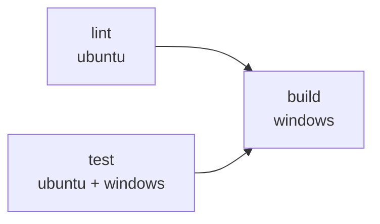

# 環境構築

> 関連: [プロジェクト概要](../overview.md) / [アーキテクチャ設計](../architecture/overview.md) / [コンポーネント設計](../components/overview.md) / [非機能要件 §10](../requirements/non-functional.md)

本書は開発環境・CI・lint／format・Git Hooks の方針を定める。**設定ファイルはまだリポジトリに存在しない**。実装 Issue（#1）の最初のステップで本書どおりに作成する。バージョンの数値は、実装着手時に最新の安定版を確認して固定する（本書では未確認の数値を断定しない）。

## 1. 概要

| 項目 | 採用 |
|------|------|
| バックエンド | Go 1.26 系（開発機の確認値: go1.26.5）。`go.mod` の `go` 行で下限を固定 |
| デスクトップ基盤 | Wails v3（バージョンは `go.mod` で固定） |
| フロントエンド | Vue 3＋TypeScript＋Vite＋Pinia |
| **パッケージマネージャ** | **bun 固定**（開発機の確認値: 1.3.14）。`npm`／`yarn`／`pnpm`／`npx` は使わない。ロックファイルは `bun.lock` のみコミットする |
| ローカル DB | SQLite（`modernc.org/sqlite`、CGO なし）。sqlc＋goose |
| Go の lint／format | golangci-lint（gofmt／goimports を含む） |
| フロントの lint／format | Biome のみ（型検査は `vue-tsc`） |
| 行数管理 | Linterly |
| Git Hooks | Lefthook |
| タスクランナー | Taskfile（Wails v3 の標準。テンプレートの `npm` 呼び出しは `bun` に置換する） |
| CI／配布 | GitHub Actions、GitHub Releases |
| Swagger／OpenAPI | **対象外**（HTTP API を持たない。契約は [バインディング仕様](../api/endpoints.md)） |

## 2. ディレクトリ構造

[アーキテクチャ設計 §4 ディレクトリ構成](../architecture/overview.md#ディレクトリ構成目安) を正とする。本書で追加する設定ファイルは次のとおり。

```
hitomado/
├─ .github/workflows/        # ci.yml, release.yml
├─ .golangci.yml
├─ .linterly.yml
├─ .editorconfig
├─ biome.json
├─ lefthook.yml
├─ sqlc.yaml
├─ Taskfile.yml              # Wails v3 テンプレート由来。bun に置換
└─ frontend/
   ├─ package.json
   └─ bun.lock
```

## 3. 開発環境セットアップ

### 3.1 必要なツール

| ツール | 用途 | 入手 |
|--------|------|------|
| Go（1.26 系） | ビルド・テスト | https://go.dev/dl/ |
| bun | フロントのパッケージ管理・スクリプト実行・テスト（`bun test`） | https://bun.sh |
| Wails v3 CLI（`wails3`） | 開発サーバー・ビルド・バインディング生成 | `go install github.com/wailsapp/wails/v3/cmd/wails3@<固定バージョン>` |
| sqlc | クエリのコード生成 | `go install github.com/sqlc-dev/sqlc/cmd/sqlc@<固定バージョン>` |
| golangci-lint | Go の lint／format | 公式インストール手順に従う |
| Lefthook | Git Hooks | `go install github.com/evilmartians/lefthook@<固定バージョン>` |
| Task | タスクランナー | `go install github.com/go-task/task/v3/cmd/task@<固定バージョン>` |
| Linterly | 行数チェック | `bun add -D @linterly/cli`（`bunx linterly` で実行） |

- goose はマイグレーションを `embed` してアプリ起動時に適用するため、**開発には CLI を必須としない**（SQL の雛形作成に使う場合のみ任意で導入）
- Windows では WebView2 ランタイムが必要（Windows 11 は標準搭載）
- 動作保証の対象は Windows。Linux／macOS の開発機では Go の単体テスト・フロントのテスト・lint は実行できるが、アプリの実行確認は Windows で行う

### 3.2 初回セットアップ

```bash
git clone https://github.com/ousiassllc/hitomado.git
cd hitomado
bun install --cwd frontend      # フロントの依存
go mod download                 # Go の依存
lefthook install                # Git Hooks を有効化
task generate                   # sqlc とバインディングを生成
task dev                        # 開発サーバー（wails3 dev）
```

### 3.3 主なタスク（`Taskfile.yml`）

| タスク | 内容 |
|--------|------|
| `task dev` | `wails3 dev`（フロントは `bun run dev`） |
| `task build` | `wails3 build`（Windows 向け成果物） |
| `task generate` | `sqlc generate` と `wails3 generate bindings` |
| `task lint` | `golangci-lint run`、`bunx biome ci`、`bun run typecheck`、`bunx linterly check` |
| `task fmt` | `golangci-lint fmt`、`bunx biome format --write` |
| `task test` | `go test ./...`、`bun test`（`frontend/` で実行） |
| `task check` | `generate` の差分なし確認＋`lint`＋`test`（CI と同等） |

- `frontend/package.json` の `scripts`: `dev`、`build`（`vue-tsc --noEmit && vite build`）、`typecheck`（`vue-tsc --noEmit`）。テストは `frontend/` で `bun test` を直接実行する（`vitest` は使わない）
- Wails v3 のテンプレートが `npm`／`npx` を呼ぶ箇所（`Taskfile.yml`、`build/` 配下のタスク）は、すべて `bun`／`bunx` に置換する

### 3.4 秘密情報

- リポジトリ・CI に OAuth クライアントの Client ID／Secret、AI の API キー、トークンを置かない。これらは利用者が実行時に入力し、資格情報ストアに保存する（[NF-S01](../requirements/non-functional.md#1-セキュリティ)）
- CI は Gmail・AI への実通信を行わない。外部クライアントはインターフェース越しのフェイクでテストする（[NF §10](../requirements/non-functional.md)）。CI で使うシークレットは `GITHUB_TOKEN` のみ

## 4. CI/CD

### 4.1 `ci.yml`

- トリガー: `main` への push、`pull_request`。同一ブランチの古い実行は `concurrency` でキャンセルする



| ジョブ | 実行環境 | 内容 |
|--------|----------|------|
| `lint` | ubuntu-latest | `golangci-lint run`、`bunx biome ci`、`vue-tsc --noEmit`、`bunx linterly check`、**生成物の差分検査**（`sqlc generate` と `wails3 generate bindings` のあと `git diff --exit-code`） |
| `test` | マトリクス: ubuntu-latest／windows-latest | `go vet ./...`、`go test ./...`（両 OS）。`bun test`（フロント、`frontend/` で実行）は ubuntu のみ（OS 非依存のため） |
| `build` | windows-latest | `needs: [lint, test]`。`wails3 build` を実行し、成果物を Actions のアーティファクトに保存 |

- セットアップ: `actions/setup-go`（`go.mod` のバージョン）、`oven-sh/setup-bun`、Go とフロントの依存キャッシュ
- 生成物の差分検査: `wails3 generate bindings` は Linux でも動く。ただし GTK ヘッダが無い環境では cgo を使う既定の Linux バックエンドをビルドできないため、`CGO_ENABLED=0` と `-tags purego`（Wails v3.1.0 の CGO なし Linux バックエンド）を付ける。Go の lint・vet・test も ubuntu では同じ設定で実行する（Windows 向けビルドには影響しない）。

### 4.2 `release.yml`

- トリガー: タグ `v*` の push
- 内容: windows-latest で `wails3 build` → 成果物（exe または zip）を GitHub Releases に添付（[NF-D01](../requirements/non-functional.md#8-配布更新)）。コード署名は行わない（NF-D02）
- マージは squash／rebase せず、マージコミット方式（リポジトリ規約）

## 5. Lint

### 5.1 Go（golangci-lint）

- 設定: `.golangci.yml`（golangci-lint v2 形式）
- 有効にするリンター（目安）: `errcheck`、`govet`、`staticcheck`、`unused`、`ineffassign`、`errorlint`、`bodyclose`、`gosec`
- 自動生成コード（sqlc、バインディング）は生成ヘッダーにより既定で除外される
- 機密のログ出力禁止（[NF-S10](../requirements/non-functional.md#1-セキュリティ)）は lint では強制できないため、コードレビューとテストで担保する

### 5.2 フロントエンド（Biome）

- 設定: `biome.json`。対象は `frontend/src`。生成物（`frontend/bindings/**`）は除外する
- 型検査は Biome の範囲外のため、`vue-tsc --noEmit` を CI／pre-push で実行して補う
- **確認結果**: Biome 2.6.4 は `html.experimentalFullSupportEnabled` で `.vue` の `<script>` と `<template>` を lint する（未使用変数・`==`・`` の alt 欠落を検出できることを確認した）。ESLint の追加は行わない。設定はルートの `biome.json`（対象は `frontend/src`・`frontend/test`。生成物 `frontend/bindings/**` は対象外）

### 5.3 フロントエンドのテスト（`bun test`）

- ランナーは **`bun test`**。パッケージ管理・Taskfile・CI・Hooks をすべて bun に統一する
- テストファイルは `frontend/src/**/*.test.ts`。DOM が必要なテストは `@happy-dom/global-registrator` を `bunfig.toml` の `[test] preload` で登録する
- **実装時に最初に検証する項目**（検証結果: 1・2 とも **bun 1.3.14 で成立**。`frontend/bunfig.toml` の preload（`test/setup.ts`）で happy-dom の登録と `.vue` ローダーを行い、Vue Test Utils で SFC をマウントできる。代替案は不要）:
  1. `bunfig.toml` の `[test] preload` に、`@happy-dom/global-registrator`（DOM の登録）と、`Bun.plugin` で `@vue/compiler-sfc` を使って `.vue` をコンパイルするローダーを登録し、`bun test` で SFC を import できるか
  2. Vue Test Utils が bun＋happy-dom 上で動くか
- **成立しない場合の代替**:
  1. コンポーネントのテストは薄く保ち、判断を伴うロジック（`lib/sanitize`、`lib/signature`、`lib/format`、ストア）を `.ts` に切り出して `bun test` でテストする
  2. SFC のテストが必要なら、純 TS ロジックのみ `bun test`、SFC のみ Vitest という併用に切り替える（そのときはランナーが 2 つになるため、CI・Hooks・本書を直す）

## 6. Format

| 対象 | ツール | 設定 |
|------|--------|------|
| Go | `golangci-lint fmt`（gofmt＋goimports） | `.golangci.yml` の `formatters` |
| TypeScript／Vue／JSON／CSS | Biome format | `biome.json` |
| 共通 | EditorConfig | `.editorconfig`（UTF-8、LF、末尾改行） |

- Windows の改行は `.gitattributes` で LF に統一する（`* text=auto eol=lf`）

## 7. Linterly

行数の上限でファイル・ディレクトリの肥大化を防ぐ。

```yaml
# .linterly.yml
rules:
  # max_lines_per_file / max_lines_per_directory はデフォルト値（300/2000）を使う。
  # 特別な理由がない限り変更しない。
  # max_lines_per_file: 300
  # max_lines_per_directory: 2000
  warning_threshold: 10

count_mode: all
default_excludes: true
language: ja

# 生成コードなど明確な理由がある場合のみ追加する。
# ignore:
#   - "frontend/bindings/**"
#   - "internal/store/db/**"
```

- `.linterlyignore` は作らない（Linterly は `.linterlyignore` と `.linterly.yml` の `ignore` が両方あると後者を無視するため、除外は `.linterly.yml` の `ignore` に一本化する）。手書きソースコードの除外パターンは追加しない。除外は、ソースコードでないもの（`docs/**`・`LICENSE`・`frontend/bun.lock`）と生成物（`frontend/bindings/**`・`internal/store/db/**`）に限る
- 生成物（`sqlc` の出力、Wails のバインディング）は、手書きでなく明確な理由があるため、**生成ファイルができた時点で**除外する
- `count_mode: all` は変更しない
- 実行: `bunx linterly check`（pre-commit ではステージ済みファイル、CI では全体）

## 8. Git Hooks

Lefthook を使う。`lefthook install` で有効化する。`--no-verify` は使わない（リポジトリ規約）。

```yaml
# lefthook.yml
pre-commit:
  parallel: true
  commands:
    go-lint:
      glob: "*.go"
      run: golangci-lint run
    biome:
      glob: "*.{ts,vue,json,css}"
      run: bunx biome check --staged --no-errors-on-unmatched
    linterly:
      run: bunx linterly check {staged_files}

pre-push:
  commands:
    go-test:
      run: go test ./...
    bun-test:
      root: "frontend/"
      run: bun test
    typecheck:
      root: "frontend/"
      run: bun run typecheck
```

- pre-commit: lint＋format 検査＋Linterly（ステージ済みファイル対象）。Go の lint はパッケージ単位の解析が必要なため `golangci-lint run` を全体に対して実行する
- pre-push: `go test ./...`、`bun test`、`vue-tsc --noEmit`（`bun run typecheck`）を、変更の有無にかかわらず実行する。ビルド（Windows）は CI に任せる
- 生成物の差分検査は CI で行う（ローカルでは `task check`）

## 9. Swagger/OpenAPI

対象外。Hitomado は HTTP サーバーを持たず、フロントと Go の境界は Wails のバインディングである。契約は [バインディング仕様](../api/endpoints.md) に記載し、TypeScript クライアントは `wails3 generate bindings` で生成する（生成物の差分検査は §4.1 の `lint` ジョブ）。`SWAGGER_ENABLED` や Stoplight Elements の組み込みは行わない。

## 改訂履歴

| 版 | 日付 | 変更内容 | 変更理由 |
|----|------|---------|---------|
| 1.0 | 2026-11-02 | 新規作成 | 初版 |
| 1.1 | 2026-11-02 | フロントのテストランナーを Vitest から `bun test` に変更（§3.3、§4.1、§8、§5.3 を新設） | bun への統一方針 |
| 1.2 | 2026-11-02 | §5.3 に preload・SFC ローダーの検証項目と Vitest 併用の代替を明記。§8 の pre-push に `vue-tsc` を追加 | `bun test` の前提（DOM・.vue）が未検証であること、template の型エラーを検出するため |
| 1.3 | 2026-11-02 | §5.2・§5.3 の検証結果、ubuntu での purego 実行を反映。Linterly の除外を `.linterly.yml` の `ignore` に一本化（`.linterlyignore` は削除） | 実装（#1）での検証 |
