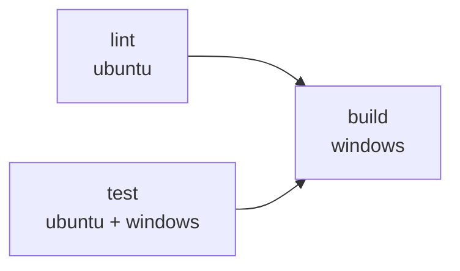

# 環境構築

> 関連: [プロジェクト概要](../overview.md) / [アーキテクチャ設計](../architecture/overview.md) / [コンポーネント設計](../components/overview.md) / [非機能要件 §10](../requirements/non-functional.md)

本書は開発環境・CI・lint／format・Git Hooks の方針を定める。本書の設定ファイル（`.golangci.yml`、`.linterly.yml`、`biome.json`、`lefthook.yml`、`sqlc.yaml`、`Taskfile.yml`、`.github/workflows/*`）はいずれもリポジトリに存在する。ツールのバージョンは `go.mod`・`frontend/package.json`・`ci.yml` の `env`（`WAILS_VERSION` など）で固定しており、本書では数値を重ねて断定しない（開発機の確認値は参考として示す）。

## 1. 概要

| 項目 | 採用 |
|------|------|
| バックエンド | Go 1.26 系（開発機の確認値: go1.26.5）。`go.mod` の `go` 行で下限を固定 |
| デスクトップ基盤 | Wails v3（バージョンは `go.mod` で固定） |
| フロントエンド | Vue 3＋TypeScript＋Vite＋Pinia |
| **パッケージマネージャ** | **bun 固定**（開発機の確認値: 1.3.14）。`npm`／`yarn`／`pnpm`／`npx` は使わない。ロックファイルは `bun.lock` のみコミットする |
| ローカル DB | SQLite（`modernc.org/sqlite`、CGO なし）。sqlc＋goose |
| Go の lint／format | golangci-lint（gofmt／goimports を含む） |
| フロントの lint／format | Biome のみ（型検査は `vue-tsc`） |
| 行数管理 | Linterly |
| Git Hooks | Lefthook |
| タスクランナー | Taskfile（Wails v3 の標準。テンプレートの `npm` 呼び出しは `bun` に置換する） |
| CI／配布 | GitHub Actions、GitHub Releases |
| Swagger／OpenAPI | **対象外**（HTTP API を持たない。契約は [バインディング仕様](../api/endpoints.md)） |

## 2. ディレクトリ構造

[アーキテクチャ設計 §4 ディレクトリ構成](../architecture/overview.md#ディレクトリ構成目安) を正とする。本書で追加する設定ファイルは次のとおり。

```
hitomado/
├─ .github/actions/build-installer/  # exe とインストーラーを作る共通手順（CI・リリースで共用）
├─ .github/scripts/          # next-version.sh（リリースのタグ決定）とそのテスト、test-installer.ps1（インストーラーの検証）
├─ .github/workflows/        # ci.yml, release.yml
├─ build/windows/nsis/       # project.nsi（NSIS インストーラー定義）
├─ .golangci.yml
├─ .linterly.yml
├─ .editorconfig
├─ biome.json
├─ lefthook.yml
├─ sqlc.yaml
├─ Taskfile.yml              # Wails v3 テンプレート由来。bun に置換
└─ frontend/
   ├─ package.json
   └─ bun.lock
```

## 3. 開発環境セットアップ

### 3.1 必要なツール

| ツール | 用途 | 入手 |
|--------|------|------|
| Go（1.26 系） | ビルド・テスト | https://go.dev/dl/ |
| bun | フロントのパッケージ管理・スクリプト実行・テスト（`bun test`） | https://bun.sh |
| Wails v3 CLI（`wails3`） | 開発サーバー・ビルド・パッケージ・バインディング生成 | `go install github.com/wailsapp/wails/v3/cmd/wails3@<固定バージョン>` |
| sqlc | クエリのコード生成 | `go install github.com/sqlc-dev/sqlc/cmd/sqlc@<固定バージョン>` |
| golangci-lint | Go の lint／format | 公式インストール手順に従う |
| Lefthook | Git Hooks | `go install github.com/evilmartians/lefthook@<固定バージョン>` |
| Task | タスクランナー | `go install github.com/go-task/task/v3/cmd/task@<固定バージョン>` |
| Linterly | 行数チェック | `bun add -D @linterly/cli`（`bunx linterly` で実行） |
| NSIS（`makensis`） | Windows インストーラーの作成（`task package`）。CI の windows-latest ではイメージに入っていればそれを使い、無ければ `choco install nsis --version=3.11`。使った版はビルドログの `makensis -VERSION` に出る | https://nsis.sourceforge.io/ |

- goose はマイグレーションを `embed` してアプリ起動時に適用するため、**開発には CLI を必須としない**（SQL の雛形作成に使う場合のみ任意で導入）
- Windows では WebView2 ランタイムが必要（Windows 11 は標準搭載）
- 動作保証の対象は Windows。Linux／macOS の開発機では Go の単体テスト・フロントのテスト・lint は実行できるが、アプリの実行確認は Windows で行う

### 3.2 初回セットアップ

```bash
git clone https://github.com/ousiassllc/hitomado.git
cd hitomado
bun install --cwd frontend      # フロントの依存
go mod download                 # Go の依存
lefthook install                # Git Hooks を有効化
task generate                   # sqlc とバインディングを生成
task dev                        # 開発サーバー（wails3 dev）
```

### 3.3 主なタスク（`Taskfile.yml`）

| タスク | 内容 |
|--------|------|
| `task dev` | `wails3 dev`（フロントは `bun run dev`）。版は `-X` なしで `main.go` の既定値 `0.0.0`（§4.3 版番号） |
| `task build` | `wails3 build`（Windows 向け成果物。`VERSION=X.Y.Z` で版を埋め込む。既定は `0.0.0`） |
| `task package` | `wails3 package VERSION=X.Y.Z`（`build` のあと NSIS で `bin/hitomado-vX.Y.Z-windows-amd64-setup.exe` を作る。§4.3） |
| `task generate` | `sqlc generate` と `wails3 generate bindings` |
| `task lint` | `golangci-lint run`、`bunx biome ci`、`bun run typecheck`、`bunx linterly check` |
| `task fmt` | `golangci-lint fmt`、`bunx biome format --write` |
| `task test` | `go test ./...`、`bun test`（`frontend/` で実行） |
| `task check` | `generate` の差分なし確認＋`lint`＋`test`（CI と同等） |

- `frontend/package.json` の `scripts`: `dev`、`build`（`vue-tsc --noEmit && vite build --mode production`）、`build:dev`（`vue-tsc --noEmit && vite build --minify false --mode development`。`build/Taskfile.yml` が `DEV=true` のときに使う）、`typecheck`（`vue-tsc --noEmit`）。テストは `frontend/` で `bun test` を直接実行する（`vitest` は使わない）
- Wails v3 のテンプレートが `npm`／`npx` を呼ぶ箇所（`Taskfile.yml`、`build/` 配下のタスク）は、すべて `bun`／`bunx` に置換する

### 3.4 秘密情報

- リポジトリ・CI に OAuth クライアントの Client ID／Secret、AI の API キー、トークンを置かない。これらは利用者が実行時に入力し、資格情報ストアに保存する（[NF-S01](../requirements/non-functional.md#1-セキュリティ)）
- CI は Gmail・AI への実通信を行わない。外部クライアントはインターフェース越しのフェイクでテストする（[NF §10](../requirements/non-functional.md)）。CI で使うシークレットは `GITHUB_TOKEN` のみ

## 4. CI/CD

### 4.1 `ci.yml`

- トリガー: `pull_request`、`workflow_call`（`release.yml` から呼ぶ）。`main` への push は `release.yml` 経由で実行する（§4.2）。同一ブランチの古い実行は `concurrency` でキャンセルする



| ジョブ | 実行環境 | 内容 |
|--------|----------|------|
| `lint` | ubuntu-latest | `go mod tidy -diff`、`golangci-lint run`、`bunx biome ci`、`vue-tsc --noEmit`、`bunx linterly check`、**生成物の差分検査**（`sqlc generate` と `wails3 generate bindings` のあと `git diff --exit-code`）、**`NOTICE` の最新性検査**（`bun .github/scripts/gen-notice.ts --check`。§4.3） |
| `test` | マトリクス: ubuntu-latest／windows-latest | `go vet ./...`、`go test ./...`（両 OS）。`bun test`（フロント、`frontend/` で実行）は ubuntu のみ（OS 非依存のため） |
| `build` | windows-latest | `needs: [lint, test]`。`wails3 package` でインストーラーを作り（版 `0.99.1` と `0.99.2` の 2 つ）、`.github/scripts/test-installer.ps1` で **インストール → 起動中の上書き拒否 → 上書き → アンインストール** を実機で検証する（§4.3）。新しい方のインストーラーを Actions のアーティファクトに保存 |

- セットアップ: `actions/setup-go`（`go.mod` のバージョン。Go のモジュール・ビルドキャッシュは既定で効く）、`oven-sh/setup-bun`（bun 1.3.14 を固定）、`bun install --frozen-lockfile`。フロントの依存は明示的にキャッシュしない
- 生成物の差分検査: `wails3 generate bindings` は Linux でも動く。ただし GTK ヘッダが無い環境では cgo を使う既定の Linux バックエンドをビルドできないため、`CGO_ENABLED=0` と `-tags purego`（Wails v3.1.0 の CGO なし Linux バックエンド）を付ける。Go の lint・vet・test も ubuntu では同じ設定で実行する（Windows 向けビルドには影響しない）。

### 4.2 `release.yml`

- トリガー: `main` への push（PR のマージ）。タグの push では動かさない。手でタグを打つ必要はない
- 版番号: `.github/scripts/next-version.sh` が決める。最新の安定版タグ（`vX.Y.Z`。`-rc1` などハイフン付きは無視）から patch を 1 つ上げる（`v0.1.0` → `v0.1.1`）。安定版タグがまだ無ければ最初の版は `v0.1.0`。そのコミットに既に安定版タグがあれば（失敗した run の再実行）、それをそのまま使う。minor／major を上げる手順は定めていない（最新のタグを基準にするだけなので、より大きい版のタグがあれば次の patch はそこから上がる）。テストは `.github/scripts/next-version_test.sh`（CI の `test` ジョブ・ubuntu で実行）
- 直列化: ワークフロー全体を `concurrency: release`（`cancel-in-progress: false`）で 1 本ずつ実行し、同時にマージされても版番号がぶつからない。待機中の run は最新の 1 本だけが残るため、間に挟まったコミットは単独のリリースにならず、次のリリースに含まれる
- 内容: 同じコミットで `ci.yml`（lint・test・Windows ビルドとインストーラーの検証）を呼んで通したうえで、windows-latest で `wails3 package VERSION=<タグから v を除いた値>`（§4.3。`-X main.version`・exe のファイルバージョン・インストーラーの表示が同じ値になる。更新確認の比較に使う）→ インストーラー `hitomado-<タグ>-windows-amd64-setup.exe`・`NOTICE`（リポジトリ直下のファイル。§4.3）・`SHA256SUMS.txt`（この 2 つのハッシュ）を作り、`gh release create <タグ> --target <コミット>` でタグと GitHub Release を成果物つきで同時に作る（[NF-D01](../requirements/non-functional.md#8-配布更新)）。Release が既にある場合（失敗した run の再実行）は、タグが同じコミットを指すときだけ成果物を上書きし、別のコミットなら失敗させる。CI が落ちたらリリースは作られない。ビルドは `contents: read`、タグ作成と公開だけ `contents: write`。コード署名は行わない（NF-D02）
- `ci.yml` は `main` への push では動かさない（`release.yml` が同じ CI を呼ぶ。両方で動かすと同じ ref の `concurrency` で互いにキャンセルする）。PR では従来どおり動く
- マージは squash／rebase せず、マージコミット方式（リポジトリ規約）

### 4.3 Windows インストーラー

配布物は NSIS（`build/windows/nsis/project.nsi`）で作る単一のインストーラー。Wails v3 が標準で提供する方式（`wails3 package` の既定）で、WebView2 ブートストラッパーの同梱もテンプレートに揃っている。MSIX は署名（証明書）が前提で、署名しない方針（NF-D02）と合わないため採らない。

| 項目 | 内容 |
|------|------|
| ファイル名 | `hitomado-vX.Y.Z-windows-amd64-setup.exe`（`NOTICE` と `SHA256SUMS.txt` を同じ Release に添付） |
| 権限・場所 | 利用者ごと（`RequestExecutionLevel user`）。既定 `%LOCALAPPDATA%\Programs\Hitomado`。UAC は出ない |
| ショートカット | スタートメニュー（必須）。デスクトップは任意（インストーラーのコンポーネント選択。既定はオフ、サイレントでも作らない） |
| 「アプリと機能」 | `HKCU\Software\Microsoft\Windows\CurrentVersion\Uninstall\jp.ousias.hitomado`（表示名・版・発行元・`InstallLocation`・`UninstallString`）。このキー名を変えると別アプリ扱いになり、上書き更新できなくなる |
| 上書き更新 | 新しい版のインストーラーを実行するだけ。前回の `InstallLocation` に入り、exe と登録内容を置き換える。起動中の `hitomado.exe` は置き換えられないため（実行中の exe を書き込みで開けるかで判定）、画面ありなら終了を促して再試行させ、サイレント（`/S`）なら何も変えずエラーコード 5 を設定して中止する（CI で終了コード 5 を確認。ウイルス対策ソフトが exe を一時的に掴んでいる間も同じ扱いになるため、少し待って再実行する） |
| 版番号 | `VERSION=X.Y.Z` 1 つから、`-X main.version`（アプリの表示・更新確認）、exe のファイルバージョン（`build/windows/info.generated.json` を `generate:syso` の前に書く。git 管理外）、インストーラーの表示と「アプリと機能」の `DisplayVersion` を作る。X.Y.Z 以外はビルドを失敗させる。`VERSION` を渡さない場合の既定値は `0.0.0`。`task dev` は `-X` を付けないため、アプリの表示・更新確認には `main.go` の `version` の既定値が使われる。この既定値と、`build/config.yml` の `info.version`（Wails テンプレート由来。`task dev` が `-config` で読むファイルだが、`info.version` を使う手順はこのリポジトリにない）、`build/windows/wails.exe.manifest` の `assemblyIdentity` の版（exe に埋め込まれる。`VERSION` とは連動しない固定値）は `0.0.0` に揃えてあり、`VERSION` の既定値を変えるときは `main.go`・`config.yml`・manifest も一緒に変える。`0.0.0` は更新確認で常に「新しい版あり」になる（dev・ローカルビルド専用の版） |
| WebView2 | 無い PC ではインストーラーに同梱したブートストラッパー（Microsoft 配布。ビルド時に `wails3 generate webview2bootstrapper` で取得）で入れる |
| 対応 | Windows 10 以降の x64 のみ。ARM64 は対象外（x64 エミュレーションで動くかは未確認のため、インストーラーは中止する。サイレントはエラーコード 64） |

#### 第三者ライセンスの表記（`NOTICE`）

Hitomado 本体は AGPL-3.0（`LICENSE`）。同梱する依存のライセンス表記と、MPL-2.0 の依存のソース入手先を、リポジトリ直下の `NOTICE` にまとめる（#3）。

- 作り方: `bun .github/scripts/gen-notice.ts`（`NOTICE` を書き換える。`--check` は最新でなければ失敗するだけで書き換えない）。Go はリリースと同じ `GOOS=windows GOARCH=amd64 -tags production` の `go list -deps` で実際に exe へリンクされるモジュールと標準ライブラリ、フロントは `frontend/package.json` の `dependencies` から `bun.lock` をたどった本番用の依存（`devDependencies` は含めない）を対象にする。各パッケージの LICENSE／COPYING／NOTICE を集め、同一の全文はまとめて 1 回だけ載せる。前提は `go mod download` 済みのモジュールキャッシュと `bun install --frozen-lockfile` 済みの `frontend/node_modules`
- MPL-2.0 の依存（現在は `github.com/hashicorp/golang-lru/v2` と、MPL-2.0 OR Apache-2.0 の `dompurify`）は、冒頭の節に版・リポジトリ・その版のソース一式の入手先（Go は `proxy.golang.org` の zip、npm は `registry.npmjs.org` の tgz）を載せる。Hitomado は MPL の依存のソースを改変しない
- ライセンスの種別を判定できない依存（`classify` の規則に無い全文）が増えるとスクリプトは失敗する。全文を確認して `.github/scripts/gen-notice.ts` に規則を足す
- 更新: `go.mod`・`frontend/package.json`・`bun.lock` を変えたら作り直してコミットする。CI の `lint` ジョブが `--check` で、`NOTICE` が古いまま通ることを防ぐ（生成は入力だけで決まる）。`NOTICE` は生成物のため `.linterly.yml` の `ignore` に入れている
- 配布: インストーラーが `NOTICE.txt` としてインストール先に置く（アンインストールで消す）。`release.yml` が同じ `NOTICE` を Release の成果物としても添付し、`SHA256SUMS.txt` に載せる

#### アンインストール時のデータの扱い

**利用者のデータは消さない**（#10 で決定。変える場合はここと README を直す）。理由: リフレッシュトークンなどの秘密は資格情報マネージャーにあり、消すと再認証が必要になる。誤って消す・更新のためにいったん消す、といった操作でデータを失わせない。完全に消したい利用者向けの手順は README に書く。

| 対象 | 場所 | アンインストールで |
|------|------|--------------------|
| プログラム本体・`uninstall.exe`・`NOTICE.txt`・スタートメニュー／デスクトップのショートカット・「アプリと機能」の登録 | インストール先、スタートメニュー、HKCU | 消す |
| インストール先フォルダ | `InstallLocation` | 空のときだけ消す（利用者が選んだフォルダの他のファイルを再帰削除しない） |
| 通知用の登録（Wails の通知サービスが起動時に書く） | `HKCU\Software\Classes\AppUserModelId\Hitomado`、その `CustomActivator` の GUID の `HKCU\Software\Classes\CLSID\{GUID}`、`HKCU\Software\Hitomado\NotificationCategories`（と空になった `HKCU\Software\Hitomado`） | 消す（次の起動で作り直される） |
| WebView2 のキャッシュ | `%APPDATA%\hitomado.exe`（Wails の既定。アプリは Web ストレージを使わないため、利用者のデータは入らない） | 消す |
| DB・設定・ログ | `%APPDATA%\Hitomado\` | **残す** |
| 資格情報（リフレッシュトークン・OAuth クライアントシークレット・AI の API キー） | Windows 資格情報マネージャー（ターゲット名 `Hitomado:hitomado/<種別>/<ID>`） | **残す** |

#### 検証

`.github/scripts/test-installer.ps1`（CI の `build` ジョブ、windows-latest）が、旧版（`0.99.1`）を入れる → 起動中（実行中の exe がある状態）の上書きが拒否され登録が変わらない → 新版（`0.99.2`）で上書きして `DisplayVersion`・exe の置き換え・exe のファイルバージョンと埋め込まれた `main.version`（exe 内の文字列。`-X` が効いていること）が新版になる → アンインストールでプログラム・ショートカット・登録が消え、`%APPDATA%\Hitomado` のデータは残る、を確認する。ローカルで実行するときは、実機のアプリと登録キー・`%APPDATA%\Hitomado` を共有するため、既に Hitomado が入っている PC では `-Force` を付けない限り動かない（使い捨ての環境で `-Force` を付ける。スクリプトが消すのは自分が作ったマーカーだけ）。GUI のウィザード（コンポーネント選択・完了ページ）は自動検証していない。

## 5. Lint

### 5.1 Go（golangci-lint）

- 設定: `.golangci.yml`（golangci-lint v2 形式）
- 有効にするリンター（目安）: `errcheck`、`govet`、`staticcheck`、`unused`、`ineffassign`、`errorlint`、`bodyclose`、`gosec`
- 自動生成コード（sqlc、バインディング）は生成ヘッダーにより既定で除外される
- 機密のログ出力禁止（[NF-S10](../requirements/non-functional.md#1-セキュリティ)）は lint では強制できないため、コードレビューとテストで担保する

### 5.2 フロントエンド（Biome）

- 設定: `biome.json`。対象は `files.includes` の `frontend/src/**`・`frontend/test/**`・`frontend/*.ts`・`frontend/package.json`・`frontend/tsconfig.json`・`biome.json`。生成物（`frontend/bindings`）は除外する
- 型検査は Biome の範囲外のため、`vue-tsc --noEmit` を CI／pre-push で実行して補う
- **確認結果**: Biome 2.6.4 は `html.experimentalFullSupportEnabled` で `.vue` の `<script>` と `<template>` を lint する（未使用変数・`==`・`` の alt 欠落を検出できることを確認した）。ESLint の追加は行わない。設定はルートの `biome.json`

### 5.3 フロントエンドのテスト（`bun test`）

- ランナーは **`bun test`**。パッケージ管理・Taskfile・CI・Hooks をすべて bun に統一する
- テストファイルは `frontend/src/**/*.test.ts` と `frontend/test/*.test.ts`（共有のセットアップ `setup.ts` もここ）。DOM が必要なテストは `@happy-dom/global-registrator` を `frontend/bunfig.toml` の `[test] preload` で登録する
- **実装時に最初に検証する項目**（検証結果: 1・2 とも **bun 1.3.14 で成立**。`frontend/bunfig.toml` の preload（`test/setup.ts`）で happy-dom の登録と `.vue` ローダーを行い、Vue Test Utils で SFC をマウントできる。代替案は不要）:
  1. `bunfig.toml` の `[test] preload` に、`@happy-dom/global-registrator`（DOM の登録）と、`Bun.plugin` で `@vue/compiler-sfc` を使って `.vue` をコンパイルするローダーを登録し、`bun test` で SFC を import できるか
  2. Vue Test Utils が bun＋happy-dom 上で動くか
- **成立しない場合の代替**:
  1. コンポーネントのテストは薄く保ち、判断を伴うロジック（`lib/sanitize`、`lib/signature`、`lib/format`、ストア）を `.ts` に切り出して `bun test` でテストする
  2. SFC のテストが必要なら、純 TS ロジックのみ `bun test`、SFC のみ Vitest という併用に切り替える（そのときはランナーが 2 つになるため、CI・Hooks・本書を直す）

## 6. Format

| 対象 | ツール | 設定 |
|------|--------|------|
| Go | `golangci-lint fmt`（gofmt＋goimports） | `.golangci.yml` の `formatters` |
| TypeScript／Vue／JSON／CSS | Biome format | `biome.json` |
| 共通 | EditorConfig | `.editorconfig`（UTF-8、LF、末尾改行） |

- Windows の改行は `.gitattributes` で LF に統一する（`* text=auto eol=lf`）

## 7. Linterly

行数の上限でファイル・ディレクトリの肥大化を防ぐ。

```yaml
# .linterly.yml
rules:
  # max_lines_per_file / max_lines_per_directory はデフォルト値（300/2000）を使う。
  # 特別な理由がない限り変更しない。
  # max_lines_per_file: 300
  # max_lines_per_directory: 2000
  warning_threshold: 10

count_mode: all
default_excludes: true
language: ja

# 生成コードなど明確な理由がある場合のみ追加する。
ignore:
  # ソースコードではないもの（仕様書・ライセンス全文・ロックファイル）。
  - "docs/**"
  - "LICENSE"
  - "NOTICE"
  - "frontend/bun.lock"
  # 生成物（Wails のバインディング・sqlc の出力）。
  - "frontend/bindings/**"
  - "internal/store/db/**"
```

- `.linterlyignore` は作らない（Linterly は `.linterlyignore` と `.linterly.yml` の `ignore` が両方あると後者を無視するため、除外は `.linterly.yml` の `ignore` に一本化する）。手書きソースコードの除外パターンは追加しない。除外は、ソースコードでないもの（`docs/**`・`LICENSE`・`NOTICE`・`frontend/bun.lock`）と生成物（`frontend/bindings/**`・`internal/store/db/**`）に限る
- 生成物（`sqlc` の出力、Wails のバインディング）は、手書きでなく明確な理由があるため、上の `ignore` で除外している
- `count_mode: all` は変更しない
- 実行: `bunx linterly check`（pre-commit ではステージ済みファイル、CI では全体）

## 8. Git Hooks

Lefthook を使う。`lefthook install` で有効化する。`--no-verify` は使わない（リポジトリ規約）。

```yaml
# lefthook.yml
pre-commit:
  parallel: true
  commands:
    go-lint:
      glob: "*.go"
      run: golangci-lint run
    biome:
      glob: "*.{ts,vue,json,css}"
      run: frontend/node_modules/.bin/biome check --staged --no-errors-on-unmatched
    linterly:
      run: frontend/node_modules/.bin/linterly check {staged_files}

pre-push:
  commands:
    go-test:
      run: go test ./...
    bun-test:
      root: "frontend/"
      run: bun test
    typecheck:
      root: "frontend/"
      run: bun run typecheck
```

- pre-commit: lint＋format 検査＋Linterly（ステージ済みファイル対象）。Go の lint はパッケージ単位の解析が必要なため `golangci-lint run` を全体に対して実行する
- pre-push: `go test ./...`、`bun test`、`vue-tsc --noEmit`（`bun run typecheck`）を、変更の有無にかかわらず実行する。ビルド（Windows）は CI に任せる
- 生成物の差分検査は CI で行う（ローカルでは `task check`）

## 9. Swagger/OpenAPI

対象外。Hitomado は HTTP サーバーを持たず、フロントと Go の境界は Wails のバインディングである。契約は [バインディング仕様](../api/endpoints.md) に記載し、TypeScript クライアントは `wails3 generate bindings` で生成する（生成物の差分検査は §4.1 の `lint` ジョブ）。`SWAGGER_ENABLED` や Stoplight Elements の組み込みは行わない。

## 改訂履歴

| 版 | 日付 | 変更内容 | 変更理由 |
|----|------|---------|---------|
| 1.0 | 2026-11-02 | 新規作成 | 初版 |
| 1.1 | 2026-11-02 | フロントのテストランナーを Vitest から `bun test` に変更（§3.3、§4.1、§8、§5.3 を新設） | bun への統一方針 |
| 1.2 | 2026-11-02 | §5.3 に preload・SFC ローダーの検証項目と Vitest 併用の代替を明記。§8 の pre-push に `vue-tsc` を追加 | `bun test` の前提（DOM・.vue）が未検証であること、template の型エラーを検出するため |
| 1.3 | 2026-11-02 | §5.2・§5.3 の検証結果、ubuntu での purego 実行を反映。Linterly の除外を `.linterly.yml` の `ignore` に一本化（`.linterlyignore` は削除） | 実装（#1）での検証 |
| 1.4 | 2026-11-02 | §4.1 の `ci.yml` から `main` への push トリガーを外し、§4.2 の `release.yml` を「`main` への push で patch を自動で上げて公開」に変更。タグ決定スクリプトとそのテストを追加 | 自動リリース（#8） |
| 1.5 | 2026-11-02 | §4.3（Windows インストーラー: NSIS・利用者ごと・上書き更新・アンインストール時にデータを残す方針）を追加。§4.1 の `build` と §4.2 の成果物を zip からインストーラーに変更。`task package`・版番号の一元化（`VERSION`） | #10 |
| 1.6 | 2026-11-03 | §4.3 の版番号に、`VERSION` を渡さないときの版（`0.0.0`）と、`main.go`・`build/config.yml`・`wails.exe.manifest` の既定値を揃える方針を追記 | #12 |
| 1.7 | 2026-11-03 | 冒頭の「設定ファイルはまだ存在しない」を削除し、§7 の YAML 例を実際の `.linterly.yml`（有効な `ignore`）に揃えた。§3.3 に `build:dev`、§4.1 のセットアップのキャッシュ（Go のみ既定、フロントは明示なし）、§5.2 の Biome の対象範囲、§5.3 のテスト配置（`frontend/test/`）を実装に合わせた | #27、#28 |
| 1.8 | 2026-11-03 | §4.3 に第三者ライセンスの表記（`NOTICE`）の作り方と配布（インストーラー同梱・Release 添付）、§4.1 の `lint` に最新性検査、§4.2 の成果物に `NOTICE` を追記。§7 の除外に `NOTICE` を追加 | #3 |
