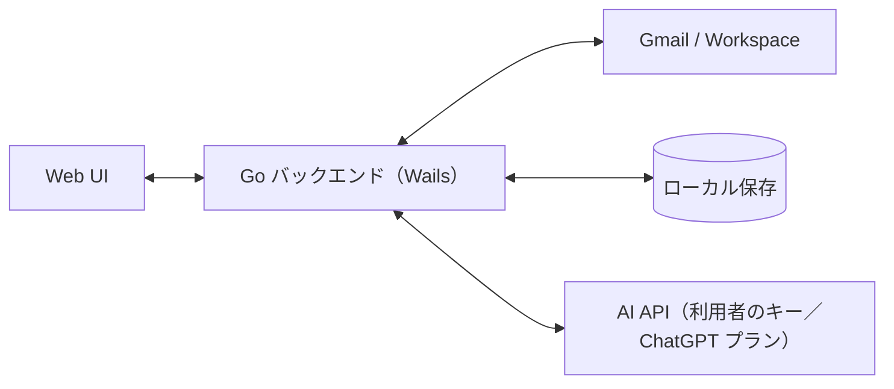

# プロジェクト概要

## 目的

複数の Gmail／Google Workspace アドレスを 1 つの統合受信箱で確認し、正しい送信元から返信できるようにする。
アプリ切替と送信元の取り違えをなくし、複数社を並行運用する人の日常の摩擦を減らす。

## 背景

- 複数社の Workspace を並行運用すると、アカウント切替と送信元ミスが日常の摩擦になる
- 統合受信箱そのものは既存製品にあるが、日本の複数社運用向けの「誤送信防止」「会社の見分け」は弱い
- 公開者はサーバーを持たない。Gmail の制限付きスコープに対する CASA（Google のセキュリティ評価）を避けるため、利用者が自分で OAuth クライアントを用意する方式（BYO OAuth）を採る

## スコープ

### 含むもの（v0.1.0）

- 複数 Gmail／Workspace の接続（BYO OAuth。OAuth クライアントを複数登録し、アカウントごとに選択）
- 統合受信箱（アカウント色・ラベル表示）
- スレッド閲覧、既読／アーカイブ／ゴミ箱の基本操作（ラベル付け替えは余力があれば）
- 返信・全員に返信・転送・送信してアーカイブ（受信アカウントから送信を強制、送信前の送信元確認）
- 新規メール作成（送信元の選択＋確認ダイアログ付き）、添付ファイル送信、宛先オートコンプリート、Gmail 下書き同期
- アカウント別署名
- AI 返信下書き（「AIで下書き」押下時のみ生成。送信は人。API キーのほか ChatGPT プランでのログインにも対応し、モデルは一覧から選べる）
- スレッドの AI 要約・AI への質問（「AI で要約」／質問の送信の操作のときのみ生成。質問ではそのスレッドの内容とそこまでの会話を文脈にする。結果・会話は開いている間だけメモリに持ち、保存しない）
- 検索（Gmail 検索クエリのパススルー、全アカウント横断）
- 新着のデスクトップ通知（トースト）とトレイ常駐
- Windows ビルド（コード署名なし、アプリ内で新バージョン通知）
- README（OAuth クライアント作成手順）
- UI は日本語のみ

### 含まないもの（当面）

- Mac ビルド、モバイル
- Outlook／IMAP 汎用
- カレンダー、チーム共有、自動送信・エージェント
- 公開者側サーバー（認証中継・メール中継・テレメトリ収集）
- ローカル全文検索インデックス、本文・添付のオフライン閲覧（ローカルにはメタデータとスニペットのみ保存）
- エイリアス（Send-as）送信元、複数 PC 間の設定同期、スター・迷惑メール報告・メールの完全削除

## ステークホルダー / 想定ユーザー

| 区分 | 役割 | 備考 |
|------|------|------|
| 悠太さん | MVP 検証者・開発者 | 約 8 アカウントを日常運用 |
| 個人事業主・複業・経営者 | 第二ターゲット | 複数アカウント持ち。Google Cloud で OAuth クライアントを作れる程度の技術力を想定 |

## ライセンス・配布

- AGPL-3.0。GitHub（`ousiassllc/hitomado`）で無料公開
- Windows 向けにビルド成果物を配布

## システム全体像

アーキテクチャの詳細は [アーキテクチャ設計](architecture/overview.md) を参照。

## ドキュメントマップ

このプロジェクトの仕様は以下のドキュメントで構成される。実装時はそれぞれ参照すること。

| ドキュメント | パス | 概要 |
|------------|------|------|
| 機能要件 | [`docs/requirements/functional.md`](requirements/functional.md) | F-01〜F-15 のユースケース・機能詳細・画面遷移・エラー動作 |
| 非機能要件 | [`docs/requirements/non-functional.md`](requirements/non-functional.md) | セキュリティ・外部通信・性能・同期・配布・テスト方針 |
| アーキテクチャ設計 | [`docs/architecture/overview.md`](architecture/overview.md) | Wails v3＋Go＋Vue の構成、レイヤー、実行モデル、通信フロー |
| ER / データモデル | [`docs/architecture/er.md`](architecture/er.md) | SQLite のテーブル定義（メタデータ・スニペットのみ）、インデックス、保持ルール |
| バインディング仕様（API 仕様） | [`docs/api/endpoints.md`](api/endpoints.md) | Go↔フロントのバインディング契約、エラーコード、送信確認トークン、外部 API 利用 |
| コンポーネント設計 | [`docs/components/overview.md`](components/overview.md) | Go／Vue のコンポーネント責務・依存・ショートカット・要件対応表 |
| MCP 連携とログ | [`docs/mcp.md`](mcp.md) | 内蔵 MCP サーバー（既定オフ・トークン必須・送信なし）の設定・ツール、ログの場所・形式・伏せ処理 |
| 環境構築 | [`docs/environment/setup.md`](environment/setup.md) | 開発ツール・bun 固定・CI（ubuntu／windows）・Biome／golangci-lint・Linterly・Lefthook。Android のビルドは [`android.md`](environment/android.md) |

## マイルストーン / リリース計画

単一リリースとして全機能をまとめて出す。日付は未定。

- v0.1.0: 「含むもの」の全機能＋README（Windows ビルド）

## 用語集

| 用語 | 定義 |
|------|------|
| 統合受信箱 | 全アカウントの受信を 1 つにまとめた一覧 |
| BYO OAuth | 利用者が自分の Google Cloud で OAuth クライアントを作って使う方式 |
| CASA | Gmail 制限付きスコープを使うアプリに Google が求めるセキュリティ評価 |
| 受信アカウント | スレッドを受信した側の Gmail／Workspace アカウント。返信の送信元は常にこれ |
| バインディング | Wails が公開する Go 関数。フロントエンドから呼び出す |

## 改訂履歴

| 版 | 日付 | 変更内容 | 変更理由 |
|----|------|---------|---------|
| 1.0 | 2026-11-02 | 新規作成。ドキュメントマップを確定し、スコープの未決事項を反映 | 初版（ひな型 0.1 をもとに作成） |
| 1.1 | 2026-11-02 | ドキュメントマップに環境構築を追加 | env-setup の実施 |
| 1.2 | 2026-11-03 | ドキュメントマップに MCP 連携とログを追加 | #14 |
| 1.3 | 2026-11-03 | AI 下書きに ChatGPT プラン（Sign in with ChatGPT）とモデル一覧からの選択を追記（詳細は各設計書の履歴） | #75、#76 |
| 1.4 | 2026-11-06 | スコープに、スレッドの AI 要約と AI への質問を追記（詳細は各設計書の履歴） | #206・#207 |
