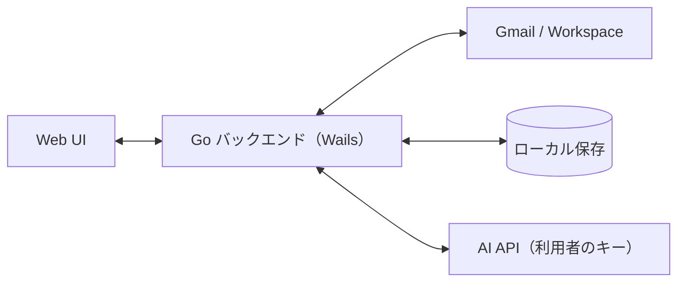

# プロジェクト概要

## 目的

複数の Gmail／Google Workspace アドレスを 1 つの統合受信箱で確認し、正しい送信元から返信できるようにする。
アプリ切替と送信元の取り違えをなくし、複数社を並行運用する人の日常の摩擦を減らす。

## 背景

- 複数社の Workspace を並行運用すると、アカウント切替と送信元ミスが日常の摩擦になる
- 統合受信箱そのものは既存製品にあるが、日本の複数社運用向けの「誤送信防止」「会社の見分け」は弱い
- 公開者はサーバーを持たない。Gmail の制限付きスコープに対する CASA（Google のセキュリティ評価）を避けるため、利用者が自分で OAuth クライアントを用意する方式（BYO OAuth）を採る

## スコープ

### 含むもの（v0.1.0）

- 複数 Gmail／Workspace の接続（BYO OAuth）
- 統合受信箱（アカウント色・ラベル表示）
- スレッド閲覧、既読／アーカイブなどの基本操作
- 返信（受信アカウントから送信を強制、送信前の送信元確認）
- 新規メール作成（送信元の選択＋確認ダイアログ付き）
- アカウント別署名
- AI 返信下書き（「AIで下書き」押下時のみ生成。送信は人）
- Windows ビルド
- README（OAuth クライアント作成手順）
- UI は日本語のみ

### 含まないもの（当面）

- Mac ビルド、モバイル
- Outlook／IMAP 汎用
- カレンダー、チーム共有、自動送信・エージェント
- 公開者側サーバー（認証中継・メール中継・テレメトリ収集）

### 未決（機能要件・非機能要件で決める）

- 全文検索、通知、オフライン閲覧、エイリアス（Send-as）、複数 PC 間の設定同期は、v0 のスコープ判定を各要件ドキュメントで行う

## ステークホルダー / 想定ユーザー

| 区分 | 役割 | 備考 |
|------|------|------|
| 悠太さん | MVP 検証者・開発者 | 約 8 アカウントを日常運用 |
| 個人事業主・複業・経営者 | 第二ターゲット | 複数アカウント持ち。Google Cloud で OAuth クライアントを作れる程度の技術力を想定 |

## ライセンス・配布

- AGPL-3.0。GitHub（`ousiassllc/hitomado`）で無料公開
- Windows 向けにビルド成果物を配布

## システム全体像

アーキテクチャの詳細は [アーキテクチャ設計](architecture/overview.md) を参照。

## ドキュメントマップ

このプロジェクトの仕様は以下のドキュメントで構成される。実装時はそれぞれ参照すること。

| ドキュメント | パス | 概要 |
|------------|------|------|
| 機能要件 | `docs/requirements/functional.md` | （作成後に確定） |
| 非機能要件 | `docs/requirements/non-functional.md` | （作成後に確定） |
| アーキテクチャ設計 | `docs/architecture/overview.md` | （作成後に確定） |
| ER / データモデル | `docs/architecture/er.md` | （作成後に確定） |
| バインディング仕様（API 仕様） | `docs/api/endpoints.md` | （作成後に確定） |
| コンポーネント設計 | `docs/components/overview.md` | （作成後に確定） |

## マイルストーン / リリース計画

単一リリースとして全機能をまとめて出す。日付は未定。

- v0.1.0: 「含むもの」の全機能＋README（Windows ビルド）

## 用語集

| 用語 | 定義 |
|------|------|
| 統合受信箱 | 全アカウントの受信を 1 つにまとめた一覧 |
| BYO OAuth | 利用者が自分の Google Cloud で OAuth クライアントを作って使う方式 |
| CASA | Gmail 制限付きスコープを使うアプリに Google が求めるセキュリティ評価 |
| 受信アカウント | スレッドを受信した側の Gmail／Workspace アカウント。返信の送信元は常にこれ |
| バインディング | Wails が公開する Go 関数。フロントエンドから呼び出す |

## 改訂履歴

| 版 | 日付 | 変更内容 | 変更理由 |
|----|------|---------|---------|
| 1.0 | 2026-11-02 | 新規作成 | 初版（ひな型 0.1 をもとに作成） |
