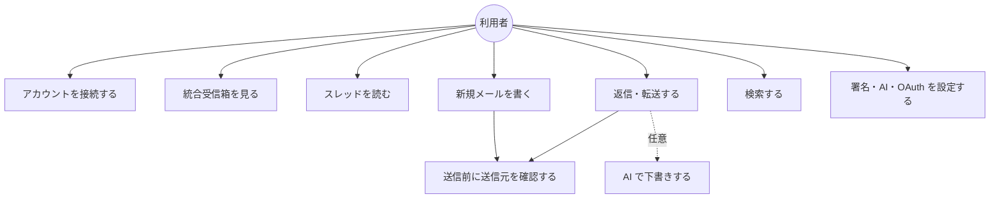
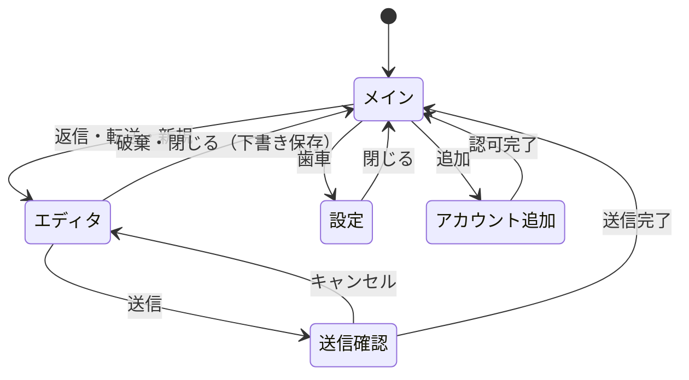
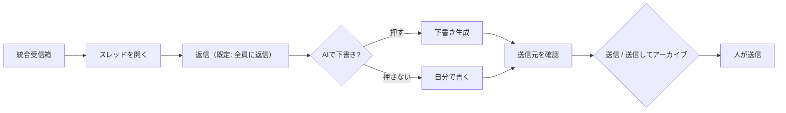

# 機能要件

> 関連: [プロジェクト概要](../overview.md) / [非機能要件](non-functional.md) / [バインディング仕様](../api/endpoints.md) / [コンポーネント設計](../components/overview.md)

## 1. 前提

- 対象は Gmail／Google Workspace。アカウントごとに Gmail API でスレッドを取得・操作する
- 公開者はサーバーを持たない。すべての通信は利用者の PC と Google／AI プロバイダ間で完結する
- 優先度: **Must**（v0.1.0 の完了条件）／ **Could**（余力があれば v0.1.0 に含める。未達でもリリース可）
- 返信・転送の送信元は常に**受信アカウントのプライマリアドレス**。エイリアス（Send-as）は扱わない

## 2. ユースケース

## 3. 機能一覧

| ID | 機能 | 優先度 |
|----|------|--------|
| F-01 | アカウント接続（BYO OAuth） | Must |
| F-02 | 統合受信箱 | Must |
| F-03 | スレッド閲覧 | Must |
| F-04 | 基本操作（既読／未読・アーカイブ・ゴミ箱） | Must |
| F-04b | ラベル付け替え（振り分け変更） | Could |
| F-05 | 返信・全員に返信・転送・送信してアーカイブ | Must |
| F-06 | 送信前確認 | Must |
| F-07 | アカウント別署名 | Must |
| F-08 | AI 返信下書き | Must |
| F-09 | 検索（Gmail 検索クエリのパススルー） | Must |
| F-10 | 新着のデスクトップ通知・トレイ常駐 | Must |
| F-11 | 新規メール作成 | Must |
| F-12 | 下書き保存（Gmail の下書きに同期） | Must |
| F-13 | 宛先オートコンプリート | Must |
| F-14 | 添付ファイル送信 | Must |
| F-15 | MCP 連携・ログの収集 | Should |
| F-16 | アプリの更新（更新確認・Windows 版の自動アップデート） | Must |

## 4. 機能詳細

### F-01 アカウント接続（BYO OAuth）

- **OAuth クライアントの登録**: 利用者が Google Cloud で作成した OAuth クライアント（種類: デスクトップアプリ）の Client ID と Client Secret を登録する。複数登録でき、名前を付けて管理する（例: 「A 社 Workspace 用」「個人用」）
- **アカウント追加**: 使用する OAuth クライアントを選び、システムブラウザで Google の認可画面を開く。ループバック（`127.0.0.1` の一時ポート）＋ PKCE で認可コードを受け取る
- **Android の認可**: Windows と同じく、デスクトップ アプリ種別のクライアントと、ループバック（`127.0.0.1` の一時ポート）＋ PKCE ＋ `state` を使う。Google が Android 種別のクライアントでのループバックと Android でのカスタム URI スキームを認めないため（一次情報は [Android ビルド §14](../environment/android.md#14-google-oauth-のリダイレクト方式86)）。ブラウザに出ている間にプロセスが止められると待受が消えて認可は完了できないので、次の起動で一度だけ「ログインの途中でアプリが終了したためやり直してください」と案内する（保存するのは『認可の途中』の印だけで、`state`・PKCE verifier・トークンは残さない）。Android 専用のクライアントは作らせず、パッケージ名・署名鍵の SHA-1 は登録しない（README）
- 要求スコープは `gmail.modify`（読み取り・ラベル変更・下書き・送信を含む。完全削除は含まない）と、アドレス取得用の `openid email profile`
- 追加時に表示名（初期値は Google プロフィール名）とアカウント色（プリセット 8〜12 色から選択、既定は未使用色を自動割当）を設定する
- **アカウント削除**: アプリ内のデータ（トークン・キャッシュ・署名・色）を削除し、可能なら Google 側のトークンも revoke する
- **再認証**: リフレッシュトークンが失効・取り消しされたアカウントは、受信箱で「要再接続」と表示し、ワンクリックで再認可へ誘導する。他アカウントの動作は妨げない
- **OAuth クライアントの資格情報が拒否された場合**（Client ID／Secret が無効・取り消し・変更されたとき）も、当該アカウントのみ「要再接続」とし、同期の自動再試行を止める。同じ資格情報での再接続は無意味なので、再接続ではなく OAuth クライアントの設定（Client ID／Secret）を確認するよう案内する。受信箱のバナーとアカウント設定の行に理由と「OAuth クライアントを確認」の導線を出し、設定の OAuth クライアントタブを開く（契約は [バインディング仕様 §1.2・§10](../api/endpoints.md)）。他アカウントの動作は妨げない
- **Android で資格情報を復号できなくなった場合**（Android Keystore の鍵が失われたとき。バックアップの復元・端末の変更・画面ロックのリセットなど）も、リフレッシュトークンが無いのと同じに扱い、当該アカウントを「要再接続」にして再認可へ誘導する（保存済みの Client Secret・API キー・ChatGPT のトークン・MCP トークンも読めなくなるため、Client Secret・API キーは設定から登録し直す）。アプリは起動を止めない
- 同じメールアドレスの二重登録は拒否する
- OAuth クライアントを削除できるのは、それを使うアカウントが 0 件のときのみ

### F-02 統合受信箱

- 全アカウントの `INBOX` ラベルのスレッドを 1 つのリストに最終メッセージ日時の降順で統合表示する（「すべて」タブ。カテゴリのプロモ・ソーシャル等も含む）
- 各行に表示: アカウント色の縦帯、アカウント名チップ、差出人（スレッド内の最新メッセージ）、件名、冒頭スニペット、日時、未読表示、添付アイコン、ユーザー作成ラベルのチップ
- **フィルタ**: アカウント（単一／複数／すべて）、未読のみ。選択はアプリ再起動後も保持する
- **タブ**: 一覧の上に **すべて／メイン／ソーシャル／プロモーション／新着** を並べる。全アカウント統合の一覧にもアカウントで絞り込んだ一覧にも、アカウントのフィルタ・未読のみと組み合わせて（AND）効き、最終メッセージ日時の降順・ページングは保つ
  - **すべて**: 全アカウントの `INBOX`（従来どおり）。**メイン**: `CATEGORY_PERSONAL` を持つスレッド、または**どの `CATEGORY_*` も持たない** `INBOX` のスレッド。**ソーシャル**: `CATEGORY_SOCIAL`。**プロモーション**: `CATEGORY_PROMOTIONS`。**新着**: 未読（`UNREAD`）のスレッドだけ。ラベルはスレッド内のいずれかのメッセージに付いていれば、そのスレッドに付いているものとして扱う
  - カテゴリのラベルが付かないスレッド（Workspace でカテゴリを使っていない等）をメインに出すのは、Gmail 本家の挙動と同じにするため。「更新」「フォーラム」（`CATEGORY_UPDATES`／`CATEGORY_FORUMS`）にだけ付くスレッドは、メイン／ソーシャル／プロモーションのどれにも出さず、「すべて」と「新着」（未読のとき）にだけ出る。この 2 つはタブにしない（5 タブで足りるため）
  - 新着タブでスレッドを既読にすると、その行は一覧から外れる（以降の取得でも出ない）。未読に戻すと次の取得で戻る
  - 選んだタブはアプリを終了すると忘れる（起動時は常に「すべて」。保存の仕組みを増やさない）。アカウントのフィルタを変えても、検索して受信箱へ戻っても、そのセッション中は選んだタブを保つ。タブを切り替えるとページングのカーソルを捨てて先頭から取り直す。検索結果にはタブを出さず、検索には効かない
  - 狭い画面（Android のスマホ幅）ではタブの列を横にスクロールできる。タブは `tablist`／`tab`／`aria-selected` を持ち、矢印キーで移動できる
- アカウント別の未読件数をサイドバーに表示する
- 続きの読み込み（一覧の末尾の「さらに読み込む」ボタンで取得する。スクロールでは自動で取得しない）。ページングは各アカウントのカーソルを保持し、統合順序を保つ
- 手動更新と自動更新（方式は [アーキテクチャ設計](../architecture/overview.md) と [非機能要件](non-functional.md) を参照）。ここでいう自動更新はメールの同期のことで、アプリ本体の更新（Windows 版の自動アップデート）とは別（[NF-D03](non-functional.md)）
- 同一メールが複数の自アカウントに届いている場合（宛先に複数社のアドレスがある等）は、アカウントごとに別行で表示する（各アカウントのスレッドは独立）

### F-03 スレッド閲覧

- スレッド内のメッセージを時系列で表示する。最新と未読は展開、それ以外は折りたたみ
- ヘッダー表示: 差出人、宛先、Cc、日時。受信アカウント（色・名前・アドレス）をスレッドヘッダに常に表示する
- 本文: HTML をサニタイズして表示する（スクリプト・フォーム・外部 CSS・iframe 等は除去）。HTML がなければプレーンテキストを表示する
- **リモート画像はデフォルトでブロック**する。メッセージ単位の「画像を表示」で、そのメッセージのみ解除する。インライン画像（`cid:`）は表示する。ただし上限がある: 画像 1 枚が 5 MiB を超えるものは取得せず、1 メッセージで `data:` URL に埋め込む合計（本文中の参照ごとに数え、同じ画像を複数回参照すれば回数分加算。base64 化後の `data:` URL の長さ）が 10 MiB を超える参照は置換しない。上限を超えた画像は表示されず（利用者への通知はしない）、添付一覧にも出ない（`Content-Disposition: attachment` の画像だけは添付一覧から保存できる）
- リンクはアプリ内遷移せず、確認なしにシステムブラウザで開く
- 添付: ファイル名・サイズを一覧表示し、保存先ダイアログでダウンロードする（Android は Storage Access Framework で保存先を選ぶ。保存先を選んでから添付を取得し、キャンセルなら通信しない）
- スレッドを開くと、スレッド内の未読を既読にする（Gmail の `UNREAD` ラベルを外す）

### F-04 基本操作

| 操作 | 内容 | Gmail 上の実体 |
|------|------|----------------|
| 既読／未読 | スレッド単位でトグル | `UNREAD` ラベルの付与・除去 |
| アーカイブ | 受信箱から外す | `INBOX` ラベルの除去 |
| ゴミ箱へ移動 | ゴミ箱に入れる。完全削除はしない | `TRASH` ラベルの付与（`INBOX` 除去） |

- 受信箱リストとスレッド画面のどちらからも実行できる
- 操作後は楽観的更新でリストから即時に消し、失敗時は元に戻してエラーを表示する
- アーカイブ・ゴミ箱は成功の直後に、画面下中央のスナックバー（「アーカイブしました。」「ゴミ箱へ移動しました。」。複数件は「N 件を…」）を「元に戻す」つきで 6 秒出す（ガイド O3: 戻せる結果はスナックバーで知らせる）。「元に戻す」を押すと Gmail 側も元の状態に戻し（アーカイブは `INBOX` の付け直し、ゴミ箱は `untrash`。受信箱にあったスレッドは `INBOX` も付け直す）、受信箱リストへ戻す。戻すのに失敗したら「元に戻せませんでした。」＋理由をエラーアラート（再試行つき）で出す
- 既存の Gmail 機能で足りるものは作らない。スター・迷惑メール報告・完全削除は v0 のスコープ外

### F-04b ラベル付け替え（Could）

- スレッドに対し、そのアカウントのユーザー作成ラベルの付与・除去ができる（Gmail の「ラベルを付ける」相当）
- ラベル一覧はアカウントごとに取得する。ラベルの新規作成・削除・改名は対象外

### F-05 返信・全員に返信・転送・送信してアーカイブ

- スレッド画面の返信ボタンの既定は**全員に返信**。メニューから「返信」（送信者のみ）、「転送」を選べる
- **送信元は受信アカウントに固定**し、変更 UI を提供しない。画面上に送信元を常時表示する
- 宛先の決定:
  - 返信: `Reply-To`（あれば）、なければ `From`。ただし自分が差出人の最新メッセージに返信する場合は元の `To`
  - 全員に返信: 返信宛先＋元の `To`／`Cc` から**受信アカウント自身のアドレスを除外**したもの
  - 転送: 宛先は空。件名は `Fwd: ` を付与、本文に元メッセージ（差出人・日時・件名・宛先ヘッダ付き）を引用し、元の添付を引き継ぐ（個別に削除可）
- 件名は `Re: ` を付与（既存なら重複させない）。`In-Reply-To`／`References` ヘッダとスレッド ID を設定し、Gmail 上で同一スレッドに入るようにする
- 引用: 返信時は元メッセージを引用として本文末尾に挿入する（折りたたみ表示可）
- **送信してアーカイブ**: 送信が成功したら同じスレッドを `INBOX` から外す。送信失敗時はアーカイブしない
- 送信は必ず F-06 の確認ダイアログを経由する。バックエンドも確認トークンなしの送信を拒否する（[バインディング仕様 §5.2](../api/endpoints.md#52-送信前確認と送信確認トークン)）

### F-06 送信前確認

- 送信（返信・転送・新規・送信してアーカイブのすべて）の直前に確認ダイアログを必ず出す
- 表示内容:
  - **送信元**: 左にアカウント色の帯を付けた落ち着いた枠（背景・文字はテーマの色）に、アカウント名とメールアドレスを表示する。取り違えを防ぐため送信元は常に見える位置に出すが、他の自アカウント宛の警告より目立たせない
  - 宛先（To／Cc／Bcc）、件名、添付ファイル数、本文（利用者が書いた部分。改行を保ち、署名・引用は含めない。長い場合はスクロール）
  - 宛先に**他の自アカウントのアドレス**が含まれる場合は警告表示（取り違えの検知）
- 確定ボタンのラベルは「<送信元アドレス> から送信」。キャンセルでエディタに戻る。確認後に宛先・件名・本文・添付を変更した場合は、再度確認ダイアログを出す（確認時と異なる内容では送信できない）
- 「今後表示しない」設定は提供しない
- 送信元が未選択（F-11）の場合は、送信ボタンを無効にする

### F-07 アカウント別署名

- アカウントごとに署名を 1 つ設定する（軽量リッチテキスト。F-11 のエディタと同形式）
- 返信・転送・新規作成の本文に、引用より前の位置へ自動挿入する。区切りに `-- ` を挿入する
- 新規作成で送信元を切り替えたときは、署名を切り替え後のアカウントのものに差し替える（利用者が署名部分を編集済みの場合は差し替えず、警告する）
- **Gmail の署名を取り込む（#110）**: 設定画面の署名で「Gmail から取得」を押すと、そのアカウントの Gmail の設定（`users.settings.sendAs.get`。アカウント本人のアドレスの署名）から署名を取り込み、署名エディタに入れる。
  - 取り込みは**押したときだけ**行う（自動取得・定期同期はしない。Gmail の署名を後から変えても自動では追従しない）。取り込んだ内容は**保存するまで反映しない**（エディタに入るだけ。保存は従来の署名の保存と同じ）。Gmail 側への書き戻しはしない
  - 署名エディタに入力済みの内容があるときは、置き換える前に確認する
  - Gmail の署名は許可タグ（太字・斜体・下線・リンク・箇条書き・段落・改行）の範囲にだけ整える。画像・表・文字色・フォントなどは取り込めないので、整えたことを画面に表示する（「画像・装飾など、取り込めない部分は除きました」）。見た目は Gmail と同じにならないことがある
  - Gmail に署名が設定されていない（空）ときは、エディタを変えず「Gmail に署名が設定されていません」と表示する
  - 追加のスコープ・再接続は要らない（既存の `gmail.modify` で読める）。取得に失敗した（オフライン・権限・レート制限）ときは、エディタを変えず理由を表示する。Android 版も同じ

### F-08 AI 返信下書き

- エディタの「AI で下書き」ボタン押下時**のみ**生成する。自動生成・自動送信は行わない
- 入力に使う内容: スレッドの本文（直近のメッセージから最大数件。上限は設定）、受信アカウントの表示名、署名。AI プロバイダに送信される旨を初回利用時に表示して同意を取る
- 生成結果はエディタ本文に挿入し、利用者が編集できる。送信は人が行う（F-06 を経由）
- 既に本文が入力されている場合は、置換前に確認する
- **AI への指示（任意。#109）**: 「AI で下書き」の近くに「AI への指示」の入力欄（複数行・最大 2,000 文字）を置き、「こういう内容にしてほしい」（例: 「日程は来週以降で調整したい旨を丁寧に」「断る」「3 行で短く」）を下書きの生成に渡せる。
  - **未入力（空・空白だけ）のときは、指示なしの従来と同じ下書き**を作る（既定の挙動は変えない。入力欄は作成画面にはじめから開いておく）
  - 指示は**その作成セッション（返信・全員に返信）のメモリにだけ**持つ。Gmail の下書き・設定・ログには保存せず、セッションを閉じると消える。生成後も入力欄に残るので、書き直して再生成できる
  - 指示は利用者本人が書いた内容として扱い、出力の形式（返信の本文だけ・署名と引用は含めない）は崩さない。スレッド内の文章に含まれる指示より優先する
  - 指示も AI プロバイダへ送られる内容に含まれる（送信先は変わらないので、同意は新しく取らない。同意の画面の説明には「入力した指示も送信される」を載せる）
  - 上限を超えた指示は生成を始めずにエラー表示する（本文は変えない）。Android 版も同じ
- API キーは利用者が設定画面で入力する（プロバイダ・保管方法は [非機能要件](non-functional.md) 参照）。キー未設定時はボタンを無効にして設定画面へ誘導する
- **ChatGPT プラン（Sign in with ChatGPT）**: API キーの代わりに、利用者自身の ChatGPT プラン（公式ドキュメントが示すのは Plus／Pro）の範囲で下書きを作れる。設定画面のプロバイダで「ChatGPT プラン」を選び、「Continue with ChatGPT」で OpenAI の公式画面（ブラウザ）にログインする。Hitomado はパスワードもセッション Cookie も受け取らず、Codex CLI など他アプリの認証情報は読まない。トークンは資格情報ストアにだけ保存し、期限切れは自動で更新し、更新できなければ再ログインを案内する。複数の ChatGPT アカウントを登録でき（同じメールアドレスでも別の登録）、設定画面の一覧から使うアカウントを選んで切り替えられる。別のアカウントの追加は、ログインを終えて検証するまで、使っているアカウントに影響しない。ログアウト（トークンの削除と OpenAI 側の失効）は選んだアカウントだけに行い、ほかのアカウントのトークンと登録は残る。OpenAI の [UI/UX ガイドライン](https://developers.openai.com/siwc/ui-ux-guidelines)に合わせ、(1) **初めてログインして ChatGPT プランの利用が有効になったときだけ**、「You're using your ChatGPT plan」の確認（プランの範囲で使うことの説明・「Got it」）を出す（アカウントごとに永続し、同じアカウントの再ログインでは出さない。別のアカウントを初めて追加したときは 1 度出る）、(2) **利用枠の超過**（`subscription_sharing_usage_limit_exceeded`）では、失敗メッセージだけにせず、ChatGPT の見出しと「Usage limit reached」の説明に「Manage usage」（ChatGPT の使用状況の画面）を主なアクションにした案内を出す（Hitomado に独自のクレジットは無いので購入の導線は出さない）、(3) 「Using ChatGPT plan」「Manage usage」の組は、作成画面にも設定の AI タブにも常時は出さない（「Manage usage」は(2)の案内にだけ残す。利用者の判断。#106）。**ChatGPT のロゴは使わない**: ログインボタンは文言（Continue with ChatGPT）だけにする。公式ドキュメントはボタン・確認に「承認された OpenAI のブランド素材」を使うよう求めるが（[UI/UX ガイドライン](https://developers.openai.com/siwc/ui-ux-guidelines)・[On your website](https://developers.openai.com/siwc/website)）、アプリへ同梱してよいとする利用条件を確認できない（[Sign in with ChatGPT Terms](https://openai.com/policies/sign-in-with-chatgpt-terms/) §5「OpenAI の名称・ロゴ・ボタンは許可された範囲でのみ」、[DevKit のライセンス](https://github.com/openai/sign-in-with-chatgpt-devkit/blob/main/LICENSE) §5「ロゴ・ブランド素材の権利は付与しない」、[OpenAI Brand guidelines](https://openai.com/brand/) の「許可なくロゴを使わない・改変しない」）。承認された素材を使える条件が公式に示されたら再検討する。未ログイン時はボタンを無効にして設定画面へ誘導する。使用中は「Using ChatGPT plan」と「Manage usage」（ChatGPT の使用状況の画面）を表示する
- 送信への同意は、プロバイダと送信先の組み合わせごとに取る（ChatGPT プランは API キーの OpenAI 互換とは別の同意）。送信先は設定画面に常に表示する
- **既定のプロバイダと初回の案内**: AI の設定をまだ保存していないときのプロバイダは **ChatGPT プラン**（`GetAIConfig` の `provider` が `chatgpt`、`configured` が偽。保存済みの `anthropic`／`openai`／`chatgpt` は変えない）。この状態で「AI で下書き」を押すと、ボタンを無効にせず、「ChatGPT でログインして使える（API キー不要）」旨の案内を出す。案内の「Continue with ChatGPT」から、同意の確認（下記）→ ChatGPT へのログイン（Continue with ChatGPT）→ モデルの選択・保存へ進み、「別のプロバイダを選ぶ」から Anthropic・OpenAI 互換の API キーの設定へ進める。下書きは、保存まで済ませたあとにもう一度「AI で下書き」を押したときだけ作る（案内から自動では作らない）。初回のログインのあとの「You're using your ChatGPT plan」の確認（#80）はそのまま出す。Android 版も同じ既定と案内（[Android ビルド §18](../environment/android.md#18-ai-の既定のプロバイダと-chatgpt-ログイン104)）
- **プロバイダを選んだときの同意とモデル一覧**: 設定画面でプロバイダ（OpenAI 互換は Base URL も）を選ぶと、**保存する前に**、(1) そのプロバイダ＋送信先にまだ同意していなければ、同意の画面（送信先を表示）を出す。同意済みなら (2) へ。(2) 「同意する」で同意を保存し、すぐモデル一覧を取得する（ChatGPT プランは未ログインならログインへ進み、ログイン後に取得。Anthropic・OpenAI 互換はキー登録済みならすぐ取得し、未登録ならキーの入力を促して登録後に取得。OpenAI 互換は Base URL が決まってから取得）。(3) 一覧からモデルを選び、そのまま保存できる（保存し直しは要らない）。同意しなかった（閉じた）ときは取得の通信を送らず、プロバイダの選択だけが残る（モデル名は手入力できる）。同意前の送信先へは、画面ではなくバックエンドが取得を送らない（`consent_required`）。取得できないとき（`no_credentials`・`unauthorized`・`unsupported` など）は、理由を表示して手入力に切り替える。流れの詳細は [コンポーネント設計 §3.9.1](../components/overview.md#391-ai-設定と初回の案内プロバイダ選択同意モデル一覧の流れ104105)
- **モデルの選択**: モデル名は手で打たなくてよい。プロバイダ（と OpenAI 互換の Base URL）を選んで同意したあと（保存前でよい）、API キーの登録・変更のあと、ChatGPT のログインのあと、設定画面の「一覧を更新」で、選んだ送信先からモデルの一覧を取得して選べる（勝手に定期的には取得しない）。同意前の送信先・使えない Base URL には取得も送らない。一覧が取れないとき（Models API が無い・通信できない・権限がない）は、理由を短く表示して手入力に切り替える。保存済みのモデルが一覧に無くても消さない
- **モデルのエフォート（任意。#111）**: モデルにエフォート（考える深さ・使うトークン量。reasoning effort）の設定がある場合は、設定画面の AI でモデルの近くに「エフォート」を選べる。選んだエフォートは「AI で下書き」の生成に渡す。
  - **既定は「モデルの既定」（何も送らない）**。設定しなければ従来と同じ要求になる。ローカルの LLM サーバーなど、エフォートを受け付けない送信先を壊さないため
  - 選べる段階: Anthropic はモデルごとに、一覧から取得した対応する段階（`low`／`medium`／`high`／`xhigh`／`max` の対応するもの）だけを出す。エフォートに対応していないモデル（取得した情報で `supported` が偽、または一覧が取れず手入力のとき）は、エフォートの選択を出さない。OpenAI 互換と ChatGPT プランは、一覧がモデルごとの段階を返さないため、共通の `low`／`medium`／`high` を出す（モデルが対応しない場合は生成が失敗するので、エラーに「エフォートを既定に戻す」案内を出す）
  - モデルやプロバイダを変えたとき、選択中のエフォートが新しいモデルの段階に無ければ「モデルの既定」に戻す（黙って引き継がない）。保存済みのエフォートがモデルの変更後に使えなくなっても、設定は消さず、生成時のプロバイダの拒否は通常のエラー表示にする
  - エフォートは送信内容（スレッドの本文）ではなくパラメータなので、同意は新しく取らない。Android 版も同じ
- 生成失敗（キー不正・レート制限・ネットワーク）はエディタ内にエラー表示し、本文は変更しない

### F-09 検索

- 検索窓に入力した Gmail 検索クエリ（`from:`・`is:unread`・`after:` 等）を、接続済みの全アカウントに対して `users.threads.list` の `q` でそのまま実行し、結果を最終メッセージ日時の降順で統合表示する
- アカウントフィルタで対象を絞れる
- 検索結果は受信箱と同じ行表示・操作を使う。`INBOX` 以外（送信済み・アーカイブ済み）も対象とする
- ローカル全文検索インデックスは作らない。オフライン時は検索できない（エラー表示）

### F-10 新着通知・トレイ常駐

- 新着（自動更新で検出した、未読の `INBOX` スレッド）を Windows のトースト通知で知らせる。通知にアカウント名と差出人・件名を表示する
- 通知クリックでアプリを前面に出し、該当スレッドを開く
- 通知はアカウント単位でオン／オフできる。初回同期で取り込んだ既存メールは通知しない
- **Android 版ではトレイ常駐とウィンドウ位置・サイズの記憶を行わない**（トレイもデスクトップ向けのウィンドウも無い。[Android ビルド §10](../environment/android.md#10-android-で動かさない機能)）。以下の「トレイ」「ウィンドウの記憶」は Windows 版の仕様
- **Android 版の新着通知**（[Android ビルド §15](../environment/android.md#15-バックグラウンド同期と新着通知88)）:
  - アプリを閉じていても、OS の定期実行（WorkManager。**15 分間隔**・ネットワーク接続が条件）で同期し、新着を通知する（最大 15 分ほど遅れる）。アプリが開いている間は従来の 60 秒間隔。Pub/Sub・FCM は使わない
  - 通知は**アカウントごとの通知チャネル**（表示名はメールアドレス。OS の通知設定でアカウントごとに音・重要度を変えられる）。スレッドごとに 1 通知、アカウントごとにサマリー通知を 1 つ（グループ化）。表示内容は Windows と同じ（見出しはアカウント名、本文は差出人と件名）。ロック画面では内容を隠す（「新着メールがあります」）
  - 通知のタップでアプリを開き、該当スレッドを表示する（アプリが終了していても）
  - 通知の許可（Android 13 以降）は、**最初のアカウントの追加が済んだところで**求める。拒否されている間は設定画面（一般）に状態と案内（「通知を許可する」「OS の通知設定を開く」）を出す
  - 再接続が必要になったアカウントは、バックグラウンドの同期で**1 回だけ**「再接続が必要です」と通知する（再び同期できるまで繰り返さない）
  - ランチャーのバッジは OS の通知件数に任せる。アプリ内の未読表示は従来どおり。トレイのバッジは Android では動かさない
- ウィンドウの × はトレイへ格納する。トレイメニューは「開く」「終了」。終了するまでバックグラウンドで自動更新を続ける
- トレイアイコンに全アカウント合計の未読有無を示すバッジ表現を付ける（形式は実装で決める）
- **ウィンドウの位置・サイズ・最大化の記憶**: 位置・サイズ（最大化していないときの値）と最大化の有無を覚え、次の起動で戻す。保存した位置がどのモニターにも入らない場合（モニターの取り外し・解像度変更）は位置を捨てて画面中央に開く。最小サイズ（幅 960px・高さ 600px）未満は最小サイズに直す

### F-11 新規メール作成

- 送信元アカウントを選択する。**初期値は、受信箱のアカウントフィルタが単一選択中ならそのアカウント、それ以外は未選択**。未選択では送信できない
- 宛先: To／Cc／Bcc（Cc／Bcc は開閉式）、件名、本文、添付
- 本文エディタは軽量リッチテキスト（太字・リンク・箇条書き）。HTML で送信し、プレーンテキストの代替パートも付ける（`multipart/alternative`）
- 送信元の切り替え時は F-07 のとおり署名を差し替える
- 返信・転送でも同じエディタを使う（送信元は固定で変更不可）
- **本文の入力欄の大きさ（#112）**: 本文エディタは、返信・転送・新規のどれでも、**常に 240px 以上の高さ（約 10 行）で表示する**。宛先・件名・「AI への指示」・添付・エラー表示などで場所が足りないときは、エディタを縮めず、作成画面全体を縦にスクロールさせる（エディタだけが数行に潰れて書きにくくならない）。本文が長くなったときはエディタの内側でスクロールする
  - **広げる**: スレッド画面の中に出る返信・転送の作成画面には「広げる」ボタンを置く。押すと作成画面が右ペイン全体を使い、スレッドの本文は隠れる（「元に戻す」で同じ位置・高さに戻る）。新規作成は最初から右ペイン全体なので対象外。広げた状態は編集中のセッションのメモリだけで持ち、保存しない（スレッドの切り替え・送信・閉じる・破棄で元に戻る）
  - 作成画面を開いている間も、スレッドの本文は従来どおり上に表示する（広げていないとき）。このとき作成画面が占める高さの上限は、右ペインの 60% を保つが、上限より本文エディタの最低高さ（240px）を優先する（右ペインが低くスレッドの表示が狭くなるときは「広げる」を使う）
  - Android 版も同じ（1 画面ずつの表示では作成画面が最初から画面全体。ソフトウェアキーボードで画面が低くなっても最低高さを保ち、作成画面が縦にスクロールする）

### F-12 下書き保存

- 編集中のメールを Gmail の下書き（`users.drafts`）として、送信元アカウントに保存する。自動保存（編集停止後に数秒）と手動保存の両方
- スレッド画面の返信下書きは Gmail の下書きとして同じスレッドに紐づく。再度開くと下書きから復元する
- **添付も下書きに保存し、再度開くと復元する**（ローカル添付・転送元添付を含む。25MB 上限は F-14 と同じ）。復元した添付は個別に削除でき、削除して再保存すると下書きからも消える。下書きの添付が合計 25MB を超えて復元できないとき（Gmail 上で作られた下書き等）は、本文・宛先のみ復元して添付が復元できなかった旨を表示する
- 送信成功時、または破棄時は下書きを削除する
- アプリ終了時に未保存の変更があれば保存してから閉じる
- 送信元が未選択の新規作成は、アカウント確定まで下書き保存しない（ローカルのメモリ上のみ）

### F-13 宛先オートコンプリート

- 宛先入力時に、**ローカルに取得済みのメッセージの差出人・宛先・Cc**から候補を表示する（Google の連絡先 API は使わず、追加スコープも要求しない）
- 候補はメールアドレスと表示名。頻度の高いものと最近のものを優先する
- 候補は**送信元アカウントごと**に分けて集計する。送信元を切り替えると候補も切り替わる（他社の連絡先が候補に混ざらない）
- 送信に使ったアドレスは、送信完了時に候補へ加算する

### F-14 添付ファイル送信

- ファイル選択ダイアログとドラッグ＆ドロップで添付する
- 合計サイズの上限は 25MB（Gmail の上限）。超える場合は追加時にエラー表示する
- 添付一覧にファイル名・サイズ・削除ボタンを表示する
- 送信中は進捗（スピナー）を表示し、送信ボタンを無効にして二重送信を防ぐ

### F-15 MCP 連携・ログの収集

- Go とフロントのエラー（未処理の例外・Promise の reject・Wails 呼び出しの失敗・panic）をログに集める。形式・場所・伏せ処理は [MCP 連携とログ](../mcp.md#ログ)。設定 → ログから、ログフォルダを開く・zip で書き出せる（Android はフォルダを開けず、書き出しのみ）
- **Android 版では MCP サーバーを持たない**（設定画面にも出さない。[Android ビルド §10](../environment/android.md#10-android-で動かさない機能)）。以下は Windows 版の仕様
- 内蔵 MCP サーバー（設定 → MCP）。**既定はオフ**。オンにしてもトークン（Bearer）が必須で、無い接続は拒否する。トークンは発行・再発行・無効化でき、値は発行直後に 1 回だけ表示する
- MCP のツールは、状態（`get_status`）・ログ（`get_logs`）・アカウント（`list_accounts`）・スレッド（`list_threads`／`search_threads`／`get_thread`）の読み取りと、返信下書きの作成（`create_reply_draft`）だけ。**送信するツールは無い**。作った下書きは、人がアプリで確認して送る（F-06 の確認の流れはアプリ内だけ）
- 下書きの送信元は受信アカウントに固定。署名・宛先・件名・引用は返信ボタンと同じ規則（F-05・F-07）

### F-16 アプリの更新（更新確認・自動アップデート）

要件は [NF-D03](non-functional.md)・[NF-D05](non-functional.md)、仕組みは [アーキテクチャ設計 §5.1](../architecture/overview.md#51-自動アップデートwindows-版nf-d03)。

- **更新確認**（設定 → 一般「更新を確認する」。既定はオン）: 起動時と 24 時間ごとに、新しい版があるかを GitHub で確認する。新しければ、設定画面と通知領域（画面上部のバナー）に表示する。「今すぐ確認」で手動確認もできる。オフなら通信しない
- **自動アップデート**（Windows 版のみ。設定 → 一般「自動アップデート」。既定はオン）: 新しい版が見つかったら、インストーラーを自動でダウンロードし、`SHA256SUMS.txt` と突き合わせる。ダウンロード中は「ダウンロードしています」、照合が済んだら「次にアプリを終了するときに更新します」と「**再起動して更新**」ボタンを、設定画面と通知領域に出す
  - 「再起動して更新」を押すと、アプリは（未保存の下書きを保存してから）終了し、インストーラーがサイレントで更新して、アプリを起動し直す
  - 押さなくても、次にアプリを終了するとき（トレイの「終了」など、アプリが終了処理を通るとき。OS のシャットダウンなどでプロセスが強制終了されたときは入れ替えず、次の終了に回す）に、同じインストーラーで更新する。このときはアプリを起動し直さない
  - **送信中・下書きの保存中は入れ替えない**。「再起動して更新」はエラー（「送信中または下書きの保存中のため、いまは更新できません」）にし、終了時は入れ替えを見送って次の終了に回す
  - ハッシュが合わなければ、そのファイルは使わずに捨てる。通信の失敗・インストーラーの失敗とあわせて、画面に知らせる（今の版のまま使い続けられる）。通信の失敗は次の確認でやり直す。インストーラーが完了せず版が上がらなかったときは、次の起動で「前回の更新の入れ替えが完了しませんでした」と知らせ、終了時の自動の入れ替えは止めて、「再起動して更新」を押したときだけ再試行する
  - オフにすると、ダウンロード済みのファイルを捨て、新しい版のリンクを表示するだけになる（手動で、Releases から新しいインストーラーを実行して更新する）
- 版が `0.0.0`（dev・ローカルビルド）と Android 版（Google Play では配布しない。[Android ビルド §10](../environment/android.md#10-android-で動かさない機能)）では、更新確認も自動アップデートも行わず、設定画面にも出さない（Android）

## 5. 画面一覧と遷移

| 画面 | 内容 |
|------|------|
| メイン（3 ペイン） | 左: アカウント・フィルタ／中央: スレッドリスト／右: スレッド表示（Windows 版は常にこの表示。最小ウィンドウ幅 960px） |
| エディタ | 返信・転送・新規。メインウィンドウ内のペイン（独立ウィンドウは設けない） |
| 送信確認ダイアログ | F-06 |
| 設定 | アカウント、OAuth クライアント、署名、AI、通知 |

### 5.1 Android（スマホ）の画面

画面のコードは Windows 版と同じ Vue で、**画面の幅で表示を切り替える**（[コンポーネント設計 §5.1](../components/overview.md#51-画面幅によるレイアウトの切り替えandroid)）。Windows 版は幅に関わらず常に 3 ペインで、表示は変わらない。

| 幅（CSS px） | 表示 |
|--------------|------|
| 1024 以上 | 3 ペイン（Windows 版と同じ） |
| 640 以上 1024 未満（Fold を開いたときなど） | 2 ペイン（一覧・スレッド）。アカウント・フィルタ・設定は、一覧の上部バーの ☰ から開くドロワー |
| 640 未満（スマホ） | 1 画面ずつ。**一覧 → スレッド → 返信（新規作成）** と進む。件名の左の「←」と Android の戻るボタンで一つ前へ戻る |

- 戻るボタン（ジェスチャー）は、開いているダイアログ・メニュー・ドロワーを先に閉じ、次に 返信・新規作成 → スレッド → （検索結果なら受信箱）の順に戻る。一覧（ルート）ではアプリをバックグラウンドへ送る（閉じない）
- 設定・アカウント追加などのダイアログは、1 画面ずつの幅のときも中央のモーダルで表示する（幅だけ画面幅 − 32px に縮める。外側のクリックで閉じる）
- 幅を変えても（Fold の開閉・画面の回転）、選択中のスレッド・書きかけの返信は失われない（遷移専用の状態を持たず、既存のストアの状態から表示を導くため）
- タッチ操作: タップ領域は 44px 以上。hover だけで出る操作は無い。長押し・スワイプの操作は設けない。キーボードショートカットに対応する操作には、すべてボタンがある
- ステータスバー・ナビゲーションバー・切り欠き・ソフトキーボードの下に画面が潜らない（Activity が insets を WebView の周りの余白に当てる。[Android ビルド §16](../environment/android.md#16-スマホ向けの画面87)）

## 6. 主な操作フロー

### 返信

## 7. エラー・エッジケース

| ケース | 動作 |
|--------|------|
| ネットワーク断 | 取得済みの表示は維持し、バナーで「オフライン」を表示。操作・送信は失敗としてエラー表示（キューしない） |
| トークン失効 | 当該アカウントのみ「要再接続」（F-01）。他アカウントは通常動作 |
| 資格情報を復号できない（Android の Keystore の鍵の喪失） | 保存済みの資格情報を破棄し、各アカウントを「要再接続」にする（F-01）。起動は止めない。Client Secret・API キーは未設定として表示される |
| OAuth クライアントの資格情報の拒否（`OAUTH_CLIENT_REJECTED`） | 当該アカウントのみ「要再接続」とし、同期の自動再試行を止め、OAuth クライアントの設定（Client ID／Secret）を確認するよう案内する（F-01）。他アカウントは通常動作。契約は [バインディング仕様 §1.2・§10](../api/endpoints.md) |
| 送信失敗 | エディタを閉じず本文・添付を保持して再送可能にする。アーカイブはしない |
| 送信したが応答を受け取れず、送信済みかも確認できない（`SEND_UNCERTAIN`） | 送信済みの可能性があるため、再送を促さず、先に送信済みフォルダーを確認するよう案内する。本文・添付は保持し、アーカイブ・下書き削除はしない。接続前の失敗（名前解決・接続拒否など、本文を送れていないもの）や、送信前の期限切れはこれに当たらず、上の「送信失敗」（再送可）として扱う |
| スレッドが他端末で変更・削除済み | 操作時の 404 は「スレッドが見つかりません」とし、リストから除去する |
| Gmail API のレート制限（429） | 指数バックオフで再試行し、解消しなければ当該アカウントの更新を次周期へ持ち越す |
| 送信元が受信アカウント以外になる状態 | 返信・転送では UI・バインディングの両方で拒否する（[バインディング仕様](../api/endpoints.md)） |

## 改訂履歴

| 版 | 日付 | 変更内容 | 変更理由 |
|----|------|---------|---------|
| 1.0 | 2026-11-02 | 新規作成 | 初版 |
| 1.1 | 2026-11-02 | F-05／F-06 にバックエンドの確認トークン検証と再確認ルールを追記。画面一覧のエディタをメインウィンドウ内ペインに統一 | バインディング仕様の確認トークン方式・アーキテクチャ（独立ウィンドウなし）との整合 |
| 1.2 | 2026-11-03 | §7 のエラー表に、応答を受け取れず送信済みか確認できない送信（`SEND_UNCERTAIN`）の扱いを追加 | バインディング仕様 §5.2 との整合（#55） |
| 1.3 | 2026-11-03 | §7 の `SEND_UNCERTAIN` の行に、送信前の期限切れも再送可の「送信失敗」として扱うことを追記 | バインディング仕様 §5.2 の `OFFLINE`／`CANCELLED`／`SEND_UNCERTAIN` の振り分けとの整合（#66） |
| 1.4 | 2026-11-03 | F-01 の再認証に、OAuth クライアントの資格情報が拒否された場合の動作（当該アカウントのみ要再接続・設定の確認を案内）を、§7 のエラー表に `OAUTH_CLIENT_REJECTED` の行を追加 | 実装（`internal/sync`）・バインディング仕様 §1.2／§10 との整合（#68。#43 の記録漏れの補正） |
| 1.5 | 2026-11-03 | F-01 の OAuth クライアント拒否の案内に、バナーとアカウント設定の行からの設定（OAuth クライアントタブ）への導線を追記 | 実装（`frontend/src/lib/banners.ts`、`AccountRow.vue`）との整合（#61、#69） |
| 1.6 | 2026-11-03 | F-15（MCP 連携・ログの収集）を追加 | #14 |
| 1.7 | 2026-11-03 | F-03 のインライン画像（`cid:`）に、1 枚 5 MiB・1 メッセージ合計 10 MiB の上限と、超過分は表示されず通知もしないことを明記 | 実装（`internal/gmail/message.go`、`internal/app/appcore/html.go`）との整合（#6） |
| 1.8 | 2026-11-03 | F-08 に、ChatGPT プラン（Sign in with ChatGPT）での下書き、同意の取り直し、設定画面でのモデル一覧からの選択を追記 | #75、#76 |
| 1.9 | 2026-11-03 | F-10・F-15 に、Android 版ではトレイ・ウィンドウ位置の記憶・MCP サーバーを持たない旨を追記 | Android 版で使わない機能の無効化（#89） |
| 1.10 | 2026-11-03 | F-01 の再認証に、Android で資格情報を復号できなくなった場合（Keystore の鍵の喪失）の動作を、§7 のエラー表に行を追加 | #84 |
| 1.11 | 2026-11-03 | F-03 の添付の保存と F-15 のログの書き出しに、Android での保存先の選び方を追記 | #85 |
| 1.12 | 2026-11-03 | F-01 に、Android の認可（デスクトップ アプリ種別のクライアント・ループバック・プロセスが止められたときの案内）を追記 | #86 |
| 1.13 | 2026-11-03 | §5 に Windows 版の 3 ペインが常に最小幅 960px であることを、§5.1（Android の画面: 幅による 3 ペイン／2 ペイン／1 画面ずつ、戻るボタン、タッチ操作）を追加 | #87 |
| 1.14 | 2026-11-03 | F-10 に Android の新着通知（WorkManager の 15 分間隔の定期同期・アカウント別チャネル・グループ化・ロック画面で内容を隠す・タップでスレッドを開く・通知の許可の求め方と案内・再接続の通知は 1 回だけ）を追記 | #88 |
| 1.15 | 2026-11-04 | F-08 の ChatGPT プランに、複数アカウントの登録・切り替え・アカウントごとのログアウトを追記 | 複数の ChatGPT アカウント（#79） |
| 1.16 | 2026-11-04 | F-08 の ChatGPT プランに、初めてのログインの確認・利用枠の超過の案内・ロゴを使わない判断（公式ドキュメントの根拠）を追記 | OpenAI の UI/UX ガイドラインへの対応（#80） |
| 1.17 | 2026-11-04 | F-02 の「カテゴリでの絞り込みは v0 では行わない」を改め、すべて／メイン／ソーシャル／プロモーション／新着のタブを追加（カテゴリなしはメイン、更新・フォーラムはタブにしない、選んだタブは保存しない） | 受信トレイのカテゴリのタブと新着タブ（#97） |
| 1.18 | 2026-11-04 | 設定画面に「自動アップデート」（Windows 版。オン／オフ・「再起動して更新」）を追加し、通知領域に新しい版の進み（ダウンロード中・入れ替え待ち・失敗）を出す旨を F-16 として追記 | #103 |
| 1.19 | 2026-11-04 | F-08 に、AI の設定が未保存のときの既定のプロバイダ（ChatGPT プラン）と「AI で下書き」の初回の案内（ChatGPT でログイン／別のプロバイダ。Android も同じ）、プロバイダを選んだときの同意の確認と保存前のモデル一覧の取得を追記。モデル一覧の取得の契機から「保存済みの設定でだけ」を外した | #104・#105 |
| 1.20 | 2026-11-05 | F-08 に「AI への指示」（任意の入力欄。未入力なら従来どおり。セッションのメモリだけに保持し、送信先・同意は変えない）を追記 | #109 |
| 1.21 | 2026-11-05 | F-07 に「Gmail から取得」（押したときだけ取り込み・保存するまで反映しない・入力済みなら置換確認・許可タグへ整形して取り込めない部分を表示・追加スコープなし）を追記 | #110 |
| 1.22 | 2026-11-05 | F-08 に「モデルのエフォート」（モデルが対応するときだけ選択。既定は送らない。プロバイダごとの段階。モデル変更時は既定に戻す。同意は変えない）を追記 | #111 |
| 1.23 | 2026-11-05 | F-11 に「本文の入力欄の大きさ」（本文エディタを常に 240px 以上で表示・足りなければ作成画面全体をスクロール・スレッド内の作成画面の「広げる」）を追記 | #112 |
| 1.24 | 2026-11-05 | F-08: AI への指示の入力欄をはじめから開いておく。「Using ChatGPT plan」「Manage usage」の常時表示を作成画面・設定の AI タブから外し、確認モーダルの「Manage usage」も外した（利用枠超過の案内には残す） | #106 の判断 |
| 1.25 | 2026-11-05 | F-06 の送信元表示を、アカウント色の全面塗りから左の帯つきの落ち着いた枠に変更。本文プレビューは改行を保ち、署名・引用を含めない | #115 |
| 1.26 | 2026-11-05 | §5.1 の幅の境目を 640／1024px（Ousiass デザインガイドの `--bp-sm`・`--bp-lg`）に変え、1 画面ずつの幅でもダイアログを全画面にせず中央のモーダルにした | #121・#124 |
| 1.27 | 2026-11-05 | F-04 に、アーカイブ・ゴミ箱のスナックバー「元に戻す」（Gmail 側も戻す。失敗はエラーアラート）を追加 | #156 |
