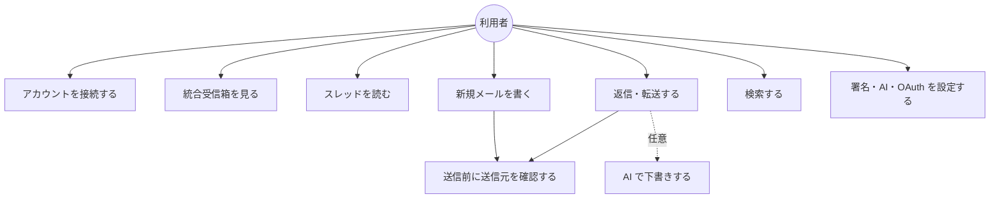
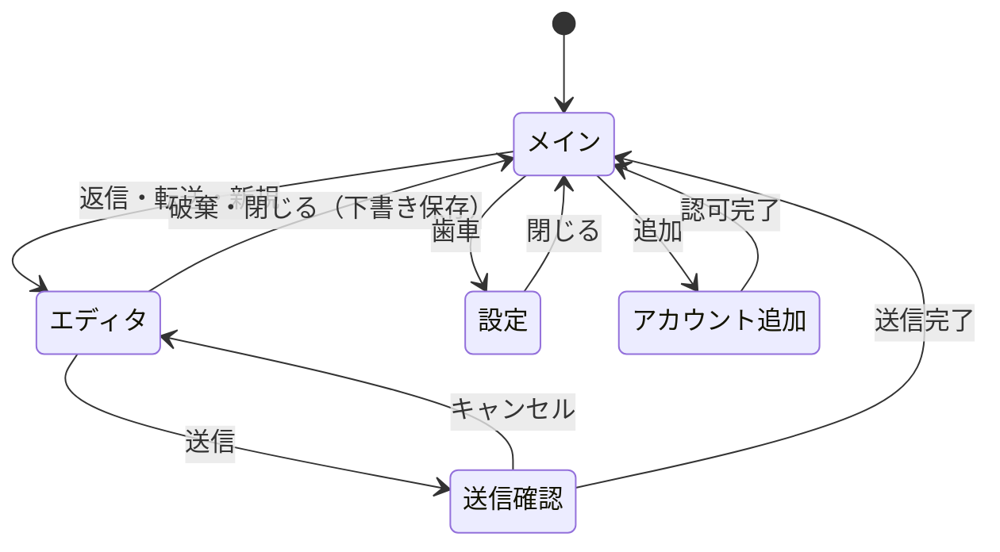
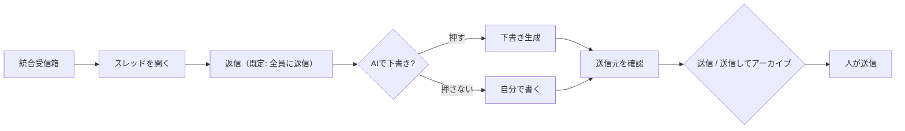

# 機能要件

> 関連: [プロジェクト概要](../overview.md) / [非機能要件](non-functional.md) / [バインディング仕様](../api/endpoints.md) / [コンポーネント設計](../components/overview.md)

## 1. 前提

- 対象は Gmail／Google Workspace。アカウントごとに Gmail API でスレッドを取得・操作する
- 公開者はサーバーを持たない。すべての通信は利用者の PC と Google／AI プロバイダ間で完結する
- 優先度: **Must**（v0.1.0 の完了条件）／ **Could**（余力があれば v0.1.0 に含める。未達でもリリース可）
- 返信・転送の送信元は常に**受信アカウントのプライマリアドレス**。エイリアス（Send-as）は扱わない

## 2. ユースケース

## 3. 機能一覧

| ID | 機能 | 優先度 |
|----|------|--------|
| F-01 | アカウント接続（BYO OAuth） | Must |
| F-02 | 統合受信箱 | Must |
| F-03 | スレッド閲覧 | Must |
| F-04 | 基本操作（既読／未読・アーカイブ・ゴミ箱） | Must |
| F-04b | ラベル付け替え（振り分け変更） | Could |
| F-05 | 返信・全員に返信・転送・送信してアーカイブ | Must |
| F-06 | 送信前確認 | Must |
| F-07 | アカウント別署名 | Must |
| F-08 | AI 返信下書き | Must |
| F-09 | 検索（Gmail 検索クエリのパススルー） | Must |
| F-10 | 新着のデスクトップ通知・トレイ常駐 | Must |
| F-11 | 新規メール作成 | Must |
| F-12 | 下書き保存（Gmail の下書きに同期） | Must |
| F-13 | 宛先オートコンプリート | Must |
| F-14 | 添付ファイル送信 | Must |
| F-15 | MCP 連携・ログの収集 | Should |

## 4. 機能詳細

### F-01 アカウント接続（BYO OAuth）

- **OAuth クライアントの登録**: 利用者が Google Cloud で作成した OAuth クライアント（種類: デスクトップアプリ）の Client ID と Client Secret を登録する。複数登録でき、名前を付けて管理する（例: 「A 社 Workspace 用」「個人用」）
- **アカウント追加**: 使用する OAuth クライアントを選び、システムブラウザで Google の認可画面を開く。ループバック（`127.0.0.1` の一時ポート）＋ PKCE で認可コードを受け取る
- 要求スコープは `gmail.modify`（読み取り・ラベル変更・下書き・送信を含む。完全削除は含まない）と、アドレス取得用の `openid email profile`
- 追加時に表示名（初期値は Google プロフィール名）とアカウント色（プリセット 8〜12 色から選択、既定は未使用色を自動割当）を設定する
- **アカウント削除**: アプリ内のデータ（トークン・キャッシュ・署名・色）を削除し、可能なら Google 側のトークンも revoke する
- **再認証**: リフレッシュトークンが失効・取り消しされたアカウントは、受信箱で「要再接続」と表示し、ワンクリックで再認可へ誘導する。他アカウントの動作は妨げない
- **OAuth クライアントの資格情報が拒否された場合**（Client ID／Secret が無効・取り消し・変更されたとき）も、当該アカウントのみ「要再接続」とし、同期の自動再試行を止める。同じ資格情報での再接続は無意味なので、再接続ではなく OAuth クライアントの設定（Client ID／Secret）を確認するよう案内する。受信箱のバナーとアカウント設定の行に理由と「OAuth クライアントを確認」の導線を出し、設定の OAuth クライアントタブを開く（契約は [バインディング仕様 §1.2・§10](../api/endpoints.md)）。他アカウントの動作は妨げない
- **Android で資格情報を復号できなくなった場合**（Android Keystore の鍵が失われたとき。バックアップの復元・端末の変更・画面ロックのリセットなど）も、リフレッシュトークンが無いのと同じに扱い、当該アカウントを「要再接続」にして再認可へ誘導する（保存済みの Client Secret・API キー・ChatGPT のトークン・MCP トークンも読めなくなるため、Client Secret・API キーは設定から登録し直す）。アプリは起動を止めない
- 同じメールアドレスの二重登録は拒否する
- OAuth クライアントを削除できるのは、それを使うアカウントが 0 件のときのみ

### F-02 統合受信箱

- 全アカウントの `INBOX` ラベルのスレッドを 1 つのリストに最終メッセージ日時の降順で統合表示する（カテゴリタブのプロモ・ソーシャル等も含む。カテゴリでの絞り込みは v0 では行わない）
- 各行に表示: アカウント色の縦帯、アカウント名チップ、差出人（スレッド内の最新メッセージ）、件名、冒頭スニペット、日時、未読表示、添付アイコン、ユーザー作成ラベルのチップ
- **フィルタ**: アカウント（単一／複数／すべて）、未読のみ。選択はアプリ再起動後も保持する
- アカウント別の未読件数をサイドバーに表示する
- 続きの読み込み（スクロールでページング）。ページングは各アカウントのカーソルを保持し、統合順序を保つ
- 手動更新と自動更新（方式は [アーキテクチャ設計](../architecture/overview.md) と [非機能要件](non-functional.md) を参照）
- 同一メールが複数の自アカウントに届いている場合（宛先に複数社のアドレスがある等）は、アカウントごとに別行で表示する（各アカウントのスレッドは独立）

### F-03 スレッド閲覧

- スレッド内のメッセージを時系列で表示する。最新と未読は展開、それ以外は折りたたみ
- ヘッダー表示: 差出人、宛先、Cc、日時。受信アカウント（色・名前・アドレス）をスレッドヘッダに常に表示する
- 本文: HTML をサニタイズして表示する（スクリプト・フォーム・外部 CSS・iframe 等は除去）。HTML がなければプレーンテキストを表示する
- **リモート画像はデフォルトでブロック**する。メッセージ単位の「画像を表示」で、そのメッセージのみ解除する。インライン画像（`cid:`）は表示する。ただし上限がある: 画像 1 枚が 5 MiB を超えるものは取得せず、1 メッセージで `data:` URL に埋め込む合計（本文中の参照ごとに数え、同じ画像を複数回参照すれば回数分加算。base64 化後の `data:` URL の長さ）が 10 MiB を超える参照は置換しない。上限を超えた画像は表示されず（利用者への通知はしない）、添付一覧にも出ない（`Content-Disposition: attachment` の画像だけは添付一覧から保存できる）
- リンクはアプリ内遷移せず、確認なしにシステムブラウザで開く
- 添付: ファイル名・サイズを一覧表示し、保存先ダイアログでダウンロードする
- スレッドを開くと、スレッド内の未読を既読にする（Gmail の `UNREAD` ラベルを外す）

### F-04 基本操作

| 操作 | 内容 | Gmail 上の実体 |
|------|------|----------------|
| 既読／未読 | スレッド単位でトグル | `UNREAD` ラベルの付与・除去 |
| アーカイブ | 受信箱から外す | `INBOX` ラベルの除去 |
| ゴミ箱へ移動 | ゴミ箱に入れる。完全削除はしない | `TRASH` ラベルの付与（`INBOX` 除去） |

- 受信箱リストとスレッド画面のどちらからも実行できる
- 操作後は楽観的更新でリストから即時に消し、失敗時は元に戻してエラーを表示する
- 既存の Gmail 機能で足りるものは作らない。スター・迷惑メール報告・完全削除は v0 のスコープ外

### F-04b ラベル付け替え（Could）

- スレッドに対し、そのアカウントのユーザー作成ラベルの付与・除去ができる（Gmail の「ラベルを付ける」相当）
- ラベル一覧はアカウントごとに取得する。ラベルの新規作成・削除・改名は対象外

### F-05 返信・全員に返信・転送・送信してアーカイブ

- スレッド画面の返信ボタンの既定は**全員に返信**。メニューから「返信」（送信者のみ）、「転送」を選べる
- **送信元は受信アカウントに固定**し、変更 UI を提供しない。画面上に送信元を常時表示する
- 宛先の決定:
  - 返信: `Reply-To`（あれば）、なければ `From`。ただし自分が差出人の最新メッセージに返信する場合は元の `To`
  - 全員に返信: 返信宛先＋元の `To`／`Cc` から**受信アカウント自身のアドレスを除外**したもの
  - 転送: 宛先は空。件名は `Fwd: ` を付与、本文に元メッセージ（差出人・日時・件名・宛先ヘッダ付き）を引用し、元の添付を引き継ぐ（個別に削除可）
- 件名は `Re: ` を付与（既存なら重複させない）。`In-Reply-To`／`References` ヘッダとスレッド ID を設定し、Gmail 上で同一スレッドに入るようにする
- 引用: 返信時は元メッセージを引用として本文末尾に挿入する（折りたたみ表示可）
- **送信してアーカイブ**: 送信が成功したら同じスレッドを `INBOX` から外す。送信失敗時はアーカイブしない
- 送信は必ず F-06 の確認ダイアログを経由する。バックエンドも確認トークンなしの送信を拒否する（[バインディング仕様 §5.2](../api/endpoints.md#52-送信前確認と送信確認トークン)）

### F-06 送信前確認

- 送信（返信・転送・新規・送信してアーカイブのすべて）の直前に確認ダイアログを必ず出す
- 表示内容:
  - **送信元**: アカウント色の大きな帯、アカウント名、メールアドレス（最大の文字サイズ）
  - 宛先（To／Cc／Bcc）、件名、添付ファイル数、本文冒頭
  - 宛先に**他の自アカウントのアドレス**が含まれる場合は警告表示（取り違えの検知）
- 確定ボタンのラベルは「<送信元アドレス> から送信」。キャンセルでエディタに戻る。確認後に宛先・件名・本文・添付を変更した場合は、再度確認ダイアログを出す（確認時と異なる内容では送信できない）
- 「今後表示しない」設定は提供しない
- 送信元が未選択（F-11）の場合は、送信ボタンを無効にする

### F-07 アカウント別署名

- アカウントごとに署名を 1 つ設定する（軽量リッチテキスト。F-11 のエディタと同形式）
- 返信・転送・新規作成の本文に、引用より前の位置へ自動挿入する。区切りに `-- ` を挿入する
- 新規作成で送信元を切り替えたときは、署名を切り替え後のアカウントのものに差し替える（利用者が署名部分を編集済みの場合は差し替えず、警告する）

### F-08 AI 返信下書き

- エディタの「AI で下書き」ボタン押下時**のみ**生成する。自動生成・自動送信は行わない
- 入力に使う内容: スレッドの本文（直近のメッセージから最大数件。上限は設定）、受信アカウントの表示名、署名。AI プロバイダに送信される旨を初回利用時に表示して同意を取る
- 生成結果はエディタ本文に挿入し、利用者が編集できる。送信は人が行う（F-06 を経由）
- 既に本文が入力されている場合は、置換前に確認する
- API キーは利用者が設定画面で入力する（プロバイダ・保管方法は [非機能要件](non-functional.md) 参照）。キー未設定時はボタンを無効にして設定画面へ誘導する
- **ChatGPT プラン（Sign in with ChatGPT）**: API キーの代わりに、利用者自身の ChatGPT プラン（公式ドキュメントが示すのは Plus／Pro）の範囲で下書きを作れる。設定画面のプロバイダで「ChatGPT プラン」を選び、「Continue with ChatGPT」で OpenAI の公式画面（ブラウザ）にログインする。Hitomado はパスワードもセッション Cookie も受け取らず、Codex CLI など他アプリの認証情報は読まない。トークンは資格情報ストアにだけ保存し、期限切れは自動で更新し、更新できなければ再ログインを案内する。ログアウト（トークンの削除と OpenAI 側の失効）もできる。未ログイン時はボタンを無効にして設定画面へ誘導する。使用中は「Using ChatGPT plan」と「Manage usage」（ChatGPT の使用状況の画面）を表示する
- 送信への同意は、プロバイダと送信先の組み合わせごとに取る（ChatGPT プランは API キーの OpenAI 互換とは別の同意）。送信先は設定画面に常に表示する
- **モデルの選択**: モデル名は手で打たなくてよい。API キーの登録・変更のあと、Base URL の変更のあと、ChatGPT のログインのあと、設定画面の「一覧を更新」で、プロバイダからモデルの一覧を取得して選べる（勝手に定期的には取得しない）。同意前の送信先・使えない Base URL には取得も送らない。一覧が取れないとき（Models API が無い・通信できない・権限がない）は、理由を短く表示して手入力に切り替える。保存済みのモデルが一覧に無くても消さない
- 生成失敗（キー不正・レート制限・ネットワーク）はエディタ内にエラー表示し、本文は変更しない

### F-09 検索

- 検索窓に入力した Gmail 検索クエリ（`from:`・`is:unread`・`after:` 等）を、接続済みの全アカウントに対して `users.threads.list` の `q` でそのまま実行し、結果を最終メッセージ日時の降順で統合表示する
- アカウントフィルタで対象を絞れる
- 検索結果は受信箱と同じ行表示・操作を使う。`INBOX` 以外（送信済み・アーカイブ済み）も対象とする
- ローカル全文検索インデックスは作らない。オフライン時は検索できない（エラー表示）

### F-10 新着通知・トレイ常駐

- 新着（自動更新で検出した、未読の `INBOX` スレッド）を Windows のトースト通知で知らせる。通知にアカウント名と差出人・件名を表示する
- 通知クリックでアプリを前面に出し、該当スレッドを開く
- 通知はアカウント単位でオン／オフできる。初回同期で取り込んだ既存メールは通知しない
- **Android 版ではトレイ常駐とウィンドウ位置・サイズの記憶を行わない**（トレイもデスクトップ向けのウィンドウも無い。通知は別 Issue で扱う。[Android ビルド §10](../environment/android.md#10-android-で動かさない機能)）。以下の「トレイ」「ウィンドウの記憶」は Windows 版の仕様
- ウィンドウの × はトレイへ格納する。トレイメニューは「開く」「終了」。終了するまでバックグラウンドで自動更新を続ける
- トレイアイコンに全アカウント合計の未読有無を示すバッジ表現を付ける（形式は実装で決める）
- **ウィンドウの位置・サイズ・最大化の記憶**: 位置・サイズ（最大化していないときの値）と最大化の有無を覚え、次の起動で戻す。保存した位置がどのモニターにも入らない場合（モニターの取り外し・解像度変更）は位置を捨てて画面中央に開く。最小サイズ（幅 960px・高さ 600px）未満は最小サイズに直す

### F-11 新規メール作成

- 送信元アカウントを選択する。**初期値は、受信箱のアカウントフィルタが単一選択中ならそのアカウント、それ以外は未選択**。未選択では送信できない
- 宛先: To／Cc／Bcc（Cc／Bcc は開閉式）、件名、本文、添付
- 本文エディタは軽量リッチテキスト（太字・リンク・箇条書き）。HTML で送信し、プレーンテキストの代替パートも付ける（`multipart/alternative`）
- 送信元の切り替え時は F-07 のとおり署名を差し替える
- 返信・転送でも同じエディタを使う（送信元は固定で変更不可）

### F-12 下書き保存

- 編集中のメールを Gmail の下書き（`users.drafts`）として、送信元アカウントに保存する。自動保存（編集停止後に数秒）と手動保存の両方
- スレッド画面の返信下書きは Gmail の下書きとして同じスレッドに紐づく。再度開くと下書きから復元する
- **添付も下書きに保存し、再度開くと復元する**（ローカル添付・転送元添付を含む。25MB 上限は F-14 と同じ）。復元した添付は個別に削除でき、削除して再保存すると下書きからも消える。下書きの添付が合計 25MB を超えて復元できないとき（Gmail 上で作られた下書き等）は、本文・宛先のみ復元して添付が復元できなかった旨を表示する
- 送信成功時、または破棄時は下書きを削除する
- アプリ終了時に未保存の変更があれば保存してから閉じる
- 送信元が未選択の新規作成は、アカウント確定まで下書き保存しない（ローカルのメモリ上のみ）

### F-13 宛先オートコンプリート

- 宛先入力時に、**ローカルに取得済みのメッセージの差出人・宛先・Cc**から候補を表示する（Google の連絡先 API は使わず、追加スコープも要求しない）
- 候補はメールアドレスと表示名。頻度の高いものと最近のものを優先する
- 候補は**送信元アカウントごと**に分けて集計する。送信元を切り替えると候補も切り替わる（他社の連絡先が候補に混ざらない）
- 送信に使ったアドレスは、送信完了時に候補へ加算する

### F-14 添付ファイル送信

- ファイル選択ダイアログとドラッグ＆ドロップで添付する
- 合計サイズの上限は 25MB（Gmail の上限）。超える場合は追加時にエラー表示する
- 添付一覧にファイル名・サイズ・削除ボタンを表示する
- 送信中は進捗（スピナー）を表示し、送信ボタンを無効にして二重送信を防ぐ

### F-15 MCP 連携・ログの収集

- Go とフロントのエラー（未処理の例外・Promise の reject・Wails 呼び出しの失敗・panic）をログに集める。形式・場所・伏せ処理は [MCP 連携とログ](../mcp.md#ログ)。設定 → ログから、ログフォルダを開く・zip で書き出せる
- **Android 版では MCP サーバーを持たない**（設定画面にも出さない。[Android ビルド §10](../environment/android.md#10-android-で動かさない機能)）。以下は Windows 版の仕様
- 内蔵 MCP サーバー（設定 → MCP）。**既定はオフ**。オンにしてもトークン（Bearer）が必須で、無い接続は拒否する。トークンは発行・再発行・無効化でき、値は発行直後に 1 回だけ表示する
- MCP のツールは、状態（`get_status`）・ログ（`get_logs`）・アカウント（`list_accounts`）・スレッド（`list_threads`／`search_threads`／`get_thread`）の読み取りと、返信下書きの作成（`create_reply_draft`）だけ。**送信するツールは無い**。作った下書きは、人がアプリで確認して送る（F-06 の確認の流れはアプリ内だけ）
- 下書きの送信元は受信アカウントに固定。署名・宛先・件名・引用は返信ボタンと同じ規則（F-05・F-07）

## 5. 画面一覧と遷移

| 画面 | 内容 |
|------|------|
| メイン（3 ペイン） | 左: アカウント・フィルタ／中央: スレッドリスト／右: スレッド表示 |
| エディタ | 返信・転送・新規。メインウィンドウ内のペイン（独立ウィンドウは設けない） |
| 送信確認ダイアログ | F-06 |
| 設定 | アカウント、OAuth クライアント、署名、AI、通知 |

## 6. 主な操作フロー

### 返信

## 7. エラー・エッジケース

| ケース | 動作 |
|--------|------|
| ネットワーク断 | 取得済みの表示は維持し、バナーで「オフライン」を表示。操作・送信は失敗としてエラー表示（キューしない） |
| トークン失効 | 当該アカウントのみ「要再接続」（F-01）。他アカウントは通常動作 |
| 資格情報を復号できない（Android の Keystore の鍵の喪失） | 保存済みの資格情報を破棄し、各アカウントを「要再接続」にする（F-01）。起動は止めない。Client Secret・API キーは未設定として表示される |
| OAuth クライアントの資格情報の拒否（`OAUTH_CLIENT_REJECTED`） | 当該アカウントのみ「要再接続」とし、同期の自動再試行を止め、OAuth クライアントの設定（Client ID／Secret）を確認するよう案内する（F-01）。他アカウントは通常動作。契約は [バインディング仕様 §1.2・§10](../api/endpoints.md) |
| 送信失敗 | エディタを閉じず本文・添付を保持して再送可能にする。アーカイブはしない |
| 送信したが応答を受け取れず、送信済みかも確認できない（`SEND_UNCERTAIN`） | 送信済みの可能性があるため、再送を促さず、先に送信済みフォルダーを確認するよう案内する。本文・添付は保持し、アーカイブ・下書き削除はしない。接続前の失敗（名前解決・接続拒否など、本文を送れていないもの）や、送信前の期限切れはこれに当たらず、上の「送信失敗」（再送可）として扱う |
| スレッドが他端末で変更・削除済み | 操作時の 404 は「スレッドが見つかりません」とし、リストから除去する |
| Gmail API のレート制限（429） | 指数バックオフで再試行し、解消しなければ当該アカウントの更新を次周期へ持ち越す |
| 送信元が受信アカウント以外になる状態 | 返信・転送では UI・バインディングの両方で拒否する（[バインディング仕様](../api/endpoints.md)） |

## 改訂履歴

| 版 | 日付 | 変更内容 | 変更理由 |
|----|------|---------|---------|
| 1.0 | 2026-11-02 | 新規作成 | 初版 |
| 1.1 | 2026-11-02 | F-05／F-06 にバックエンドの確認トークン検証と再確認ルールを追記。画面一覧のエディタをメインウィンドウ内ペインに統一 | バインディング仕様の確認トークン方式・アーキテクチャ（独立ウィンドウなし）との整合 |
| 1.2 | 2026-11-03 | §7 のエラー表に、応答を受け取れず送信済みか確認できない送信（`SEND_UNCERTAIN`）の扱いを追加 | バインディング仕様 §5.2 との整合（#55） |
| 1.3 | 2026-11-03 | §7 の `SEND_UNCERTAIN` の行に、送信前の期限切れも再送可の「送信失敗」として扱うことを追記 | バインディング仕様 §5.2 の `OFFLINE`／`CANCELLED`／`SEND_UNCERTAIN` の振り分けとの整合（#66） |
| 1.4 | 2026-11-03 | F-01 の再認証に、OAuth クライアントの資格情報が拒否された場合の動作（当該アカウントのみ要再接続・設定の確認を案内）を、§7 のエラー表に `OAUTH_CLIENT_REJECTED` の行を追加 | 実装（`internal/sync`）・バインディング仕様 §1.2／§10 との整合（#68。#43 の記録漏れの補正） |
| 1.5 | 2026-11-03 | F-01 の OAuth クライアント拒否の案内に、バナーとアカウント設定の行からの設定（OAuth クライアントタブ）への導線を追記 | 実装（`frontend/src/lib/banners.ts`、`AccountRow.vue`）との整合（#61、#69） |
| 1.6 | 2026-11-03 | F-15（MCP 連携・ログの収集）を追加 | #14 |
| 1.7 | 2026-11-03 | F-03 のインライン画像（`cid:`）に、1 枚 5 MiB・1 メッセージ合計 10 MiB の上限と、超過分は表示されず通知もしないことを明記 | 実装（`internal/gmail/message.go`、`internal/app/appcore/html.go`）との整合（#6） |
| 1.8 | 2026-11-03 | F-08 に、ChatGPT プラン（Sign in with ChatGPT）での下書き、同意の取り直し、設定画面でのモデル一覧からの選択を追記 | #75、#76 |
| 1.9 | 2026-11-03 | F-10・F-15 に、Android 版ではトレイ・ウィンドウ位置の記憶・MCP サーバーを持たない旨を追記 | Android 版で使わない機能の無効化（#89） |
| 1.10 | 2026-11-03 | F-01 の再認証に、Android で資格情報を復号できなくなった場合（Keystore の鍵の喪失）の動作を、§7 のエラー表に行を追加 | #84 |
